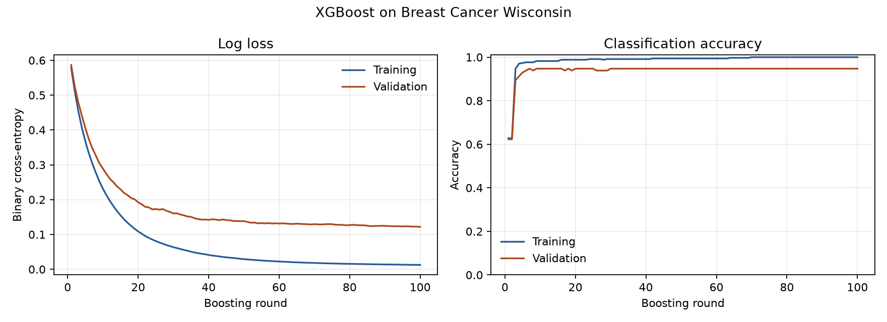
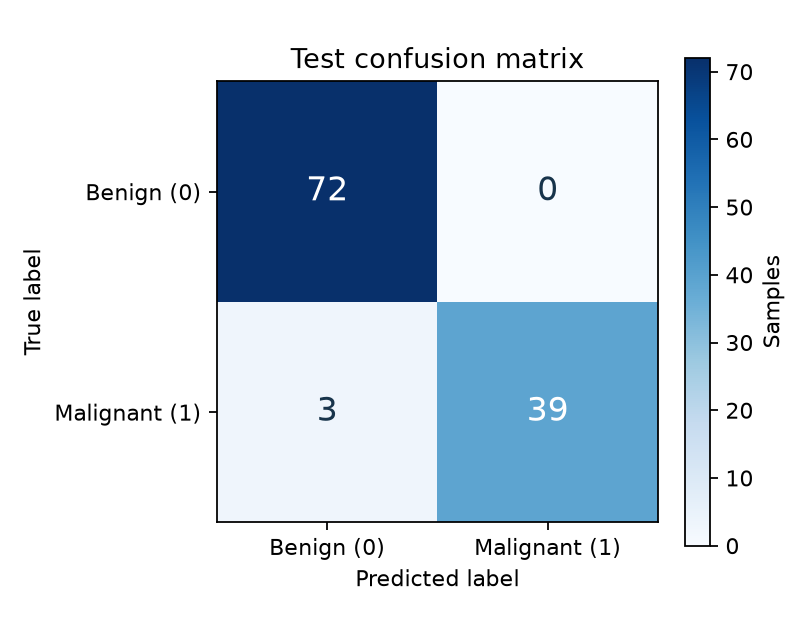
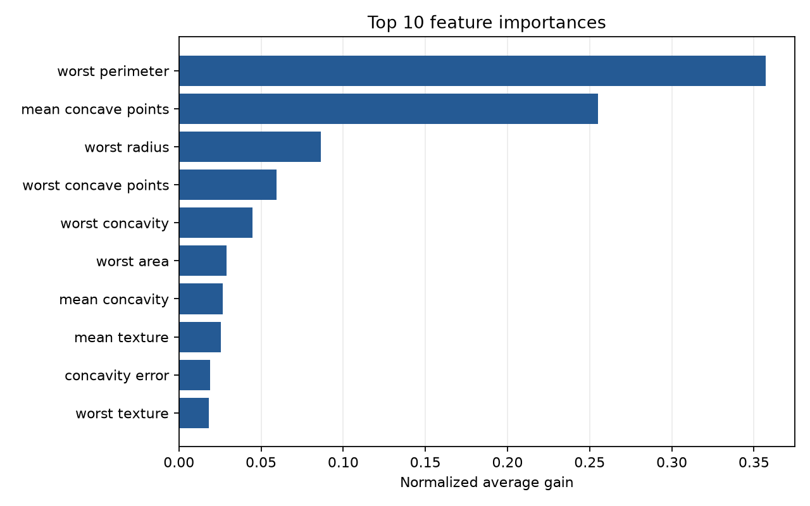

# XGBoost: Theory and Experiment
[中文](README.md) | English

<br>

## 1. Directory

```text
01.XGBoost
├── main.py                 # Experiment entry point
├── requirements.txt
├── run/
│   ├── configs.json        # Experiment parameters
│   ├── data.py             # Data loading and splitting
│   └── model.py            # Training, evaluation, and export
├── tools/
│   └── plot.py             # Result plots
└── output/                 # Experiment results
```

<br>

## 2. Inputs and Outputs

The sklearn [Wisconsin Diagnostic Breast Cancer dataset](https://scikit-learn.org/stable/modules/generated/sklearn.datasets.load_breast_cancer.html) contains 569 samples with 30 numeric features each, including statistics of radius, texture, perimeter, and area. Features retain their original values. No separate data download is needed.

The original labels use $0$ for malignant and $1$ for benign. [`run/data.py`](../run/data.py) converts them to this experiment's labels: $0$ for benign and $1$ for malignant.

| Stage | Input | Output |
| --- | --- | --- |
| Training | `X_train`: a $341\times30$ feature matrix; `y_train`: 341 labels | A model containing 100 trees |
| Prediction | `X`: an $N\times30$ feature matrix, with columns in training order | An $N\times2$ probability matrix and $N$ predicted labels |

Each row represents one sample; each column represents one feature. Training needs features and labels. Predicting new samples needs only features. Column 0 of `predict_proba(X)` is the benign probability; column 1 is the malignant probability. This experiment assigns class $1$ when the malignant probability is at least $0.5$.

<br>

## 3. What Happens Between Input and Output

XGBoost is a gradient-boosted ensemble of decision trees. Trees learn sequentially to correct the current predictions, and their scores are added to produce the final result.

### How trees combine features
A tree combines features through a sequence of threshold decisions. A path might first test mean radius and then mean texture before reaching a leaf. Here, “combining features” means applying several conditions in sequence along a path.

Each tree receives the same original 30 feature columns and selects features for its splits. Different trees can choose different features, while a feature can also appear in several trees or at several nodes within one tree. The following hypothetical paths illustrate feature reuse:

| Tree | Features tested along one example path |
| --- | --- |
| Tree 1 | Mean radius, then mean texture |
| Tree 2 | Mean area, then mean radius |
| Tree 3 | Mean texture, then mean smoothness |

The 30 features describe the input columns. The 100 trees are set by `n_estimators`; their count is independent of the number of features.

### Start every sample with an initial score
The model estimates an initial score from the malignant proportion $p_0$ in the training set:

$$
F_0=\log\frac{p_0}{1-p_0},\qquad p=\sigma(F)=\frac{1}{1+e^{-F}}.
$$

$F$ is the score before conversion to a probability. The sigmoid function $\sigma$ converts it into malignant probability $p$.

### Learn one tree of corrections per round
1. Use the current model to calculate malignant probability $p_i$ for each training sample and compare it with label $y_i$.
2. Calculate cross-entropy and its gradient $g_i$ and second derivative $h_i$ with respect to the current score. These describe the current error and loss curvature:

$$
\ell_i=-y_i\log p_i-(1-y_i)\log(1-p_i),\qquad
g_i=p_i-y_i,\qquad h_i=p_i(1-p_i).
$$

3. The new tree tries splits of the form “is this feature below a threshold?” For example, it can divide samples using a radius threshold and then split the groups further. This experiment limits tree depth to 3.
4. Sum $g_i$ and $h_i$ over samples reaching the same leaf to obtain $G_j$ and $H_j$. With the default L2 regularization used here, the leaf's correction score is:

$$
w_j=-\frac{G_j}{H_j+\lambda},\qquad
G_j=\sum_{i\in I_j}g_i,\quad H_j=\sum_{i\in I_j}h_i,\quad \lambda=1.
$$

$I_j$ contains the training samples reaching leaf $j$. Split search compares how much child nodes can reduce the loss to choose groups. Each leaf outputs a real-valued correction that can be positive or negative.
5. Keep the existing trees fixed and add the new tree's output, scaled by learning rate $\eta$, to the current score:

$$
F_t(x)=F_{t-1}(x)+\eta f_t(x),\qquad \eta=0.1.
$$

Every new tree searches splits in the same original feature matrix `X_train`; $g_i$ and $h_i$ change as the current model changes. Repeat for 100 rounds to obtain 100 sequentially learned trees. `XGBClassifier.fit` computes gradients, searches splits, and learns leaf weights internally. The Python code handles splitting data, calling training, and saving results. [Official model tutorial](https://xgboost.readthedocs.io/en/stable/tutorials/model.html)

For a hypothetical example, suppose a malignant sample has score $F=-1$ and the new tree returns a correction of $2$. The update gives $F=-1+0.1\times2=-0.8$, increasing its malignant probability from about $0.2689$ to $0.3100$. These numbers illustrate the calculation; they are not actual leaves from this run.

### At prediction time, visit every tree and convert the total score
Pass the same new sample's features separately through every tree to obtain each leaf correction. Add all corrections to the initial score:

$$
F(x)=F_0+0.1\sum_{t=1}^{100}f_t(x),\qquad
p(x)=\sigma(F(x)),\qquad
\widehat y=\begin{cases}1,&p(x)\geq0.5,\\0,&p(x)<0.5.\end{cases}
$$

Training adds trees one round at a time; prediction uses all the trained trees. The probability output is $(1-p(x),p(x))$, corresponding to benign and malignant. [Python API](https://xgboost.readthedocs.io/en/stable/python/python_api.html)

### How XGBoost compares with other classifiers
XGBoost suits tabular data where features matter in combination. For example, it can split samples by radius and then use texture to split samples within a particular radius range.

| Classifier | Difference / advantage |
| --- | --- |
| Logistic regression on raw features | Uses a linear score before sigmoid. XGBoost can learn nonlinear relationships and feature interactions directly through tree splits. |
| A single decision tree | Provides one set of rules. XGBoost adds shallow trees that correct the current predictions and combines their rules to fit more complex relationships. |
| Random forest | Trains trees with randomized samples and features, then averages their predictions. XGBoost trains each new tree on the current model's errors to reduce the loss. |

The 97.37% accuracy below describes XGBoost on this test set. An accuracy comparison requires the same data split and evaluation metrics for each model. [XGBoost model tutorial](https://xgboost.readthedocs.io/en/stable/tutorials/model.html) · [Logistic regression](https://scikit-learn.org/stable/modules/linear_model.html#logistic-regression) · [Random forests](https://scikit-learn.org/stable/modules/ensemble.html#random-forests)

<br>

## 4. Configuration and Running

[`run/configs.json`](../run/configs.json) contains four parameters:

| Parameter | Value | Meaning |
| --- | ---: | --- |
| `n_estimators` | 100 | Training rounds; each round adds one tree here |
| `max_depth` | 3 | Maximum depth of each tree |
| `learning_rate` | 0.1 | Scale applied to each new tree's corrections |
| `random_state` | 42 | Random seed for data splitting and the model |

`main.py` reads the JSON and calls `run_experiment(config, output_dir)`. [`run/model.py`](../run/model.py) creates the model with `XGBClassifier(**config)`. Other settings use library defaults, including the binary probability objective and log loss metric. [Parameter reference](https://xgboost.readthedocs.io/en/stable/parameter.html)

Run from the repository root:

```bash
cd Classical-ML/01.XGBoost
python -m pip install -r requirements.txt
python main.py
```

<br>

## 5. Results

First reserve $20\%$ for testing with a stratified split, then reserve $25\%$ of the remaining samples for validation with another stratified split. Both use seed 42, giving 341 training, 114 validation, and 114 test samples. Fit 100 rounds on training data only. Validation monitors the curves without early stopping; test data do not enter training or parameter selection.

| Split | Correct / Total | Accuracy | Precision | Recall | F1 | ROC AUC | Log loss |
| --- | ---: | ---: | ---: | ---: | ---: | ---: | ---: |
| Training | 341 / 341 | 1.000000 | 1.000000 | 1.000000 | 1.000000 | 1.000000 | 0.012545 |
| Validation | 108 / 114 | 0.947368 | 0.930233 | 0.930233 | 0.930233 | 0.991811 | 0.121785 |
| Test | 111 / 114 | 0.973684 | 1.000000 | 0.928571 | 0.962963 | 0.991733 | 0.088877 |

Metrics come from [`metrics.json`](../output/metrics.json). Precision, recall, and F1 treat malignant as positive; ROC AUC uses malignant probabilities. The model classifies 111/114 test samples correctly: all 72 benign samples and 39 of 42 malignant samples. It misses 3 malignant samples. Training is entirely correct, while validation still has 6 errors.

| Training curves | Confusion matrix | Feature importance |
| :---: | :---: | :---: |
|  |  |  |
