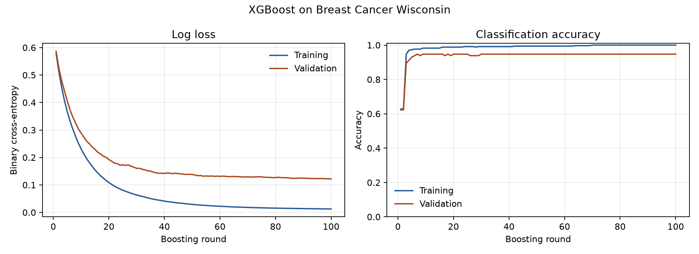
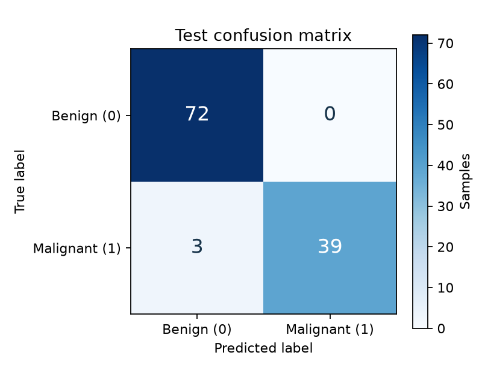
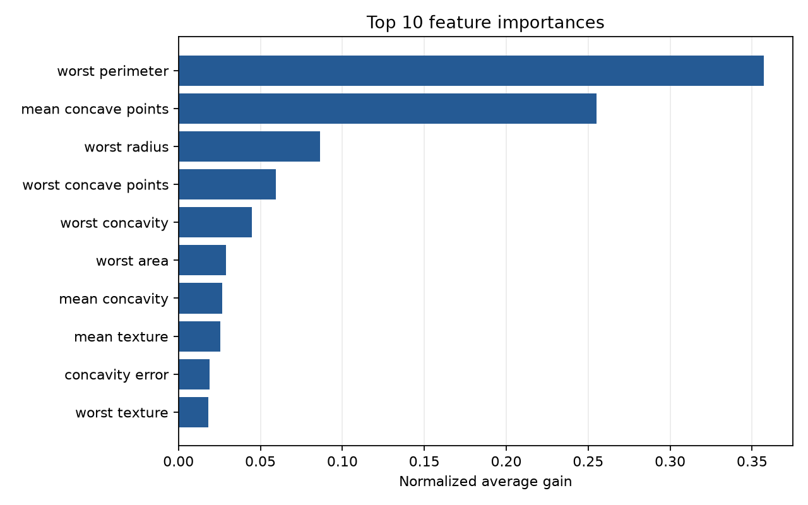

# XGBoost：原理与实验
中文 | [English](README.en.md)

<br>

## 1. 目录
```text
01.XGBoost
├── main.py                 # 实验入口
├── requirements.txt
├── run/
│   ├── configs.json        # 实验参数
│   ├── data.py             # 数据加载与划分
│   └── model.py            # 训练、评估与保存
├── tools/
│   └── plot.py             # 结果绘图
└── output/                 # 实验结果
```

<br>

## 2. 输入与输出
使用 sklearn 内置的 [Wisconsin Diagnostic Breast Cancer 数据集](https://scikit-learn.org/stable/modules/generated/sklearn.datasets.load_breast_cancer.html)：569 个样本，每个样本有 30 个数值特征，包括半径、纹理、周长和面积的统计量。特征直接使用原始数值，无需另下载数据。

原始标签中恶性为 $0$、良性为 $1$。[`run/data.py`](../run/data.py) 将其转换为本实验的标签：良性为 $0$，恶性为 $1$。

| 阶段 | 输入 | 输出 |
| --- | --- | --- |
| 训练 | `X_train`：$341\times30$ 的特征矩阵；`y_train`：341 个标签 | 由 100 棵树组成的模型 |
| 预测 | `X`：$N\times30$ 的特征矩阵，特征顺序与训练时一致 | $N\times2$ 的类别概率，以及 $N$ 个预测标签 |

矩阵中每行是一个样本，每列是一个特征。训练需要特征和标签；预测新样本时只需特征。`predict_proba(X)` 的第 0 列是良性概率，第 1 列是恶性概率。本实验取恶性概率达到 $0.5$ 的样本为类别 $1$。

<br>

## 3. 中间怎样计算
XGBoost 是由多棵决策树组成的梯度提升集成模型。各棵树依次学习，逐轮修正当前预测，再将分数累加得到最终结果。

### 决策树怎样组合使用特征
一棵决策树是一组按顺序执行的判断规则。每个判断节点选择一个特征和一个阈值，例如先判断“半径是否小于 15”，再判断“纹理是否小于 20”，最后到达叶节点并取出分数。多个特征通过这些连续的判断组合起来。

每棵树都可以从同一份 30 个输入特征中选择有用的特征。随着每轮要修正的误差变化，各棵树可能选择不同的特征、阈值和叶节点分数。例如：

| 树 | 一条判断路径可能使用的特征 |
| --- | --- |
| 第 1 棵树 | 先判断半径，再判断纹理 |
| 第 2 棵树 | 先判断面积，再判断半径 |
| 第 3 棵树 | 先判断纹理，再判断光滑度 |

上表只是特征组合的示意。一个特征可以出现在多棵树中，也可以在一棵树中重复使用；不同树使用的特征可以重叠，不要求每棵树使用互不相同的特征。

30 是每个样本的输入特征数，100 来自配置中的 `n_estimators`，表示本次训练 100 棵树。每棵树可以组合使用多个特征，树的数量与特征数量独立设置。训练结束后，同一个新样本分别经过所有树，再汇总各棵树的分数。

### 先给所有样本一个起始分数
模型先根据训练集中的恶性比例 $p_0$ 估计初始分数：

$$
F_0=\log\frac{p_0}{1-p_0},\qquad p=\sigma(F)=\frac{1}{1+e^{-F}}.
$$

$F$ 是尚未转为概率的分数。sigmoid 函数 $\sigma$ 把它变成恶性概率 $p$。

### 每一轮学习一棵修正错误的树
1. 用已有模型计算每个训练样本的恶性概率 $p_i$，与真实标签 $y_i$ 比较。
2. 计算交叉熵及其关于当前分数的梯度 $g_i$、二阶导数 $h_i$，描述当前误差及损失曲率：

$$
\ell_i=-y_i\log p_i-(1-y_i)\log(1-p_i),\qquad
g_i=p_i-y_i,\qquad h_i=p_i(1-p_i).
$$

3. 新树尝试按“某个特征是否小于某个阈值”划分样本。例如，按半径阈值分成两组，再继续细分。本实验最多分到深度 3。
4. 将落入同一叶节点的 $g_i$、$h_i$ 分别求和，得到 $G_j$、$H_j$。在本实验的默认 L2 正则化下，该叶的修正分数为：

$$
w_j=-\frac{G_j}{H_j+\lambda},\qquad
G_j=\sum_{i\in I_j}g_i,\quad H_j=\sum_{i\in I_j}h_i,\quad \lambda=1.
$$

$I_j$ 是落到叶节点 $j$ 的训练样本集合。分裂搜索比较加入子节点后损失能降低多少，再决定如何分组。每个叶节点输出一个可正可负的实数修正量。
5. 保持已有树不变，把新树的输出乘学习率 $\eta$ 后加到当前分数上：

$$
F_t(x)=F_{t-1}(x)+\eta f_t(x),\qquad \eta=0.1.
$$

每棵新树都用同一份原始特征矩阵 `X_train` 寻找分裂；用于计算修正量的 $g_i$、$h_i$ 随当前模型逐轮变化。重复 100 轮，得到 100 棵依次学习的树。梯度、分裂搜索和叶权重都由 `XGBClassifier.fit` 内部计算；Python 代码负责数据划分、调用训练和保存结果。[官方原理说明](https://xgboost.readthedocs.io/en/stable/tutorials/model.html)

举一个假设例子：某恶性样本当前 $F=-1$，新树给出的修正量为 $2$。更新后 $F=-1+0.1\times2=-0.8$，恶性概率从约 $0.2689$ 上升到 $0.3100$。这些数值仅用于说明计算，不是本次模型的实际叶节点。

### 预测时遍历全部树，再把分数变成概率
把同一个新样本的特征分别送入每棵树，取得各自叶节点的修正量。把这些修正量加到初始分数上：

$$
F(x)=F_0+0.1\sum_{t=1}^{100}f_t(x),\qquad
p(x)=\sigma(F(x)),\qquad
\widehat y=\begin{cases}1,&p(x)\geq0.5,\\0,&p(x)<0.5.\end{cases}
$$

训练时逐轮增加树；预测时使用已经训练好的全部树。概率输出为 $(1-p(x),p(x))$，对应良性、恶性两类。[Python API](https://xgboost.readthedocs.io/en/stable/python/python_api.html)

### 和其他分类算法相比有什么优势
XGBoost 适合特征需要结合判断的表格数据。例如，模型可以先按半径划分样本，再仅在某个半径范围内用纹理细分。

| 算法 | XGBoost 的优势或区别 |
| --- | --- |
| 逻辑回归 | 直接使用原始特征的逻辑回归用线性加权得到分数。XGBoost 可以通过树的分支直接学到非线性关系和特征组合。 |
| 单棵决策树 | 单棵树只用一套分支规则。XGBoost 用多棵浅树逐轮修正预测，能组合多套规则来拟合更复杂的关系。 |
| 随机森林 | 随机森林用随机抽样和随机特征选择训练多棵树，再平均它们的预测。XGBoost 每轮根据当前模型的误差训练下一棵树，目标是进一步降低损失。 |

下方的 97.37% 是 XGBoost 在本次测试集上的准确率。比较模型的准确率时，需要用相同的数据划分和评估指标。[XGBoost 原理](https://xgboost.readthedocs.io/en/stable/tutorials/model.html) · [逻辑回归](https://scikit-learn.org/stable/modules/linear_model.html#logistic-regression) · [随机森林](https://scikit-learn.org/stable/modules/ensemble.html#random-forests)

<br>

## 4. 配置与运行
参数集中在 [`run/configs.json`](../run/configs.json)，保留四项：

| 参数 | 当前值 | 含义 |
| --- | ---: | --- |
| `n_estimators` | 100 | 训练轮数，本实验每轮增加一棵树 |
| `max_depth` | 3 | 每棵树的最大深度 |
| `learning_rate` | 0.1 | 每棵新树修正量的缩放系数 |
| `random_state` | 42 | 数据划分与模型的随机种子 |

`main.py` 读取 JSON 后调用 `run_experiment(config, output_dir)`；[`run/model.py`](../run/model.py) 用 `XGBClassifier(**config)` 创建模型。其余设置沿用库默认值，包括二分类概率目标和 log loss 指标。[参数说明](https://xgboost.readthedocs.io/en/stable/parameter.html)

在仓库根目录运行：

```bash
cd Classical-ML/01.XGBoost
python -m pip install -r requirements.txt
python main.py
```

<br>

## 5. 实验结果
先分层留出 $20\%$ 为测试集，再从剩余数据中分层留出 $25\%$ 为验证集，两次都用种子 42，得到训练集 341、验证集 114、测试集 114 个样本。仅在训练集拟合 100 轮，验证集用于观察曲线，不用早停；测试集不参与训练或参数选择。

| 集合 | 正确 / 总数 | Accuracy | Precision | Recall | F1 | ROC AUC | Log loss |
| --- | ---: | ---: | ---: | ---: | ---: | ---: | ---: |
| 训练集 | 341 / 341 | 1.000000 | 1.000000 | 1.000000 | 1.000000 | 1.000000 | 0.012545 |
| 验证集 | 108 / 114 | 0.947368 | 0.930233 | 0.930233 | 0.930233 | 0.991811 | 0.121785 |
| 测试集 | 111 / 114 | 0.973684 | 1.000000 | 0.928571 | 0.962963 | 0.991733 | 0.088877 |

指标来自 [`metrics.json`](../output/metrics.json)。Precision、Recall 和 F1 以恶性为正类，ROC AUC 使用恶性概率。测试集判对 111/114 个样本：72 个良性全部判对，42 个恶性中判对 39 个，漏判 3 个。训练集全部正确，验证集仍有 6 个错误。

| 训练曲线 | 混淆矩阵 | 特征重要性 |
| :---: | :---: | :---: |
|  |  |  |
