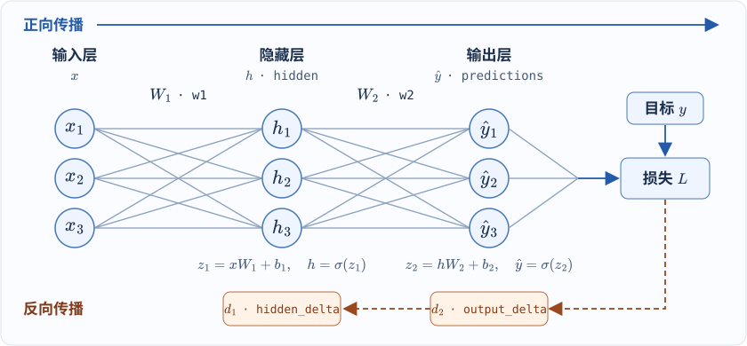

# Neural Network Forward Propagation and Backpropagation
[中文](README.md) | English

<br>

## Running the Example
[neural_network.py](../neural_network.py) uses NumPy to demonstrate a fully connected 3→3→3 network. Run these commands from the experiment directory.

```bash
python -m pip install -r requirements.txt
python neural_network.py
```

<br>

## Worked Numerical Example


Each group of connections between layers corresponds to a weight matrix. Forward propagation computes $x\to h\to\hat y$ and then uses $\hat y$ and the target $y$ to calculate $L$. Backpropagation starts from $L$ and computes $d_2=\partial L/\partial z_2$ followed by $d_1=\partial L/\partial z_1$.

| Symbol in the diagram | Code |
| --- | --- |
| Input $x$, target $y$, loss $L$ | `x`, `y`, `loss(predictions, y)` |
| Weights $W_1$ and $W_2$, biases $b_1$ and $b_2$ | `w1`, `w2`, `b1`, `b2` |
| Hidden-layer weighted sum $z_1$ and activation $h$ | `hidden_input`, `hidden` |
| Output-layer weighted sum $z_2$ and prediction $\hat y$ | `output_input`, `predictions` |
| Output-layer gradient $d_2$ and hidden-layer gradient $d_1$ | `output_delta`, `hidden_delta` |

### 1. Inputs, Weights, and Biases
The network has three inputs, three hidden units, and three outputs. The `main()` function sets a single input $x$, its target $y$, two initial bias vectors, and the learning rate $\eta$. [Initialization code](../neural_network.py#L39-L46)

$$
\begin{aligned}
x &= (1,\ 2,\ -1), & y &= (0.2,\ 0.8,\ 0.5),\\
b_1 &= (0,\ 0,\ 0), & b_2 &= (0,\ 0,\ 0), & \eta &= 0.5.
\end{aligned}
$$

$$
W_1 = \begin{bmatrix}
 0.2 & -0.1 &  0.4\\
 0.3 &  0.0 & -0.2\\
-0.1 &  0.2 &  0.2
\end{bmatrix},
\qquad
W_2 = \begin{bmatrix}
 0.1 & -0.2 &  0.3\\
 0.4 &  0.1 & -0.3\\
-0.2 &  0.3 &  0.2
\end{bmatrix}.
$$

The matrix $W_1$ connects the input and hidden layers, and $W_2$ connects the hidden and output layers. Each row of a weight matrix corresponds to a unit in the preceding layer, and each column corresponds to a unit in the next layer. The code stores a single example as a $1\times 3$ row vector. The symbol $\approx$ marks rounded values.
### 2. Forward Propagation
**Input layer to hidden layer.** Compute $z_1=xW_1+b_1$. The initial bias is zero, so take a separate weighted sum using each of the three columns of $W_1$.

$$
\begin{aligned}
(z_1)_1 &= 1(0.2)+2(0.3)+(-1)(-0.1)=0.9,\\
(z_1)_2 &= 1(-0.1)+2(0)+(-1)(0.2)=-0.3,\\
(z_1)_3 &= 1(0.4)+2(-0.2)+(-1)(0.2)=-0.2.
\end{aligned}
$$

Apply $\sigma(z)=1/(1+e^{-z})$ to each of the three weighted sums to get the hidden activations $h=\sigma(z_1)\approx(0.71094950,\ 0.42555748,\ 0.45016600)$.

In the code, `hidden_input = x @ w1 + b1` computes $z_1$ and `hidden = sigmoid(hidden_input)` computes $h$. [Hidden-layer code](../neural_network.py#L12-L13)

**Hidden layer to output layer.** Use $h$ as the input to this layer and compute $z_2=hW_2+b_2$. The initial bias is again zero.

$$
\begin{aligned}
(z_2)_1 &\approx 0.71094950(0.1)+0.42555748(0.4)+0.45016600(-0.2)\approx 0.15128474,\\
(z_2)_2 &\approx 0.71094950(-0.2)+0.42555748(0.1)+0.45016600(0.3)\approx 0.03541565,\\
(z_2)_3 &\approx 0.71094950(0.3)+0.42555748(-0.3)+0.45016600(0.2)\approx 0.17565081.
\end{aligned}
$$

Apply sigmoid to each of the three components of $z_2$ to obtain the network output.

$$
\hat y = \sigma(z_2) \approx (0.53774922,\ 0.50885299,\ 0.54380014).
$$

In the code, `output_input = hidden @ w2 + b2` computes $z_2$ and `predictions = sigmoid(output_input)` computes $\hat y$. [Output-layer code](../neural_network.py#L14-L15)
### 3. Computing the Loss
Use the forward prediction $\hat y$ and the target $y$ to compute half the squared error. The code averages over the number of examples, which is one here.

$$
\begin{aligned}
\hat y-y &\approx (0.33774922,\ -0.29114701,\ 0.04380014),\\
L &= \tfrac12\sum_{j=1}^{3}(\hat y_j-y_j)^2\\
  &\approx 0.05703727+0.04238329+0.00095923 \approx 0.100380.
\end{aligned}
$$

The code uses `0.5 * np.sum((predictions - y) ** 2) / len(y)`. [Loss function](../neural_network.py#L19-L21)
### 4. Backpropagation
**Compute the output-layer gradient first.** The derivative of sigmoid is $\sigma'(z)=\sigma(z)(1-\sigma(z))$. Use the chain rule to propagate the loss gradient from the output to the weighted sum $z_2$. The symbol $\odot$ denotes elementwise multiplication.

$$
\begin{aligned}
d_2 &= \frac{\partial L}{\partial z_2}
= (\hat y-y)\odot\hat y\odot(1-\hat y)\\
&\approx (0.08395601,\ -0.07276393,\ 0.01086601).
\end{aligned}
$$

The first component, for example, is $(0.53774922-0.2)\times 0.53774922\times(1-0.53774922)\approx 0.08395601$. The code computes this in `output_delta`, with a division by the number of examples for a batch. [Output-layer gradient code](../neural_network.py#L24-L26)

Multiply the transpose of $h$ by $d_2$ to obtain the gradient of $W_2$. For the weight from the first hidden unit to the first output unit, the gradient is $0.71094950\times 0.08395601\approx 0.05968848$. The bias adds directly to $z_2$, so its gradient for one example is $d_2$.

$$
\begin{aligned}
\frac{\partial L}{\partial W_2}
&= h^{\mathsf T}d_2 \approx
\begin{bmatrix}
 0.05968848 & -0.05173148 & 0.00772518\\
 0.03572811 & -0.03096524 & 0.00462411\\
 0.03779414 & -0.03275585 & 0.00489151
\end{bmatrix},\\
\frac{\partial L}{\partial b_2}
&=d_2 \approx(0.08395601,\ -0.07276393,\ 0.01086601).
\end{aligned}
$$

The code uses `grad_w2 = hidden.T @ output_delta` and `grad_b2 = output_delta.sum(axis=0)`. [Output-layer parameter gradients](../neural_network.py#L32-L33)

**Then compute the hidden-layer gradient.** Each hidden unit connects to all three output units. Use the original $W_2$ to pass the three gradient contributions back to the hidden layer, then multiply elementwise by the derivatives of the hidden-layer sigmoid activations.

$$
\begin{aligned}
d_2 W_2^{\mathsf T} &\approx (0.02620819,\ 0.02304621,\ -0.03644718),\\
d_1 &= \frac{\partial L}{\partial z_1}
= (d_2W_2^{\mathsf T})\odot h\odot(1-h)\\
&\approx(0.00538579,\ 0.00563384,\ -0.00902128).
\end{aligned}
$$

For example, the weighted sum of the gradient contributions to the first hidden unit is $0.08395601(0.1)+(-0.07276393)(-0.2)+0.01086601(0.3)\approx 0.02620819$. Multiply that sum by $0.71094950(1-0.71094950)$ to get the first component of $d_1$. The code stores $d_1$ in `hidden_delta`. [Hidden-layer gradient code](../neural_network.py#L27)

Use $x^{\mathsf T}d_1$ to obtain the gradient of $W_1$. For the weight from the second input to the first hidden unit, the gradient is $2\times0.00538579\approx0.01077158$. The bias gradient for one example is $d_1$.

$$
\begin{aligned}
\frac{\partial L}{\partial W_1}
&=x^{\mathsf T}d_1\approx
\begin{bmatrix}
 0.00538579 &  0.00563384 & -0.00902128\\
 0.01077158 &  0.01126767 & -0.01804256\\
-0.00538579 & -0.00563384 &  0.00902128
\end{bmatrix},\\
\frac{\partial L}{\partial b_1}
&=d_1\approx(0.00538579,\ 0.00563384,\ -0.00902128).
\end{aligned}
$$

The code uses `grad_w1 = x.T @ hidden_delta` and `grad_b1 = hidden_delta.sum(axis=0)`. [Hidden-layer parameter gradients](../neural_network.py#L30-L31)
### 5. Updating the Parameters Once
After computing the gradients for both layers, update each parameter with $\theta_{\mathrm{new}}=\theta-\eta\,\partial L/\partial\theta$. The example shows the update for two weights and one bias.

$$
\begin{aligned}
(W_1^{\mathrm{new}})_{11} &\approx 0.2-0.5(0.00538579)\approx 0.19730710,\\
(W_2^{\mathrm{new}})_{11} &\approx 0.1-0.5(0.05968848)\approx 0.07015576,\\
(b_2^{\mathrm{new}})_1 &\approx 0-0.5(0.08395601)\approx -0.04197801.
\end{aligned}
$$

The code uses `parameter -= learning_rate * gradient`. A second forward pass with the updated parameters produces $(0.51703206,\ 0.52666119,\ 0.54171192)$. The loss for this example drops from $0.100380$ to $0.088482$. [Parameter update and second forward pass](../neural_network.py#L62-L67)

---

<br>

## Forward and Backward Derivation
This derivation uses neuron indices for the same network and omits the biases from the equations.
### 1. Notation

| Quantity | Notation |
| :----: | :------------------: |
| Input layer | Inputs $x_1,x_2,x_3$ |
| Hidden layer | Inputs $\delta_4, \delta_5, \delta_6$<br />Activations $\alpha_4, \alpha_5, \alpha_6$ |
| Output layer | Inputs $\delta_7, \delta_8, \delta_9$<br />Predictions $\hat{y}_7, \hat{y}_8, \hat{y}_9$ |
| Activation function | $\sigma(x)=\frac{1}{1+e^{-x}}$ |
| Learning rate | $\eta$ |
| Targets | $y_7, y_8, y_9$ |
| Loss | $L_{si}=\frac{1}{2}(y_i-\hat y_i)^2$, $L_s=\sum_{i=7}^{9}L_{si}$ |
| Weight | $\omega_{ij}$. For example, $\omega_{14}$ connects neurons 1 and 4. |

### 2. Forward Propagation

> Given

- The network receives $x_1$, $x_2$, and $x_3$ at the input layer.

- Each weight $\omega_{ij}$ controls the strength of a connection, such as $\omega_{14}$ from neuron 1 to neuron 4.

- The activation function is $\sigma(x)$, with $\sigma(x)=\frac{1}{1+e^{-x}}$.

- The loss is $L_s=\frac{1}{2}\sum_{i=7}^{9}(y_i-\hat y_i)^2$.

- The targets $y_7$, $y_8$, and $y_9$ enter the loss calculation after the forward pass.

> Quantities to compute

- Hidden activations $\alpha_4$, $\alpha_5$, and $\alpha_6$ are the weighted sums after applying the activation function.

$$
\begin{gathered}
\alpha_i=\sigma(\delta_i),~~~~\delta_i=\omega_{1i} x_1+\omega_{2i} x_2+\omega_{3i} x_3,~~~~i=4,5,6\\
\\
e.g: \alpha_4=\sigma(\delta_4),~~~~\delta_4=\omega_{14} x_1+\omega_{24} x_2+\omega_{34} x_3,~~~~i=4,5,6
\end{gathered}
$$

- Output predictions $\hat{y}_7$, $\hat{y}_8$, and $\hat{y}_9$ are the final values the network predicts for the input.

$$
\begin{gathered}
\hat{y_i}=\sigma(\delta_i),~~~~\delta_i=\omega_{4i} \alpha_4+\omega_{5i} \alpha_5+\omega_{6i} \alpha_6,~~~~i=7,8,9\\
\\
e.g: \hat{y_7}=\sigma(\delta_7),~~~~\delta_7=\omega_{47} \alpha_4+\omega_{57} \alpha_5+\omega_{67} \alpha_6,~~~~i=7,8,9
\end{gathered}
$$

- Compute half the squared error for each output and sum the terms to get the total loss $L_s=\sum_{i=7}^{9} L_{si}$.

$$
\begin{gathered}
L_{si}=\frac{1}{2}(y_i - \hat{y_i})^2,~~i=7,8,9\\
\\
e.g: L_{s7}=\frac{1}{2}(y_7 - \hat{y_7})^2
\end{gathered}
$$

### 3. Backpropagation

> Given

- Results of the forward pass include hidden activations such as $\alpha_4$, $\alpha_5$, and $\alpha_6$, and output predictions such as $\hat{y}_7$, $\hat{y}_8$, and $\hat{y}_9$.

- Targets $y_7$, $y_8$, and $y_9$.

- Learning rate $\eta$.

- Loss function $L_s=\frac{1}{2}\sum_{i=7}^{9}(y_i-\hat y_i)^2$.

- Each weight $\omega_{ij}$ controls the strength of a connection, such as $\omega_{14}$ from neuron 1 to neuron 4.

- Activation function $\sigma(x)$, with $\sigma(x)=\frac{1}{1+e^{-x}}$.

> Quantities to compute

- Use the weight gradients and learning rate to compute the updated weights $\hat{\omega_{ij}}$.

$$
\begin{gathered}
\frac{\partial L_{s7}}{\partial \hat{y}_{7}}= \frac{\partial  \frac{1}{2}(y_7 - \hat{y_7})^2}{\partial \hat{y}_{7}}=(\hat{y}_{7}-y_{7}),~~~~~
\frac{\partial \hat{y}_{7}}{\partial \delta_{7}}=\frac{\partial \sigma(\delta_7)}{\partial \delta_{7}}=\sigma(\delta_7)(1-\sigma(\delta_7))=\hat{y}_{7}(1-\hat{y}_{7}),\\
\\
\frac{\partial \delta_{7}}{\partial \omega_{47}}=\frac{\partial (\omega_{47} \alpha_4+\omega_{57} \alpha_5+\omega_{67} \alpha_6)}{\partial \omega_{47}} =\alpha_4,\\
\\
\text{Weight gradient. }~~~\frac{\partial L_{s7}}{\partial \omega_{47}}= \frac{\partial L_{s7}}{\partial \hat{y}_{7}} \frac{\partial \hat{y}_{7}}{\partial \delta_{7}} \frac{\partial \delta_{7}}{\partial \omega_{47}}=(\hat{y}_{7}-y_{7})\cdot\hat{y}_{7}(1 - \hat{y}_{7})\cdot \alpha_{4}\\
\\
\text{Similarly. }\frac{\partial L_{s8}}{\partial \omega_{48}}=(\hat{y}_{8}-y_{8})\cdot\hat{y}_{8}(1 - \hat{y}_{8})\cdot \alpha_{4},~~~~~\frac{\partial L_{s9}}{\partial \omega_{49}}=(\hat{y}_{9}-y_{9})\cdot\hat{y}_{9}(1 - \hat{y}_{9})\cdot \alpha_{4}\\
\end{gathered}
$$

- Update the weights connecting the hidden and output layers. Take neuron 4 as an example.

$$
\begin{gathered}
\hat{\omega_{47}}=\omega_{47}-\eta\frac{\partial L_{s7}}{\partial \omega_{47}}=\omega_{47}-\eta(\hat{y}_{7}-y_{7})\cdot\hat{y}_{7}(1 - \hat{y}_{7})\cdot \alpha_{4}\\
\\
\text{Similarly. }\hat{\omega_{ij}}=\omega_{ij}-\eta(\hat{y}_{j}-y_{j})\cdot\hat{y}_{j}(1 - \hat{y}_{j})\cdot \alpha_{i},~~i=4,5,6,~~j=7,8,9
\end{gathered}
$$

- Update the weights connecting the input and hidden layers. Take neuron 1 as an example.

$$
\begin{gathered}
\hat{\omega_{14}}=\omega_{14}-\eta\sum\limits_{k=7}^{9}\frac{\partial L_{sk}}{\partial \omega_{14}}\\
\\
\text{Similarly. }\hat{\omega_{ij}}=\omega_{ij}-\eta\sum\limits_{k=7}^{9}\frac{\partial L_{sk}}{\partial \omega_{ij}},~~i=1,2,3,~~j=4,5,6\\
\end{gathered}
$$

---
