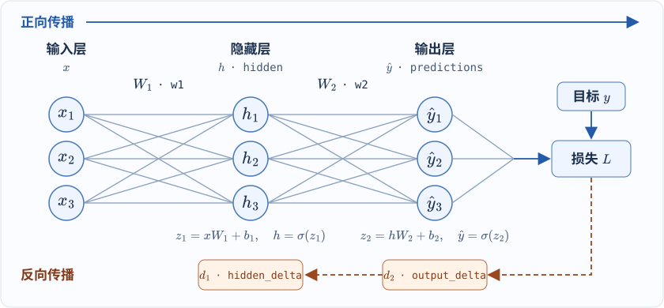

# 神经网络正向传播与反向传播
中文 | [English](README.en.md)

<br>

## 运行算法
[neural_network.py](../neural_network.py) 用 NumPy 演示一个 3→3→3 的全连接网络。在算法目录中运行：

```bash
python -m pip install -r requirements.txt
python neural_network.py
```

<br>

## 数值例子


图中每组层间连线对应一个权重矩阵。正向传播按 $x\to h\to\hat y$ 计算，之后用 $\hat y$ 和目标值 $y$ 求 $L$。反向传播从 $L$ 出发，依次求 $d_2=\partial L/\partial z_2$ 和 $d_1=\partial L/\partial z_1$。

| 图中符号 | 代码变量 |
| --- | --- |
| 输入 $x$、目标 $y$、损失 $L$ | `x`、`y`、`loss(predictions, y)` |
| 权重 $W_1$、$W_2$，偏置 $b_1$、$b_2$ | `w1`、`w2`、`b1`、`b2` |
| 隐藏层加权和 $z_1$、激活值 $h$ | `hidden_input`、`hidden` |
| 输出层加权和 $z_2$、输出 $\hat y$ | `output_input`、`predictions` |
| 输出层梯度 $d_2$、隐藏层梯度 $d_1$ | `output_delta`、`hidden_delta` |

### 1. 输入、权重和偏置
网络有 3 个输入、3 个隐藏单元和 3 个输出。`main()` 里固定了一条输入 $x$、对应的目标 $y$、两组初始偏置和学习率 $\eta$。[初始化代码](../neural_network.py#L39-L46)

$$
\begin{aligned}
x &= (1,\ 2,\ -1), & y &= (0.2,\ 0.8,\ 0.5),\\
b_1 &= (0,\ 0,\ 0), & b_2 &= (0,\ 0,\ 0), & \eta &= 0.5.
\end{aligned}
$$

$$
W_1 = \begin{bmatrix}
 0.2 & -0.1 &  0.4\\
 0.3 &  0.0 & -0.2\\
-0.1 &  0.2 &  0.2
\end{bmatrix},
\qquad
W_2 = \begin{bmatrix}
 0.1 & -0.2 &  0.3\\
 0.4 &  0.1 & -0.3\\
-0.2 &  0.3 &  0.2
\end{bmatrix}.
$$

$W_1$ 连接输入层和隐藏层，$W_2$ 连接隐藏层和输出层。权重矩阵的每一行对应前一层的单元，每一列对应后一层的单元。代码把单条样本存成 $1\times 3$ 的行向量。文中用 $\approx$ 标记四舍五入后的数值。
### 2. 正向传播
**输入层 → 隐藏层。** 先计算 $z_1=xW_1+b_1$。初始偏置为零，按 $W_1$ 的三列分别求和。

$$
\begin{aligned}
(z_1)_1 &= 1(0.2)+2(0.3)+(-1)(-0.1)=0.9,\\
(z_1)_2 &= 1(-0.1)+2(0)+(-1)(0.2)=-0.3,\\
(z_1)_3 &= 1(0.4)+2(-0.2)+(-1)(0.2)=-0.2.
\end{aligned}
$$

再对三个加权和分别应用 $\sigma(z)=1/(1+e^{-z})$，得到隐藏层激活值 $h=\sigma(z_1)\approx(0.71094950,\ 0.42555748,\ 0.45016600)$。

代码中，`hidden_input = x @ w1 + b1` 计算 $z_1$，`hidden = sigmoid(hidden_input)` 计算 $h$。[隐藏层代码](../neural_network.py#L12-L13)

**隐藏层 → 输出层。** 把 $h$ 作为这一层的输入，计算 $z_2=hW_2+b_2$。初始偏置同样为零。

$$
\begin{aligned}
(z_2)_1 &\approx 0.71094950(0.1)+0.42555748(0.4)+0.45016600(-0.2)\approx 0.15128474,\\
(z_2)_2 &\approx 0.71094950(-0.2)+0.42555748(0.1)+0.45016600(0.3)\approx 0.03541565,\\
(z_2)_3 &\approx 0.71094950(0.3)+0.42555748(-0.3)+0.45016600(0.2)\approx 0.17565081.
\end{aligned}
$$

对 $z_2$ 的三个分量应用 sigmoid，得到网络输出。

$$
\hat y = \sigma(z_2) \approx (0.53774922,\ 0.50885299,\ 0.54380014).
$$

代码中，`output_input = hidden @ w2 + b2` 计算 $z_2$，`predictions = sigmoid(output_input)` 计算 $\hat y$。[输出层代码](../neural_network.py#L14-L15)
### 3. 计算损失
正向传播得到 $\hat y$ 后，再用目标值 $y$ 计算半平方误差。代码对样本数取平均，本例只有一条样本。

$$
\begin{aligned}
\hat y-y &\approx (0.33774922,\ -0.29114701,\ 0.04380014),\\
L &= \tfrac12\sum_{j=1}^{3}(\hat y_j-y_j)^2\\
  &\approx 0.05703727+0.04238329+0.00095923 \approx 0.100380.
\end{aligned}
$$

代码对应 `0.5 * np.sum((predictions - y) ** 2) / len(y)`。[损失函数](../neural_network.py#L19-L21)
### 4. 反向传播
**先求输出层的梯度。** sigmoid 的导数是 $\sigma'(z)=\sigma(z)(1-\sigma(z))$。用链式法则把损失对输出值的梯度传到加权和 $z_2$。符号 $\odot$ 表示逐元素相乘。

$$
\begin{aligned}
d_2 = \frac{\partial L}{\partial z_2}
= (\hat y-y)\odot\hat y\odot(1-\hat y)\approx (0.08395601,\ -0.07276393,\ 0.01086601).
\end{aligned}
$$

例如第一个分量是 $(0.53774922-0.2)\times 0.53774922\times(1-0.53774922)\approx 0.08395601$。

代码里的 `output_delta` 计算这一项，多样本时还会除以样本数。[输出层误差代码](../neural_network.py#L24-L26)

把 $h$ 转置后乘以 $d_2$，得到 $W_2$ 的梯度。第一个隐藏单元到第一个输出单元的权重梯度是 $0.71094950\times 0.08395601\approx 0.05968848$。偏置直接加到 $z_2$ 上，所以单条样本的偏置梯度等于 $d_2$。

$$
\begin{aligned}
\frac{\partial L}{\partial W_2}
&= h^{\mathsf T}d_2 \approx
\begin{bmatrix}
 0.05968848 & -0.05173148 & 0.00772518\\
 0.03572811 & -0.03096524 & 0.00462411\\
 0.03779414 & -0.03275585 & 0.00489151
\end{bmatrix},\\
\frac{\partial L}{\partial b_2}
&=d_2 \approx(0.08395601,\ -0.07276393,\ 0.01086601).
\end{aligned}
$$

代码对应 `grad_w2 = hidden.T @ output_delta` 和 `grad_b2 = output_delta.sum(axis=0)`。[输出层参数梯度](../neural_network.py#L32-L33)

**再求隐藏层的梯度。** 每个隐藏单元都连接到三个输出单元。用更新前的 $W_2$ 把三路梯度传回隐藏层，再逐元素乘上隐藏层的 sigmoid 导数。

$$
\begin{aligned}
d_2 W_2^{\mathsf T} &\approx (0.02620819,\ 0.02304621,\ -0.03644718),\\
d_1 &= \frac{\partial L}{\partial z_1}
= (d_2W_2^{\mathsf T})\odot h\odot(1-h)\\
&\approx(0.00538579,\ 0.00563384,\ -0.00902128).
\end{aligned}
$$

例如第一个隐藏单元收到的三路梯度加权和是 $0.08395601(0.1)+(-0.07276393)(-0.2)+0.01086601(0.3)\approx 0.02620819$。再乘 $0.71094950(1-0.71094950)$，得到 $d_1$ 的第一个分量。代码用 `hidden_delta` 保存 $d_1$。[隐藏层误差代码](../neural_network.py#L27)

用 $x^{\mathsf T}d_1$ 得到 $W_1$ 的梯度。例如第二个输入到第一个隐藏单元的权重梯度是 $2\times0.00538579\approx0.01077158$。单条样本的偏置梯度等于 $d_1$。

$$
\begin{aligned}
\frac{\partial L}{\partial W_1}
&=x^{\mathsf T}d_1\approx
\begin{bmatrix}
 0.00538579 &  0.00563384 & -0.00902128\\
 0.01077158 &  0.01126767 & -0.01804256\\
-0.00538579 & -0.00563384 &  0.00902128
\end{bmatrix},\\
\frac{\partial L}{\partial b_1}
&=d_1\approx(0.00538579,\ 0.00563384,\ -0.00902128).
\end{aligned}
$$

代码对应 `grad_w1 = x.T @ hidden_delta` 和 `grad_b1 = hidden_delta.sum(axis=0)`。[隐藏层参数梯度](../neural_network.py#L30-L31)
### 5. 更新一次参数
等两层的梯度都算完，再用 $\theta_{\mathrm{new}}=\theta-\eta\,\partial L/\partial\theta$ 更新每个参数。以两个权重和一个偏置为例。

$$
\begin{aligned}
(W_1^{\mathrm{new}})_{11} &\approx 0.2-0.5(0.00538579)\approx 0.19730710,\\
(W_2^{\mathrm{new}})_{11} &\approx 0.1-0.5(0.05968848)\approx 0.07015576,\\
(b_2^{\mathrm{new}})_1 &\approx 0-0.5(0.08395601)\approx -0.04197801.
\end{aligned}
$$

代码对应 `parameter -= learning_rate * gradient`。用更新后的参数再做一次正向传播，得到输出 $(0.51703206,\ 0.52666119,\ 0.54171192)$。这一条样本的损失从 $0.100380$ 降到 $0.088482$。[参数更新与复算](../neural_network.py#L62-L67)

---

<br>

## 正反向传播推导
这里用神经元编号表示同一网络，公式省略偏置。
### 1. 符号含义

| 内容     | 符号                                                         |
| :----: | :------------------: |
| 输入层 | 输入:  $x_1,x_2,x_3$ |
| 隐藏层 | 输入：$\delta_4, \delta_5, \delta_6$<br />激活值：$\alpha_4, \alpha_5, \alpha_6$ |
| 输出层 | 输入：$\delta_7, \delta_8, \delta_9$<br />预测值：$\hat{y}_7, \hat{y}_8, \hat{y}_9$ |
| 激活函数 | $\sigma(x)=\frac{1}{1+e^{-x}}$ |
| 学习率 | $\eta$ |
| 真实值 | $y_7, y_8, y_9$ |
| 损失函数 | $L_{si}=\frac{1}{2}(y_i-\hat y_i)^2$，$L_s=\sum_{i=7}^{9}L_{si}$  |
| 权重 | $\omega_{ij}$  (如神经元1, 4, 权重$\omega_{14}$) |

### 2. 正向传播

> 已知内容

- 输入数据：输入层的 $x_1$、$x_2$、$x_3$, 它们是网络接收的初始信息.

- 权重:  $\omega_{ij}$  (如神经元1, 4, 权重$\omega_{14}$), 决定了信号传递的强度.

- 激活函数: $\sigma(x)$, $\sigma(x)=\frac{1}{1+e^{-x}}$

- 损失函数：$L_s=\frac{1}{2}\sum_{i=7}^{9}(y_i-\hat y_i)^2$

- 真实值：即 $y_7$、$y_8$、$y_9$ , 可用于后续评估预测结果, 但不参与正向传播计算本身.

> 需求内容

- 隐藏层激活值： $\alpha_4$、$\alpha_5$、$\alpha_6$ 这类隐藏层神经元经过加权求和并通过激活函数后的输出值.

$$
\begin{gathered}
\alpha_i=\sigma(\delta_i),~~~~\delta_i=\omega_{1i} x_1+\omega_{2i} x_2+\omega_{3i} x_3,~~~~i=4,5,6\\
\\
e.g: \alpha_4=\sigma(\delta_4),~~~~\delta_4=\omega_{14} x_1+\omega_{24} x_2+\omega_{34} x_3,~~~~i=4,5,6
\end{gathered}
$$

- 输出层预测值： $\hat{y}_7$、$\hat{y}_8$、$\hat{y}_9$ , 这是网络针对输入数据给出的最终预测结果, 是正向传播的主要计算目标.

$$
\begin{gathered}
\hat{y_i}=\sigma(\delta_i),~~~~\delta_i=\omega_{4i} \alpha_4+\omega_{5i} \alpha_5+\omega_{6i} \alpha_6,~~~~i=7,8,9\\
\\
e.g: \hat{y_7}=\sigma(\delta_7),~~~~\delta_7=\omega_{47} \alpha_4+\omega_{57} \alpha_5+\omega_{67} \alpha_6,~~~~i=7,8,9
\end{gathered}
$$

- 损失值：对每个输出计算半平方误差，再将各项相加得到总损失 $L_s=\sum_{i=7}^{9} L_{si}$。

$$
\begin{gathered}
L_{si}=\frac{1}{2}(y_i - \hat{y_i})^2,~~i=7,8,9\\
\\
e.g: L_{s7}=\frac{1}{2}(y_7 - \hat{y_7})^2
\end{gathered}
$$

### 3. 反向传播

> 已知内容

- 正向传播结果：包括隐藏层激活值（如$\alpha_4$、$\alpha_5$、$\alpha_6$）和输出层预测值（如$\hat{y}_7$、$\hat{y}_8$、$\hat{y}_9$）

- 真实值：$y_7$、$y_8$、$y_9$

- 学习率:  $\eta$

- 损失函数：$L_s=\frac{1}{2}\sum_{i=7}^{9}(y_i-\hat y_i)^2$

- 权重:  $\omega_{ij}$  (如神经元1, 4, 权重$\omega_{14}$), 决定了信号传递的强度.

- 激活函数: $\sigma(x)$, $\sigma(x)=\frac{1}{1+e^{-x}}$

> 要求内容

- 更新权重：$\hat{\omega_{ij}}$ 根据计算得到的权重梯度和学习率, 对权重进行更新

$$
\begin{gathered}
\frac{\partial L_{s7}}{\partial \hat{y}_{7}}= \frac{\partial  \frac{1}{2}(y_7 - \hat{y_7})^2}{\partial \hat{y}_{7}}=(\hat{y}_{7}-y_{7}),~~~~~
\frac{\partial \hat{y}_{7}}{\partial \delta_{7}}=\frac{\partial \sigma(\delta_7)}{\partial \delta_{7}}=\sigma(\delta_7)(1-\sigma(\delta_7))=\hat{y}_{7}(1-\hat{y}_{7}),\\
\\
\frac{\partial \delta_{7}}{\partial \omega_{47}}=\frac{\partial (\omega_{47} \alpha_4+\omega_{57} \alpha_5+\omega_{67} \alpha_6)}{\partial \omega_{47}} =\alpha_4,\\
\\
\text{权重梯度: }~~~\frac{\partial L_{s7}}{\partial \omega_{47}}= \frac{\partial L_{s7}}{\partial \hat{y}_{7}} \frac{\partial \hat{y}_{7}}{\partial \delta_{7}} \frac{\partial \delta_{7}}{\partial \omega_{47}}=(\hat{y}_{7}-y_{7})\cdot\hat{y}_{7}(1 - \hat{y}_{7})\cdot \alpha_{4}\\
\\
\text{同理: }\frac{\partial L_{s8}}{\partial \omega_{48}}=(\hat{y}_{8}-y_{8})\cdot\hat{y}_{8}(1 - \hat{y}_{8})\cdot \alpha_{4},~~~~~\frac{\partial L_{s9}}{\partial \omega_{49}}=(\hat{y}_{9}-y_{9})\cdot\hat{y}_{9}(1 - \hat{y}_{9})\cdot \alpha_{4}\\
\end{gathered}
$$

- 更新隐藏层和输出层的权重 (举例神经元4)

$$
\begin{gathered}
\hat{\omega_{47}}=\omega_{47}-\eta\frac{\partial L_{s7}}{\partial \omega_{47}}=\omega_{47}-\eta(\hat{y}_{7}-y_{7})\cdot\hat{y}_{7}(1 - \hat{y}_{7})\cdot \alpha_{4}\\
\\
\text{同理: }\hat{\omega_{ij}}=\omega_{ij}-\eta(\hat{y}_{j}-y_{j})\cdot\hat{y}_{j}(1 - \hat{y}_{j})\cdot \alpha_{i},~~i=4,5,6,~~j=7,8,9
\end{gathered}
$$

- 更新输入层和隐藏层的权重 (举例神经元1)

$$
\begin{gathered}
\hat{\omega_{14}}=\omega_{14}-\eta\sum\limits_{k=7}^{9}\frac{\partial L_{sk}}{\partial \omega_{14}}\\
\\
\text{同理: }\hat{\omega_{ij}}=\omega_{ij}-\eta\sum\limits_{k=7}^{9}\frac{\partial L_{sk}}{\partial \omega_{ij}},~~i=1,2,3,~~j=4,5,6\\
\end{gathered}
$$

---

