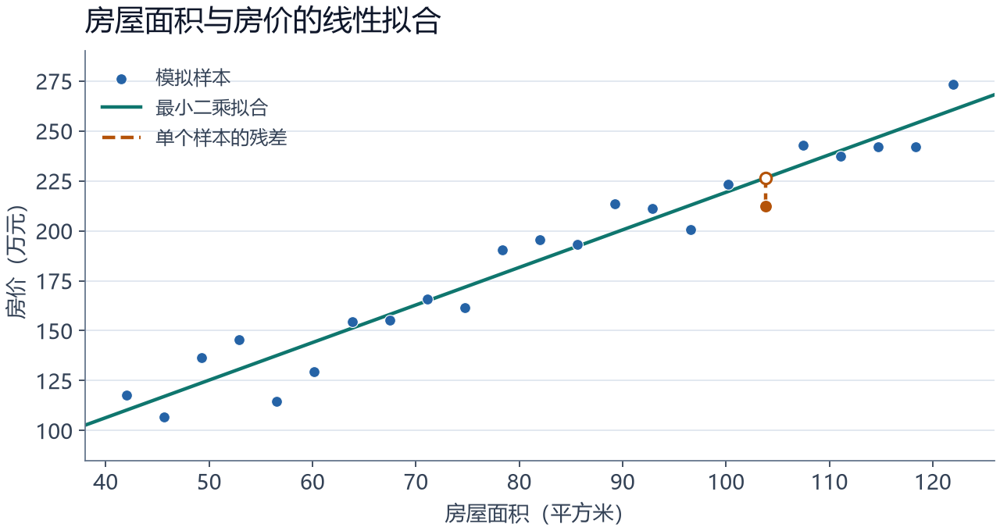
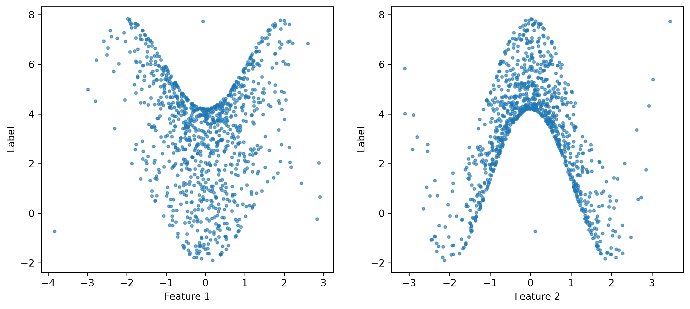
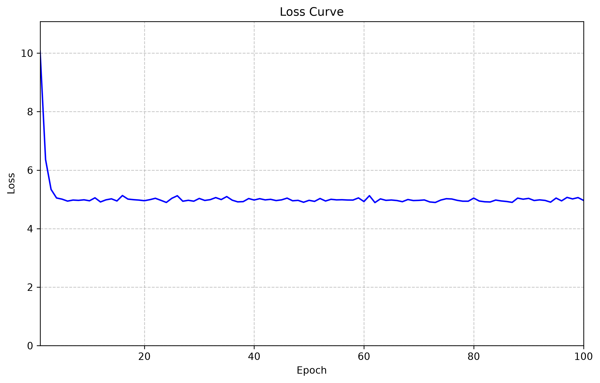
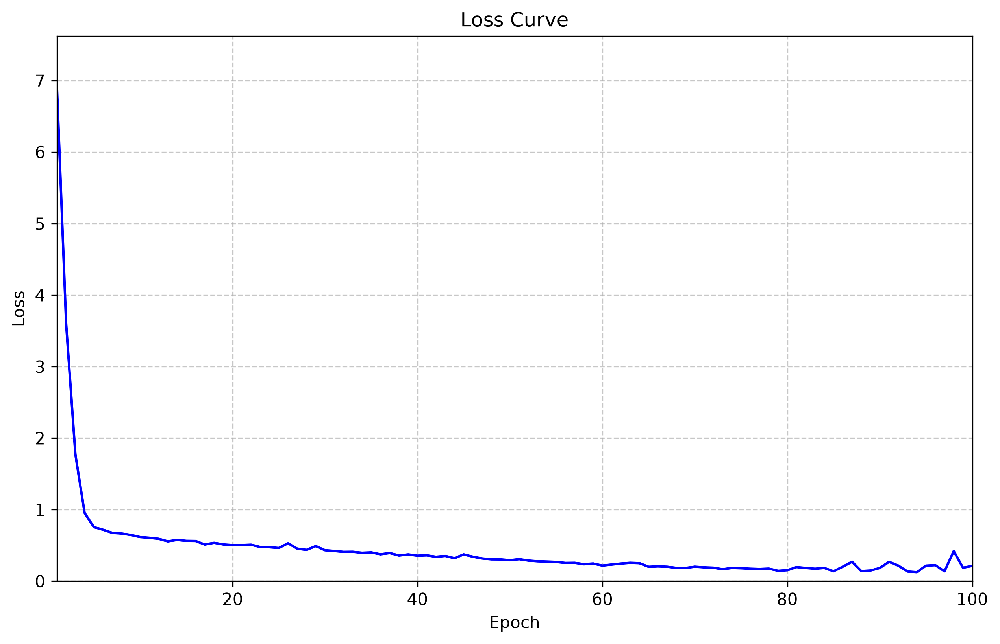
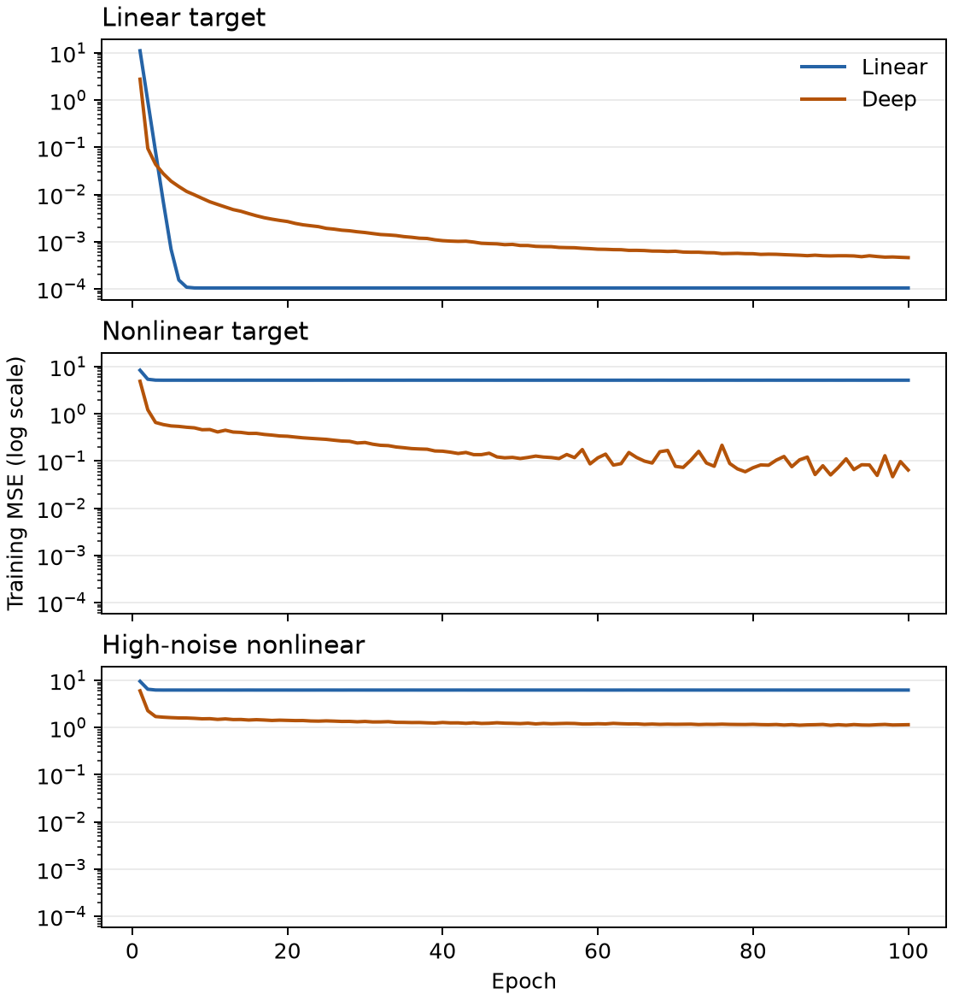
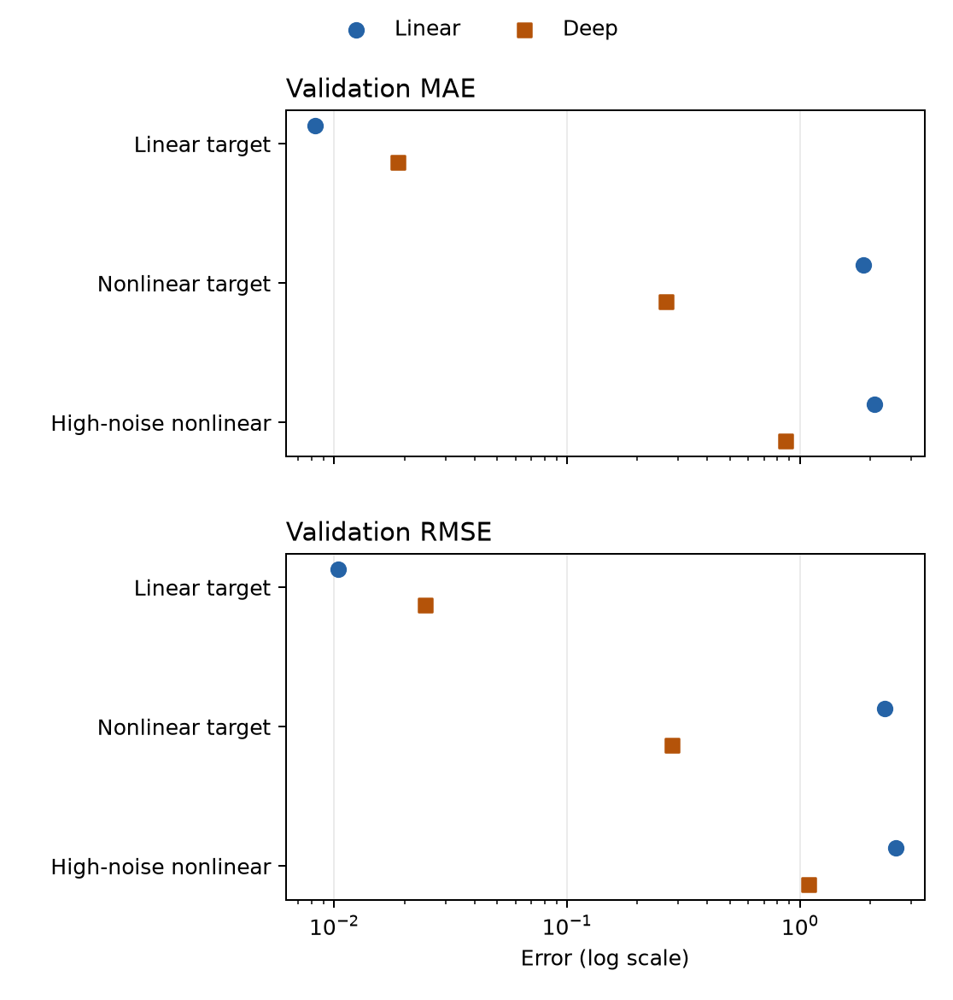

# Regression
[中文](README.md) | English

> Reference [Dive into Deep Learning (Chinese edition)](https://zh-v2.d2l.ai/).

<br>

## Directory Structure

```text
02.Regression
├── main.py                    # Select train or compare with MODE
├── requirements.txt
├── run
│   ├── data.py                # Synthetic data and batch loading
│   ├── model.py               # Linear and deep models
│   ├── train.py               # Training, validation, and default experiment
│   └── compare.py             # Comparison experiment and metrics JSON
├── tools
│   └── plot.py                # Scatter plots, loss curves, and error comparisons
└── output  # Experiment results
```

<br>

## Introduction

Regression models the relationship between one or more independent variables and a dependent variable.
Researchers in the natural and social sciences often use regression to describe how inputs relate to outputs.

Most machine learning tasks involve **prediction**.
Regression predicts a **numerical value**.

Common examples include the following.

- Predicting house or stock prices
- Predicting the length of a hospital stay
- Predicting retail sales

Prediction is a broader category that also includes tasks such as classification.

---

<br>

## Linear Regression Basics

Linear regression is one of the simplest and most widely used regression methods. The model described here makes two assumptions.

1. The independent variables $\mathbf{x}$ and the dependent variable $y$ have a **linear relationship**.
2. The noise follows a **normal distribution**.

For example, predict the price of a house from its floor area and age.

The following terms describe the training data.

- The dataset used to fit the model is the **training set**.
- Each row of data is a **sample**.
- The value to predict is the **label** or **target**.
- An input used to make a prediction is a **feature**.
- The number of samples is $n$.
- Sample $i$ has features $\mathbf{x}^{(i)} = [x_1^{(i)}, x_2^{(i)}]^\top$ and label $y^{(i)}$.

With floor area as the only input, a straight line can fit the simulated house prices. The dashed line marks the residual for one example, the difference between observed and predicted prices at the same floor area.



---

<br>

## Linear Model

The model predicts the house price as a weighted sum of features with a bias.

$$
\text{price} = w_{\text{area}} \cdot \text{area} + w_{\text{age}} \cdot \text{age} + b.
$$

- The weights $w$ determine how much each feature contributes.
- The term $b$ is the **bias**, also called the offset or intercept.

The bias lets the model shift its predictions independently of the feature values, even when the features never take the value zero.
### Linear Regression with Multiple Features
With $d$ features, the prediction is

$$
\hat{y} = w_1 x_1 + w_2 x_2 + \dots + w_d x_d + b.
$$

The vector form is

$$
\hat{y} = \mathbf{w}^\top \mathbf{x} + b.
$$

For a batch of $n$ samples, the prediction is

$$
\hat{\mathbf{y}} = \mathbf{X}\mathbf{w} + b.
$$

Training finds $\mathbf{w}, b$ that make the predictions as close to the labels as possible.

---

<br>

## Loss Function

The loss function quantifies the **difference between predictions and targets**.

A common regression objective is squared error. Here the definition includes a factor of one half.

$$
l^{(i)}(\mathbf{w}, b) = \frac{1}{2}\left(\hat{y}^{(i)} - y^{(i)}\right)^2.
$$

Average the loss over all samples.

$$
L(\mathbf{w}, b) = \frac{1}{n}\sum_{i=1}^n l^{(i)}(\mathbf{w}, b)
$$

Training minimizes the average loss.
$
(\mathbf{w}, b) = \arg\min_{\mathbf{w}, b}\ L(\mathbf{w}, b).
$

In the experiments, [`run/train.py`](../run/train.py#L16) uses `nn.MSELoss()` to average squared errors over the current minibatch.

---

<br>

## Analytical Solution

Linear regression is one of the few models with a **closed-form solution**.

Fold the bias into the design matrix and minimize $\|\mathbf{y}-\mathbf{X}\mathbf{w}\|^2$. When $\mathbf{X}^\top \mathbf{X}$ is invertible, the solution is

$$
\mathbf{w} = (\mathbf{X}^\top \mathbf{X})^{-1}\mathbf{X}^\top \mathbf{y}.
$$

This closed-form solution applies to least-squares linear regression. Deep models typically use iterative optimization.

---

<br>

## Stochastic Gradient Descent (SGD)

Gradient descent optimizes deep learning models by updating parameters in the direction that decreases the loss.

In practice, **minibatch SGD** computes the gradient for a small random subset of samples at each step, reducing computation per update and averaging over several samples.

---

### Update Equations

$$
\begin{aligned}
\mathbf{w} &\leftarrow \mathbf{w} - \frac{\eta}{|\mathcal{B}|} \sum_{i\in\mathcal{B}} \mathbf{x}^{(i)}\left(\mathbf{w}^\top\mathbf{x}^{(i)}+b-y^{(i)}\right),\\
b &\leftarrow b - \frac{\eta}{|\mathcal{B}|} \sum_{i\in\mathcal{B}}\left(\mathbf{w}^\top\mathbf{x}^{(i)}+b-y^{(i)}\right).
\end{aligned}
$$

The update uses the following quantities.

- $\mathcal{B}$ is the set of samples in the minibatch.
- $|\mathcal{B}|$ is the batch size.
- $\eta$ is the learning rate.
- Batch size and learning rate are **hyperparameters**.

Training proceeds as follows.

1. Randomly initialize the parameters.
2. Repeatedly sample a minibatch and update the parameters along the negative gradient.
3. Stop when the stopping criterion is met.

---

<br>

## Experimental Results

Run these commands from the repository root. Set `MODE` to `"train"` at the top of the entry point to run the default experiment, which writes scatter plots and training loss curves to `output` in the regression example.

```bash
cd Deep-Learning/02.Regression
python -m pip install -r requirements.txt
python main.py
```

The default experiment generates 1,000 examples with seed 42. Both features follow independent standard normal distributions. Labels follow $y = 2x_1\sin x_1 - 3.4x_2\sin x_2 + 4.2 + \epsilon$, where $\epsilon$ is zero-mean Gaussian noise with standard deviation 0.01.



Train the linear model and the deep ReLU model with SGD for 100 epochs, using a batch size of 32 and a learning rate of 0.01. Each plot shows the mean of the minibatch mean squared errors for each epoch. The plots have separate vertical scales.

| Linear Model Training Loss | Deep Model Training Loss |
|:---:|:---:|
|  |  |

After training, the program uses seed 43 to generate 10 separate validation samples from the same distribution. Validation MAE measures the mean absolute difference between predictions and noisy labels.

| Model | Epoch 100 Training Loss (MSE) | MAE on 10 Validation Samples |
|:---|---:|---:|
| Linear model | 4.964740 | 2.4093 |
| Deep model | 0.213931 | 0.1993 |

The $x\sin x$ terms make the labels nonlinear. The deep model builds a piecewise linear function with ReLU and obtains a lower fitting error on these data.
### Model Comparison Across Three Synthetic Datasets
After installing dependencies, set `MODE` to `"compare"` at the top of `main.py` and run `python main.py`. The program saves both plots and `results.json` in `output/comparison`. For each condition, train on 2,048 samples and validate on 500 separately generated samples from the same distribution. The noiseless linear target is $2x_1-3.4x_2+4.2$. The two nonlinear conditions use the $x\sin x$ transformation from the previous section.

The training and validation seeds are 42 and 43, respectively. All three conditions reuse the same features and standard normal noise draws, varying only the target function or the noise standard deviation. For each condition, initialize each model with seed 44. Both models use the same minibatch order in each epoch with seed 45. Train on CPU with SGD for 100 epochs using a batch size of 32 and a learning rate of 0.01.

| Training Loss by Dataset | Validation Error by Dataset |
|:---:|:---:|
|  |  |

MAE is mean absolute error, and RMSE is root mean squared error. Both use the noisy validation labels. The results also include each model’s training MSE at epoch 100. [Full experiment data](../output/comparison/results.json)

| Dataset | Noise Standard Deviation | Linear MAE | Linear RMSE | Deep MAE | Deep RMSE |
|:---|---:|---:|---:|---:|---:|
| Linear | 0.01 | **0.0083** | **0.0104** | 0.0188 | 0.0246 |
| Nonlinear | 0.01 | 1.8742 | 2.3103 | **0.2657** | **0.2821** |
| Nonlinear with higher noise | 1.00 | 2.0873 | 2.5691 | **0.8698** | **1.0943** |

The linear model has lower errors in the first condition because it uses the same functional form that generated the labels. In the other two conditions, $x\sin x$ is an even function. With symmetric, independent inputs, each raw feature has zero population covariance with the label. The deep model can fit this nonlinearity. Higher noise raises both models' validation errors, in part because the validation labels themselves vary at random.
