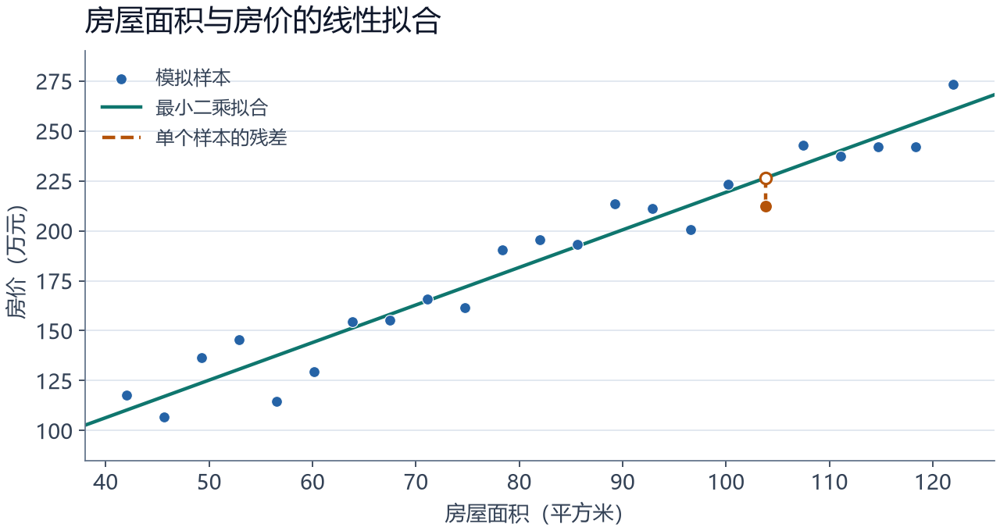
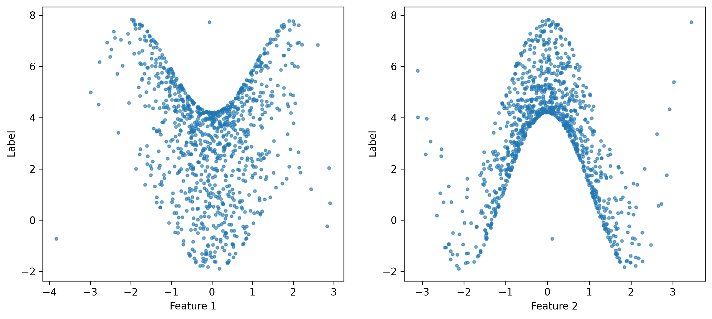
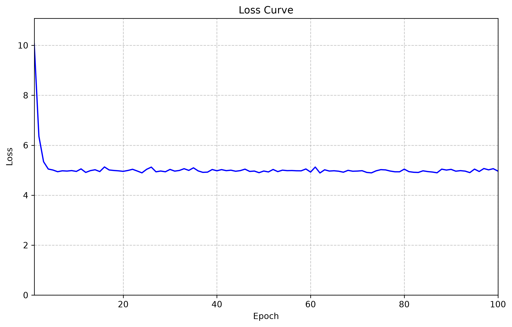
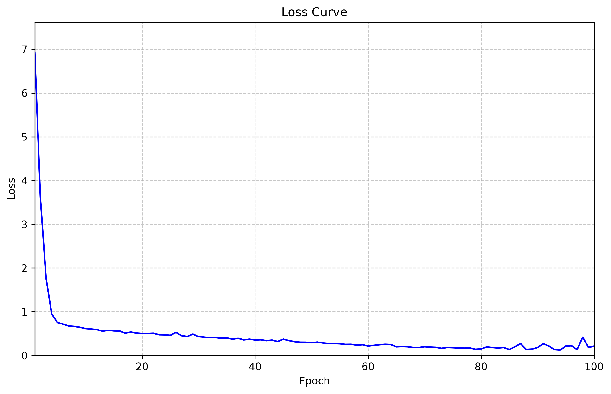
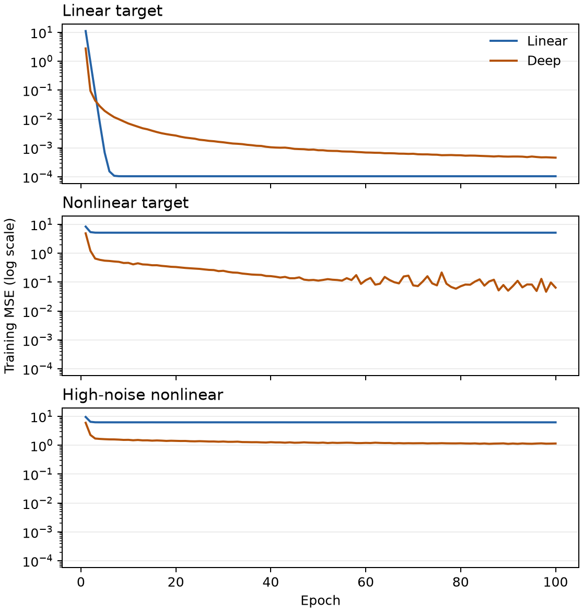
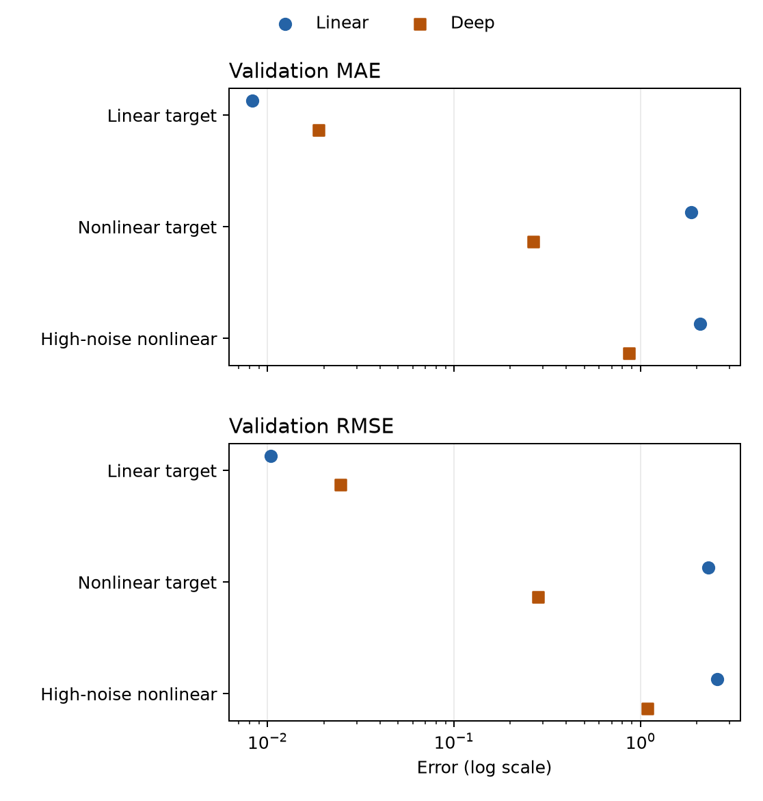

# 回归
中文 | [English](README.en.md)

> 本文参考[《动手学深度学习》](https://zh-v2.d2l.ai/)。

<br>

## 目录

```text
02.Regression
├── main.py                    # 顶部 MODE 选择 train 或 compare
├── requirements.txt
├── run
│   ├── data.py                # 合成数据与批量加载
│   ├── model.py               # 线性模型与深度模型
│   ├── train.py               # 训练、验证与默认实验
│   └── compare.py             # 对照实验与指标 JSON
├── tools
│   └── plot.py                # 散点图、损失曲线与误差对照
└── output  # 实验结果
```

<br>

## 介绍
回归（regression）是能为一个或多个自变量与因变量之间关系建模的一类方法。
在自然科学和社会科学领域，回归经常用来表示输入和输出之间的关系。

机器学习中的大多数任务都与**预测**有关。
当我们想预测一个**数值**时，就会涉及回归问题。

例子：

- 预测价格（房屋、股票）
- 预测住院时间
- 预测零售销量

注意：**并非所有预测都是回归问题**。

---

<br>

## 线性回归的基本元素
线性回归（linear regression）是最简单、最常用的回归方法之一。这里考虑两个假设。

1. 自变量 $\mathbf{x}$ 与因变量 $y$ 是**线性关系**
2. 噪声服从**正态分布**

例子：根据房屋面积、房龄 预测 房价。

机器学习术语：

- 数据集：训练集（training set）
- 每行数据：样本（sample）
- 预测目标：标签（label）/目标（target）
- 预测依据：特征（feature）
- 样本数：$n$
- 第 $i$ 个样本：$\mathbf{x}^{(i)} = [x_1^{(i)}, x_2^{(i)}]^\top$，标签 $y^{(i)}$

只考虑房屋面积时，可以用直线拟合模拟房价。图中虚线标出同一面积下观测值与预测值的差，也就是该样本的残差。



---

<br>

## 线性模型
目标（房价）可以表示为特征的加权和：

$$
\text{price} = w_{\text{area}} \cdot \text{area} + w_{\text{age}} \cdot \text{age} + b.
$$

- $w$：权重（weight），决定每个特征的影响
- $b$：偏置（bias/偏移量/截距）

即使特征不会为 0，**仍需要偏置项**，否则模型表达能力受限。
### 高维线性回归
$d$ 个特征时：

$$
\hat{y} = w_1 x_1 + w_2 x_2 + \dots + w_d x_d + b.
$$

向量化表示：

$$
\hat{y} = \mathbf{w}^\top \mathbf{x} + b.
$$

批量形式（$n$ 个样本）：

$$
\hat{\mathbf{y}} = \mathbf{X}\mathbf{w} + b.
$$

训练目标：找到 $\mathbf{w}, b$，让预测尽可能接近真实标签。

---

<br>

## 损失函数
损失函数（loss function）量化**真实值与预测值的差距**。

回归最常用：**平方误差损失**

$$
l^{(i)}(\mathbf{w}, b) = \frac{1}{2}\left(\hat{y}^{(i)} - y^{(i)}\right)^2.
$$

全局平均损失：

$$
L(\mathbf{w}, b) = \frac{1}{n}\sum_{i=1}^n l^{(i)}(\mathbf{w}, b)
$$

训练目标：
$
(\mathbf{w}, b) = \arg\min_{\mathbf{w}, b}\ L(\mathbf{w}, b).
$

实验中， [`run/train.py`](../run/train.py#L16) 使用 `nn.MSELoss()`，对当前批次的平方误差直接取平均。

---

<br>

## 解析解
线性回归是少数有**解析解（公式解）**的模型。

把偏置并入设计矩阵后，最小化 $\|\mathbf{y}-\mathbf{X}\mathbf{w}\|^2$。当 $\mathbf{X}^\top\mathbf{X}$ 可逆时，解为

$$
\mathbf{w} = (\mathbf{X}^\top \mathbf{X})^{-1}\mathbf{X}^\top \mathbf{y}.
$$

这个解析解适用于最小二乘线性回归。深度模型通常使用迭代优化。

---

<br>

## 随机梯度下降（SGD）
梯度下降（gradient descent）**几乎能优化所有深度学习模型**，沿损失递减方向更新参数。

实际使用 **小批量随机梯度下降（minibatch SGD）**：每次随机抽一小批数据计算梯度，更快更稳定。

---

### 更新公式

$$
\begin{aligned}
\mathbf{w} &\leftarrow \mathbf{w} - \frac{\eta}{|\mathcal{B}|} \sum_{i\in\mathcal{B}} \mathbf{x}^{(i)}\left(\mathbf{w}^\top\mathbf{x}^{(i)}+b-y^{(i)}\right),\\
b &\leftarrow b - \frac{\eta}{|\mathcal{B}|} \sum_{i\in\mathcal{B}}\left(\mathbf{w}^\top\mathbf{x}^{(i)}+b-y^{(i)}\right).
\end{aligned}
$$

符号说明：

- $\mathcal{B}$：小批量样本集合
- $|\mathcal{B}|$：批量大小（batch size）
- $\eta$：学习率（learning rate）
- 批量大小、学习率：**超参数（hyperparameter）**

训练流程：

1. 随机初始化参数
2. 迭代抽取小批量，沿负梯度更新
3. 满足停止条件时停止

---

<br>

## 实验结果
从仓库根目录运行以下命令。将入口顶部的 `MODE` 改为 `"train"` 可运行默认实验，散点图和训练损失曲线写入回归示例的 `output` 目录。

```bash
cd Deep-Learning/02.Regression
python -m pip install -r requirements.txt
python main.py
```

默认实验用种子 42 生成 1,000 个样本。两个特征独立服从标准正态分布，标签按 $y = 2x_1\sin x_1 - 3.4x_2\sin x_2 + 4.2 + \epsilon$ 生成，其中 $\epsilon$ 是标准差为 0.01 的零均值高斯噪声。



线性模型和带 ReLU 的深度模型都用 SGD 训练 100 轮，批量大小为 32，学习率为 0.01。下图记录每轮各批次均方误差的平均值，两图使用各自的纵轴刻度。

| 线性模型训练损失 | 深度模型训练损失 |
|:---:|:---:|
|  |  |

训练后，程序用种子 43 单独生成 10 个同分布的验证样本。验证 MAE 是模型预测值与带噪标签之间的平均绝对误差。

| 模型 | 第 100 轮训练损失（MSE） | 10 个验证样本的 MAE |
|:---|---:|---:|
| 线性模型 | 4.964740 | 2.4093 |
| 深度模型 | 0.213931 | 0.1993 |

标签中的 $x\sin x$ 项引入了非线性。深度模型通过 ReLU 构造分段线性函数，在这组数据上取得了更低的拟合误差。
### 三种合成数据上的模型对比
安装依赖后，将 `main.py` 顶部的 `MODE` 改为 `"compare"`，再运行 `python main.py`。对照图和 `results.json` 一起写入 `output/comparison`。每组用 2,048 个样本训练，用另外生成的 500 个同分布样本验证。线性标签的无噪声部分为 $2x_1-3.4x_2+4.2$，两组非线性标签沿用上一节的 $x\sin x$ 变换。

训练集与验证集的随机种子分别为 42 和 43。三组复用相同的特征和标准正态噪声抽样，只改变目标函数或噪声标准差。每种模型在三个条件下都用种子 44 初始化，两个模型每轮按同一顺序取小批量（种子 45）。每次在 CPU 上用 SGD 训练 100 轮，批量大小为 32，学习率为 0.01。

| 各数据集的训练损失 | 各数据集的验证误差 |
|:---:|:---:|
|  |  |

MAE 为平均绝对误差，RMSE 为均方根误差，两者均以验证集的带噪声标签为基准。各模型第 100 轮的训练 MSE 也收录在结果中。[完整实验数据](../output/comparison/results.json)

| 数据集 | 噪声标准差 | 线性 MAE | 线性 RMSE | 深度 MAE | 深度 RMSE |
|:---|---:|---:|---:|---:|---:|
| 线性 | 0.01 | **0.0083** | **0.0104** | 0.0188 | 0.0246 |
| 非线性 | 0.01 | 1.8742 | 2.3103 | **0.2657** | **0.2821** |
| 高噪声非线性 | 1.00 | 2.0873 | 2.5691 | **0.8698** | **1.0943** |

线性模型在第一组的误差更低，因为它的预测形式与生成标签的函数一致。后两组使用的 $x\sin x$ 是偶函数，在对称、独立的输入分布下，原始特征与标签的总体协方差为零。深度模型能拟合这种非线性。提高噪声后，两种模型的验证误差都变大，其中包含验证标签本身的随机波动。
