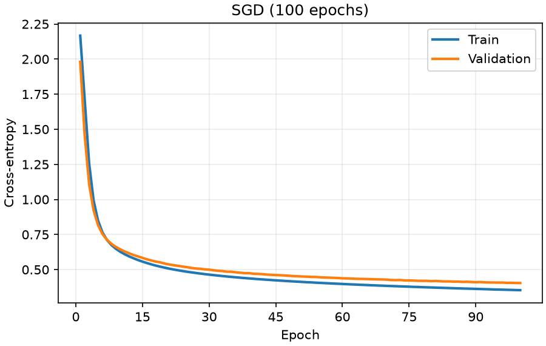
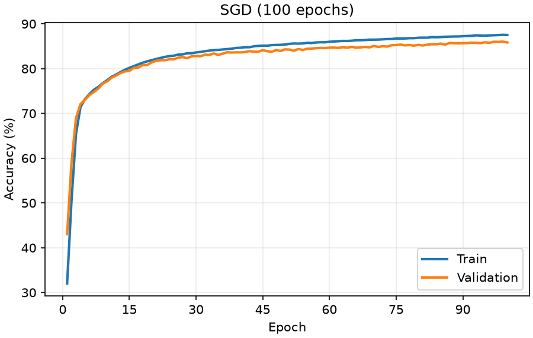
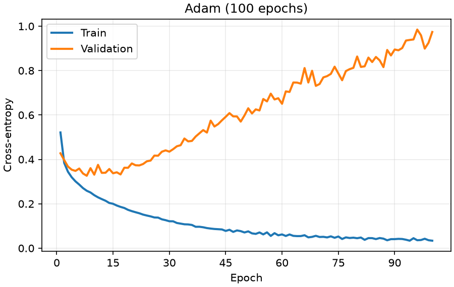
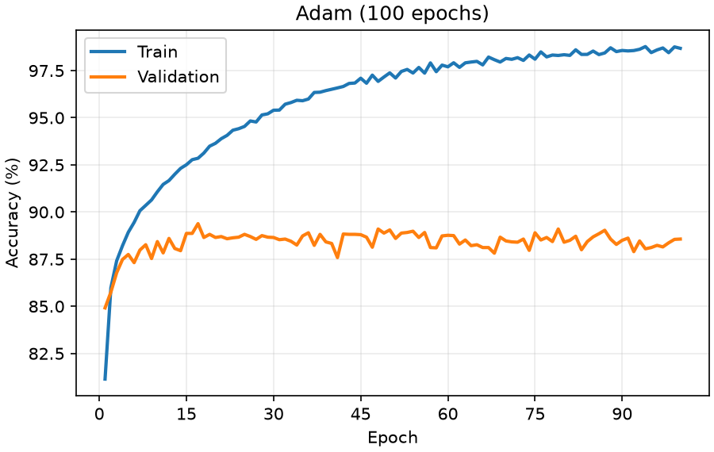
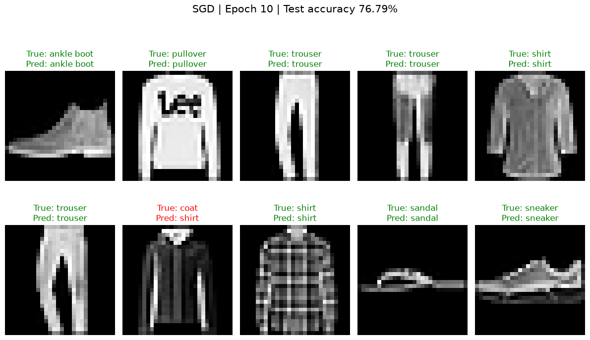
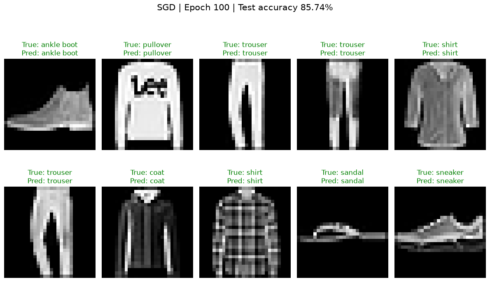
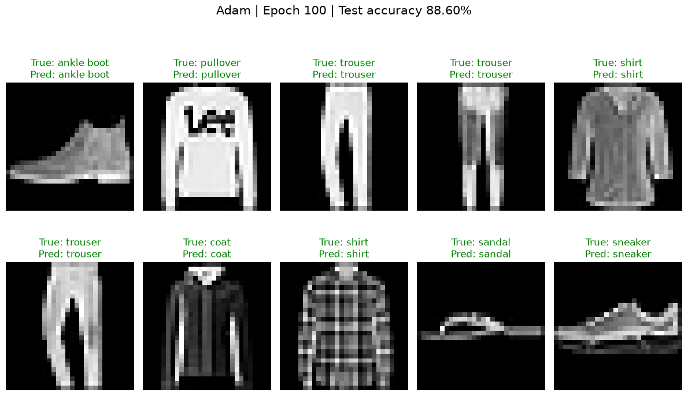

# Fashion-MNIST Image Classification
[中文](README.md) | English

See [Dive into Deep Learning (Chinese edition)](https://zh-v2.d2l.ai/).

<br>

## Repository Structure

~~~text
03.Classification
├── main.py        # Train with SGD, then Adam, for 100 epochs each
├── requirements.txt
├── run
│   ├── data.py    # Download, normalization, and stratified split
│   ├── model.py   # Multilayer perceptron
│   ├── train.py   # SGD/Adam training, evaluation, and results
│   └── analyze.py # Optional dataset statistics
├── tools
│   └── plot.py    # Training results and dataset plots
└── output  # Experiment results
~~~

<br>

## Run the Experiment

Run the following commands from the repository root. The first run downloads the training and test sets. Later runs reuse the cache in the experiment's `data/` directory.

```bash
cd Deep-Learning/03.Classification
python -m pip install -r requirements.txt
python main.py
```

One execution runs SGD and then Adam for 100 epochs each, both with a learning rate of 0.001 and seed 42. Both experiments use the same data split, initial model parameters, and training sample order. `main.py` keeps the following settings:

```python
EPOCHS = 100
SEED = 42

for optimizer_name in ("SGD", "Adam"):
    run_training(OUTPUT_DIR, optimizer_name, epochs=EPOCHS, seed=SEED)
```

SGD and Adam save their results in `output/sgd` and `output/adam`, respectively. Each `results.json` contains the experiment configuration and per-epoch metrics. To view class distributions, example images, and pixel value distributions, run the optional analysis separately from the experiment directory:

```bash
python -m run.analyze
```

<br>

## Introduction

Classification asks which category an input belongs to. Common examples include:

- Does this email belong in the spam folder?
- Will this user sign up for a subscription?
- Does this image show a donkey, a dog, a cat, or a chicken?
- Which movie is this person most likely to watch next?

A classifier can return a hard label, the single class assigned to an example, or soft labels, the probabilities assigned to all classes. A model can produce soft labels and use them to choose a hard label.

---

Start with an image classification example. **Suppose each input is a $2\times2$ grayscale image.**

Each pixel has a scalar value, so each image has four features $x_1, x_2, x_3, x_4$.

Suppose each image belongs to one of three classes: cat, chicken, or dog.

One way to represent the label is $y \in \{1, 2, 3\}$, with the integers representing cat, chicken, and dog respectively. This is an efficient way to store class labels.

---

**One-hot encoding is another way to represent class labels.**

A one-hot vector has one component per class. Set the component for the matching class to 1 and all others to 0. In this example, the three-dimensional label vector $y$ is $(1, 0, 0)$ for cat, $(0, 1, 0)$ for chicken, or $(0, 0, 1)$ for dog.

$$
y \in \{(1, 0, 0), (0, 1, 0), (0, 0, 1)\}.
$$

---

**We optimize the parameters to maximize the likelihood of the observed data.**

Interpret the output $\hat{y}_j$ as the probability of class $j$ and predict the class with the highest probability, $\operatorname{argmax}_j \hat{y}_j$.

For example, if $\hat{y}_1$, $\hat{y}_2$, and $\hat{y}_3$ are 0.1, 0.1, and 0.8, the prediction is class 3, dog.

---

The model first computes three unnormalized scores, called logits, $o_1$, $o_2$, and $o_3$.

$$
\begin{aligned}
o_1 &= x_1 w_{11} + x_2 w_{12} + x_3 w_{13} + x_4 w_{14} + b_1,\\
o_2 &= x_1 w_{21} + x_2 w_{22} + x_3 w_{23} + x_4 w_{24} + b_2,\\
o_3 &= x_1 w_{31} + x_2 w_{32} + x_3 w_{33} + x_4 w_{34} + b_3.
\end{aligned}
$$

The affine layer's outputs can be negative, and their sum can differ from 1. To interpret the outputs as probabilities, they must be nonnegative and sum to 1 for every input. We also need a training objective that rewards accurate probability estimates.

For example, among predictions for which a classifier assigns a probability of 0.5 to the predicted class, ideally half are correct. This property is called calibration.

<br>

## Softmax

Softmax converts logits to a probability distribution and is differentiable. Exponentiating each logit produces a positive value. Dividing each value by their sum makes the resulting probabilities sum to 1.

$$
\hat{\mathbf{y}} = \mathrm{softmax}(\mathbf{o})\quad \text{where}\quad \hat{y}_j = \frac{\exp(o_j)}{\sum_k \exp(o_k)}
$$

For each $j$, $0 \leq \hat{y}_j \leq 1$, so $\hat{\mathbf{y}}$ is a valid probability distribution.

Softmax preserves the ordering of the logits $\mathbf{o}$ while assigning a probability to every class. The most probable class is therefore the class with the largest logit.

$$
\operatorname{argmax}_j \hat y_j = \operatorname{argmax}_j o_j.
$$

Softmax regression is a linear model because its class scores come from an affine transformation of the input features. The softmax transformation itself is nonlinear.

<br>

## Loss Function

For a label $\mathbf{y}$ and a prediction $\hat{\mathbf{y}}$, the cross-entropy loss is

$$
l(\mathbf{y}, \hat{\mathbf{y}}) = - \sum_{j=1}^q y_j \log \hat{y}_j.
$$

With a one-hot vector $\mathbf{y}$ of length $q$, only the term for the true class contributes. The log of any predicted probability $\hat{y}_j$ is at most $0$. The loss reaches its minimum when the model assigns probability 1 to the true class, $P(\mathbf{y} \mid \mathbf{x})=1$.

In practice, label noise can introduce mislabeled examples, and the input features can lack the information needed to classify every example perfectly.

<br>

## Softmax and Its Derivative

Using the softmax definition, we can write the cross-entropy loss in terms of logits.

$$
\begin{aligned}
l(\mathbf{y}, \hat{\mathbf{y}}) &=  - \sum_{j=1}^q y_j \log \frac{\exp(o_j)}{\sum_{k=1}^q \exp(o_k)} \\
&= \sum_{j=1}^q y_j \log \sum_{k=1}^q \exp(o_k) - \sum_{j=1}^q y_j o_j\\
&= \log \sum_{k=1}^q \exp(o_k) - \sum_{j=1}^q y_j o_j.
\end{aligned}
$$

Its derivative with respect to the logit $o_j$ is

$$
\partial_{o_j} l(\mathbf{y}, \hat{\mathbf{y}}) = \frac{\exp(o_j)}{\sum_{k=1}^q \exp(o_k)} - y_j = \mathrm{softmax}(\mathbf{o})_j - y_j.
$$

The derivative is the difference between the probability assigned by the model and the observed outcome, represented by a component of the one-hot label. It has the same prediction-minus-target form as the gradient in squared-error regression.

---

<br>

## Model and Training

Fashion-MNIST contains $28\times28$ grayscale images of ten clothing classes. `FashionNN` flattens each image into a 784-dimensional vector, passes it through two ReLU hidden layers, and outputs ten logits. The network structure is `784 → 128 → 64 → 10`.

Represent one image as a column vector. The weight shapes follow the storage convention of `nn.Linear`:

$$
W_1\in\mathbb R^{128\times784},\qquad
W_2\in\mathbb R^{64\times128},\qquad
W_3\in\mathbb R^{10\times64}.
$$

The forward pass is:

$$
\begin{aligned}
\mathbf h_1&=\operatorname{ReLU}(W_1\mathbf x+\mathbf b_1),\\
\mathbf h_2&=\operatorname{ReLU}(W_2\mathbf h_1+\mathbf b_2),\\
\mathbf o&=W_3\mathbf h_2+\mathbf b_3.
\end{aligned}
$$

Training uses `nn.CrossEntropyLoss()`, which takes logits and integer class labels directly. `train_epoch` computes the loss, backpropagates, and updates parameters with the current experiment's SGD or Adam optimizer. `evaluate_model` computes mean loss and accuracy in evaluation mode. Validation runs after every training epoch. See the [model](../run/model.py) and [training and evaluation code](../run/train.py).

```python
if optimizer_name == "SGD":
    optimizer = optim.SGD(model.parameters(), lr=0.001)
else:
    optimizer = optim.Adam(model.parameters(), lr=0.001)
criterion = nn.CrossEntropyLoss()
```

<br>

## Experiment Settings and Results

Both experiments hold out 600 images per class from the official training set, leaving 54,000 images for training and 6,000 for validation. Each uses seed 42, a batch size of 64, a learning rate of 0.001, and two CPU threads for 100 epochs. Each experiment resets the data loader and model seeds to use the same data split, initial parameters, and training sample order. It converts images to tensors and normalizes them once before each experiment's training, then reuses them across epochs.

Training loss and accuracy aggregate predictions made before each batch update. Validation metrics are computed at the end of each epoch. Loss is cross-entropy averaged over samples. At epochs 10 and 100, each experiment evaluates the official 10,000-image test set and saves predictions for the same first 10 test images.

The tables and figures below come from this complete run of 100 epochs each for SGD and Adam. Values come from each experiment's `results.json`.

| Optimizer | Epoch | Training loss | Validation loss | Training accuracy | Validation accuracy | Test accuracy |
| --- | ---: | ---: | ---: | ---: | ---: | ---: |
| SGD | 10 | 0.6273 | 0.6445 | 77.42% | 77.15% | 76.79% |
| SGD | 100 | 0.3534 | 0.4045 | 87.52% | 85.85% | 85.74% |
| Adam | 10 | 0.2388 | 0.3311 | 91.07% | 88.43% | 88.16% |
| Adam | 100 | 0.0337 | 0.9740 | 98.68% | 88.57% | 88.60% |

| Optimizer | Training and validation loss | Training and validation accuracy |
|:---:|:---:|:---:|
| SGD | [](../output/sgd/loss.png) | [](../output/sgd/accuracy.png) |
| Adam | [](../output/adam/loss.png) | [](../output/adam/accuracy.png) |

| Optimizer | Predictions at epoch 10 | Predictions at epoch 100 |
|:---:|:---:|:---:|
| SGD | [](../output/sgd/predictions_10.png) | [](../output/sgd/predictions_100.png) |
| Adam | [](../output/adam/predictions_10.png) | [](../output/adam/predictions_100.png) |

From epoch 10 to epoch 100, SGD's validation loss fell from 0.6445 to 0.4045 and its test accuracy rose from 76.79% to 85.74%. Its highest validation accuracy across 100 epochs was 86.03% at epoch 99.

Over the same interval, Adam's training loss fell from 0.2388 to 0.0337 while its validation loss rose from 0.3311 to 0.9740, indicating overfitting. Its test accuracy still rose slightly from 88.16% to 88.60%. Its highest validation accuracy was 89.38% at epoch 17. In this experiment with a learning rate of 0.001, Adam's epoch-100 test accuracy was 2.86 percentage points higher than SGD's.

To rerun SGD and then Adam, run the following command from the experiment directory. Each 100-epoch experiment saves prediction figures and test accuracy at both epochs 10 and 100 in its own output directory.

```bash
python main.py
```

Test accuracy is recorded at epoch 10 and the final epoch. [SGD results](../output/sgd/results.json) · [Adam results](../output/adam/results.json)
