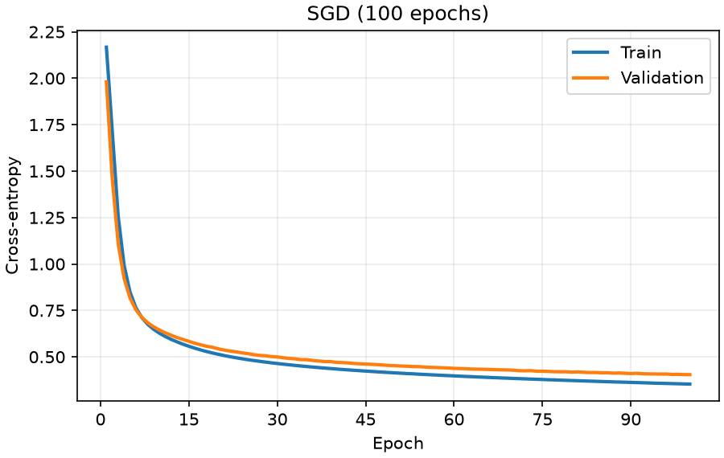
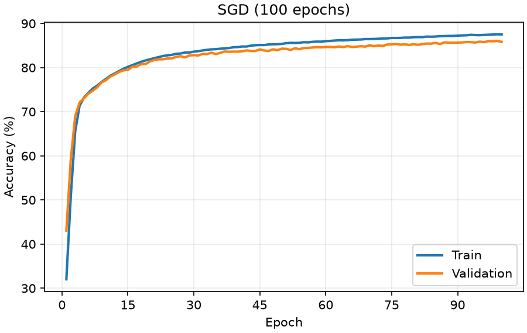
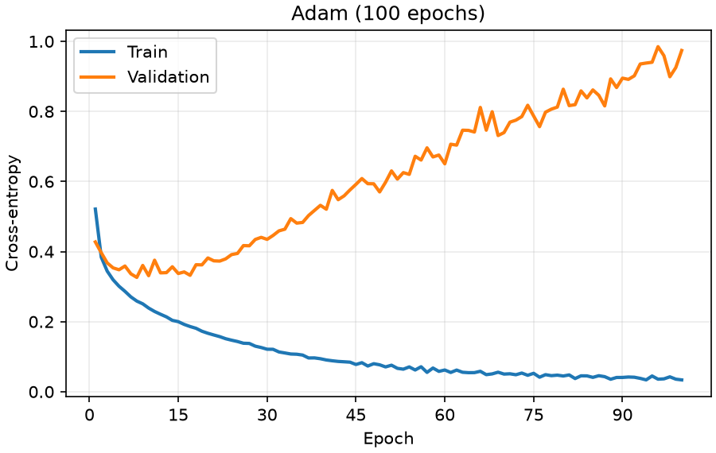
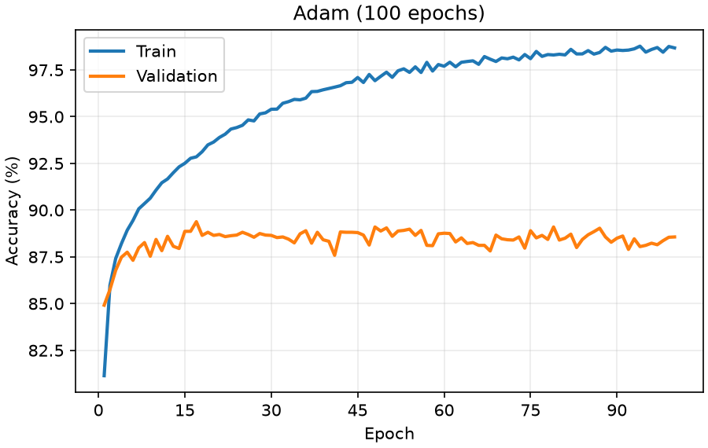
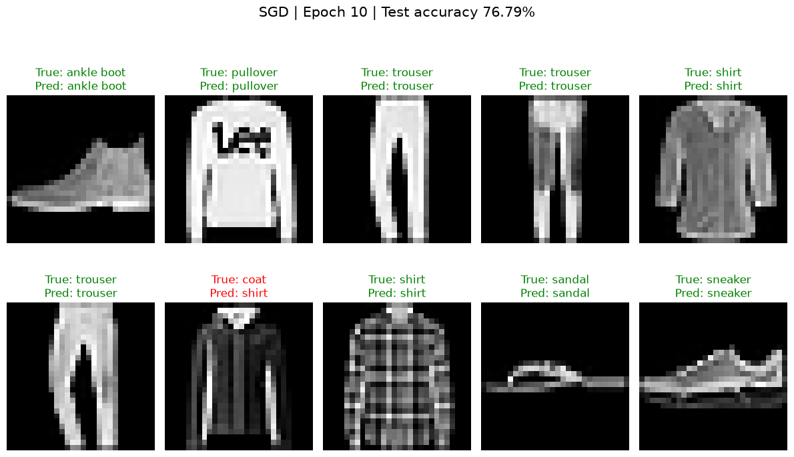
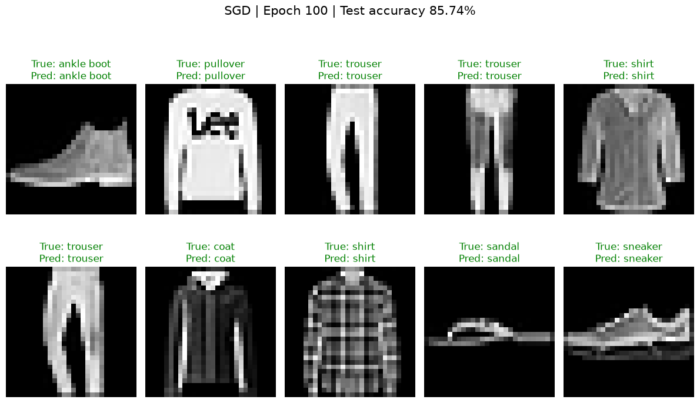
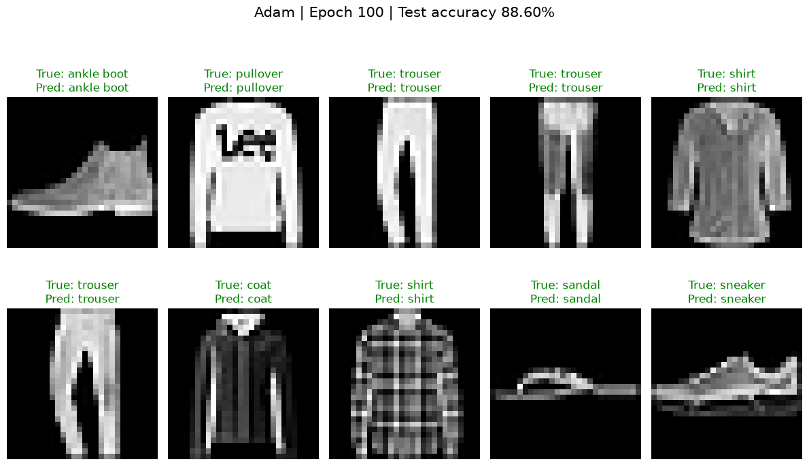

# Fashion-MNIST 图像分类
中文 | [English](README.en.md)

参考 [《动手学深度学习》](https://zh-v2.d2l.ai/)。

<br>

## 目录

~~~text
03.Classification
├── main.py        # 依次使用 SGD、Adam 各训练 100 轮
├── requirements.txt
├── run
│   ├── data.py    # 下载、归一化和分层划分数据
│   ├── model.py   # 多层感知机
│   ├── train.py   # SGD、Adam 训练、评估与结果保存
│   └── analyze.py # 可选的数据集统计
├── tools
│   └── plot.py    # 训练结果与数据分析绘图
└── output  # 实验结果
~~~

<br>

## 运行实验

在仓库根目录执行以下命令。程序首次运行时会自动下载训练集和测试集，之后复用实验目录 `data/` 中的本地缓存。

```bash
cd Deep-Learning/03.Classification
python -m pip install -r requirements.txt
python main.py
```

一次执行会依次完成 SGD 和 Adam 两组实验，各训练 100 轮，学习率均为 0.001，随机种子均为 42。两组实验使用相同的数据划分、初始模型参数和训练样本顺序。`main.py` 中保留以下设置：

```python
EPOCHS = 100
SEED = 42

for optimizer_name in ("SGD", "Adam"):
    run_training(OUTPUT_DIR, optimizer_name, epochs=EPOCHS, seed=SEED)
```

SGD 和 Adam 的结果分别保存在 `output/sgd` 和 `output/adam`。各自的 `results.json` 包含实验配置和逐轮指标。如需查看类别分布、样本和像素值分布，可在实验目录单独运行：

```bash
python -m run.analyze
```

<br>

## 介绍
分类问题：不是问“多少”，而是问“哪一个”：

- 某个电子邮件是否属于垃圾邮件文件夹？
- 某个用户可能注册或不注册订阅服务？
- 某个图像描绘的是驴、狗、猫、还是鸡？
- 某人接下来最有可能看哪部电影？

通常，机器学习实践者用分类这个词来描述两个有微妙差别的问题：

- 我们只对样本的“硬性”类别感兴趣，即属于哪个类别；
- 我们希望得到“软性”类别，即得到属于每个类别的概率。

这两者的界限往往很模糊。其中的一个原因是：即使我们只关心硬类别，我们仍然使用软类别的模型（用概率描述离散类别）。

---

我们从一个图像分类问题开始。**假设每次输入是一个 $2\times2$ 的灰度图像。**

我们可以用一个标量表示每个像素值，每个图像对应四个特征 $x_1, x_2, x_3, x_4$。

此外，假设每个图像属于类别“猫”“鸡”和“狗”中的一个。

接下来，我们要选择如何表示标签。
我们有两个明显的选择。最直接的想法是选择 $y \in \{1, 2, 3\}$，其中整数依次代表猫、鸡和狗。这是存储类别标签的有效方法。

---

**一种表示分类数据的简单方法：独热编码（one-hot encoding）。**

独热编码是一个向量，它的分量和类别一样多。

类别对应的分量设置为1，其他所有分量设置为0。

在我们的例子中，标签 $y$ 将是一个三维向量，其中 $(1, 0, 0)$ 对应于“猫”、$(0, 1, 0)$ 对应于“鸡”、$(0, 0, 1)$ 对应于“狗”：

$$
y \in \{(1, 0, 0), (0, 1, 0), (0, 0, 1)\}.
$$

---

**现在我们将优化参数以最大化观测数据的概率**

我们希望模型的输出 $\hat{y}_j$ 可以视为属于类 $j$ 的概率，然后选择具有最大输出值的类别 $\operatorname{argmax}_j \hat{y}_j$ 作为我们的预测。

例如，如果 $\hat{y}_1$、$\hat{y}_2$ 和 $\hat{y}_3$ 分别为0.1、0.1和0.8，那么我们预测的类别是3，在我们的例子中代表“狗”。

---

下面我们为每个输入计算三个未规范化的预测（logit）：$o_1$、$o_2$ 和 $o_3$。

$$
\begin{aligned}
o_1 &= x_1 w_{11} + x_2 w_{12} + x_3 w_{13} + x_4 w_{14} + b_1,\\
o_2 &= x_1 w_{21} + x_2 w_{22} + x_3 w_{23} + x_4 w_{24} + b_2,\\
o_3 &= x_1 w_{31} + x_2 w_{32} + x_3 w_{33} + x_4 w_{34} + b_3.
\end{aligned}
$$

然而我们能否将未规范化的预测 $o$ 直接视作我们感兴趣的输出呢？

答案是否定的。

因为将线性层的输出直接视为概率时存在一些问题：

- 一方面，我们没有限制这些输出数字的总和为1。
- 另一方面，根据输入的不同，它们可以为负值。

这些违反了概率基本公理。

要将输出视为概率，我们必须保证在任何数据上的输出都是非负的且总和为1。
此外，我们需要一个训练的目标函数，来激励模型精准地估计概率。

例如，在分类器输出0.5的所有样本中，我们希望这些样本是刚好有一半实际上属于预测的类别。

这个属性叫做校准（calibration）。

<br>

## Softmax
softmax函数能够将未规范化的预测变换为非负数并且总和为1，同时让模型保持可导的性质。

为了完成这一目标，我们首先对每个未规范化的预测求幂，这样可以确保输出非负。

为了确保最终输出的概率值总和为1，我们再让每个求幂后的结果除以它们的总和。如下式：

$$
\hat{\mathbf{y}} = \mathrm{softmax}(\mathbf{o})\quad \text{其中}\quad \hat{y}_j = \frac{\exp(o_j)}{\sum_k \exp(o_k)}
$$

这里，对于所有的 $j$ 总有 $0 \leq \hat{y}_j \leq 1$。

因此，$\hat{\mathbf{y}}$ 可以视为一个正确的概率分布。

softmax运算不会改变未规范化的预测 $\mathbf{o}$ 之间的大小次序，只会确定分配给每个类别的概率。

因此，在预测过程中，我们仍然可以用下式来选择最有可能的类别。

$$
\operatorname{argmax}_j \hat y_j = \operatorname{argmax}_j o_j.
$$

尽管softmax是一个非线性函数，但softmax回归的输出仍然由输入特征的仿射变换决定。

因此，softmax回归是一个线性模型（linear model）。

<br>

## 损失函数
对于任何标签 $\mathbf{y}$ 和模型预测 $\hat{\mathbf{y}}$，损失函数为：

$$
l(\mathbf{y}, \hat{\mathbf{y}}) = - \sum_{j=1}^q y_j \log \hat{y}_j.
$$

损失函数被称为交叉熵损失（cross-entropy loss）。

由于 $\mathbf{y}$ 是一个长度为 $q$ 的独热编码向量，所以除了一个项以外的所有项 $j$ 都消失了。

由于所有 $\hat{y}_j$ 都是预测的概率，所以它们的对数永远不会大于 $0$。

因此，如果正确地预测实际标签，即如果实际标签 $P(\mathbf{y} \mid \mathbf{x})=1$，则损失函数不能进一步最小化。

注意，这往往是不可能的。

例如，数据集中可能存在标签噪声（比如某些样本可能被误标），或输入特征没有足够的信息来完美地对每一个样本分类。

<br>

## Softmax 及其导数
由于softmax和相关的损失函数很常见，因此我们需要更好地理解它的计算方式。

利用softmax的定义，我们得到：

$$
\begin{aligned}
l(\mathbf{y}, \hat{\mathbf{y}}) &=  - \sum_{j=1}^q y_j \log \frac{\exp(o_j)}{\sum_{k=1}^q \exp(o_k)} \\
&= \sum_{j=1}^q y_j \log \sum_{k=1}^q \exp(o_k) - \sum_{j=1}^q y_j o_j\\
&= \log \sum_{k=1}^q \exp(o_k) - \sum_{j=1}^q y_j o_j.
\end{aligned}
$$

考虑相对于任何未规范化的预测 $o_j$ 的导数，我们得到：

$$
\partial_{o_j} l(\mathbf{y}, \hat{\mathbf{y}}) = \frac{\exp(o_j)}{\sum_{k=1}^q \exp(o_k)} - y_j = \mathrm{softmax}(\mathbf{o})_j - y_j.
$$

换句话说，导数是我们softmax模型分配的概率与实际发生的情况（由独热标签向量表示）之间的差异。

从这个意义上讲，这与我们在回归中看到的非常相似，其中梯度是观测值 $y$ 和估计值 $\hat{y}$ 之间的差异。

---

<br>

## 模型与训练

Fashion-MNIST 包含 10 类服饰的 $28\times28$ 灰度图像。`FashionNN` 将图片展平为 784 维向量，经过两个 ReLU 隐藏层，输出 10 个 logits，网络结构为 `784 → 128 → 64 → 10`。

用单张图片的列向量表示网络，权重形状与 `nn.Linear` 的存储方式一致：

$$
W_1\in\mathbb R^{128\times784},\qquad
W_2\in\mathbb R^{64\times128},\qquad
W_3\in\mathbb R^{10\times64}.
$$

前向传播为：

$$
\begin{aligned}
\mathbf h_1&=\operatorname{ReLU}(W_1\mathbf x+\mathbf b_1),\\
\mathbf h_2&=\operatorname{ReLU}(W_2\mathbf h_1+\mathbf b_2),\\
\mathbf o&=W_3\mathbf h_2+\mathbf b_3.
\end{aligned}
$$

训练使用 `nn.CrossEntropyLoss()`，直接接收 logits 和整数类别标签。`train_epoch` 计算损失、反向传播，再由本次实验的 SGD 或 Adam 优化器更新参数；`evaluate_model` 在评估模式下计算平均损失和准确率。每轮训练结束后评估验证集。实现见 [模型代码](../run/model.py) 和 [训练与评估代码](../run/train.py)。

```python
if optimizer_name == "SGD":
    optimizer = optim.SGD(model.parameters(), lr=0.001)
else:
    optimizer = optim.Adam(model.parameters(), lr=0.001)
criterion = nn.CrossEntropyLoss()
```

<br>

## 实验设置与结果
两组实验均从官方训练集的每个类别留出 600 张图像，共 54,000 张用于训练、6,000 张用于验证。使用随机种子 42、批大小 64 和学习率 0.001，在 CPU 上用 2 个线程各训练 100 轮。每组实验重新设置数据加载器和模型的随机种子，保持相同的数据划分、初始参数和训练样本顺序。图片在每组实验训练前一次完成相同的张量转换和归一化，供各轮训练复用。

训练损失和训练准确率按本轮各批次更新前的预测累计，验证指标在每轮训练结束后计算。损失均为逐样本平均交叉熵。每组实验在第 10、100 轮评估官方 10,000 张测试图像，并对同一组前 10 张测试图片生成预测示例。

以下表格和图片来自本次 SGD、Adam 各 100 轮的完整训练，数值取自各自的 `results.json`。

| 优化器 | 轮次 | 训练损失 | 验证损失 | 训练准确率 | 验证准确率 | 测试准确率 |
| --- | ---: | ---: | ---: | ---: | ---: | ---: |
| SGD | 10 | 0.6273 | 0.6445 | 77.42% | 77.15% | 76.79% |
| SGD | 100 | 0.3534 | 0.4045 | 87.52% | 85.85% | 85.74% |
| Adam | 10 | 0.2388 | 0.3311 | 91.07% | 88.43% | 88.16% |
| Adam | 100 | 0.0337 | 0.9740 | 98.68% | 88.57% | 88.60% |

| 优化器 | 训练与验证损失 | 训练与验证准确率 |
|:---:|:---:|:---:|
| SGD | [](../output/sgd/loss.png) | [](../output/sgd/accuracy.png) |
| Adam | [](../output/adam/loss.png) | [](../output/adam/accuracy.png) |

| 优化器 | 第 10 轮预测 | 第 100 轮预测 |
|:---:|:---:|:---:|
| SGD | [](../output/sgd/predictions_10.png) | [](../output/sgd/predictions_100.png) |
| Adam | [](../output/adam/predictions_10.png) | [](../output/adam/predictions_100.png) |

SGD 从第 10 轮到第 100 轮的验证损失由 0.6445 降至 0.4045，测试准确率由 76.79% 升至 85.74%。100 轮中的最高验证准确率为 86.03%，出现在第 99 轮。

Adam 在同一阶段的训练损失由 0.2388 降至 0.0337，验证损失由 0.3311 升至 0.9740，出现了过拟合；测试准确率仍由 88.16% 小幅升至 88.60%。其最高验证准确率为 89.38%，出现在第 17 轮。在本次学习率为 0.001 的实验中，Adam 第 100 轮的测试准确率比 SGD 高 2.86 个百分点。

在实验目录运行下列命令可依次重跑 SGD 和 Adam。每组 100 轮训练都会在各自的输出目录保存第 10、100 轮的预测图和测试准确率。

```bash
python main.py
```

测试准确率只在第 10 轮和最终轮记录。[SGD 结果](../output/sgd/results.json) · [Adam 结果](../output/adam/results.json)
