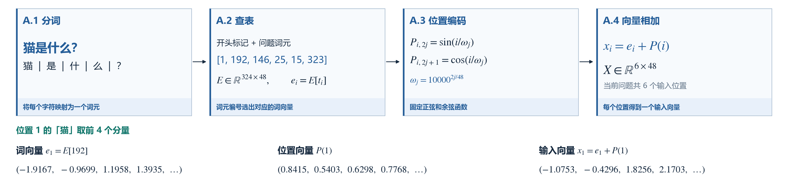
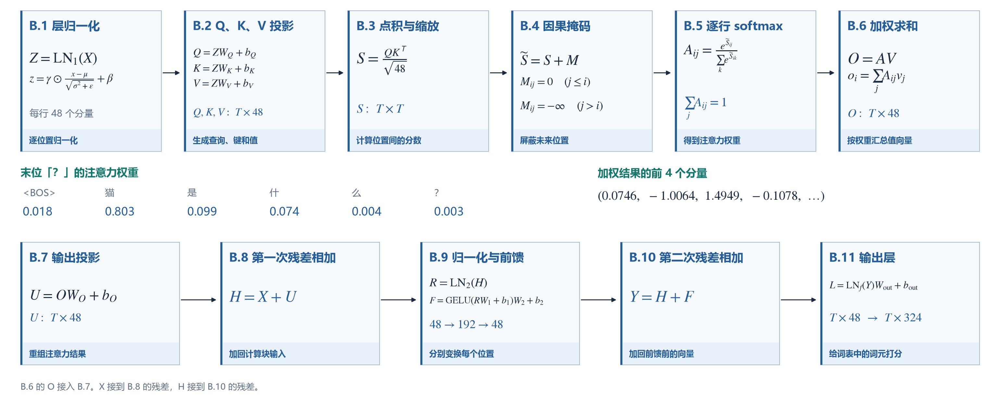
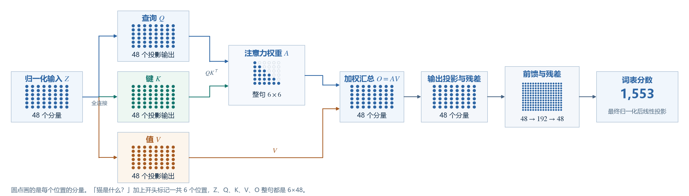
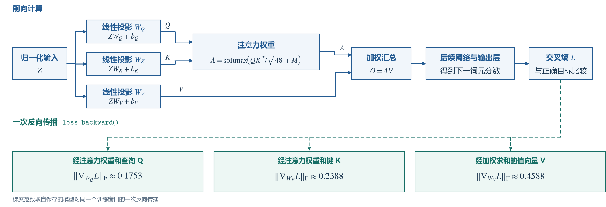
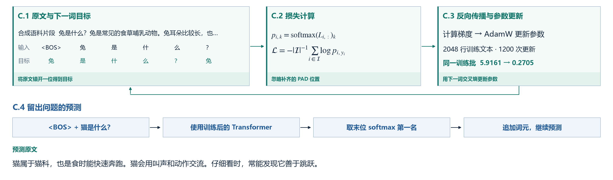
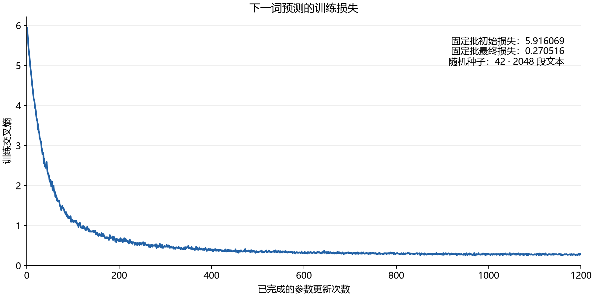
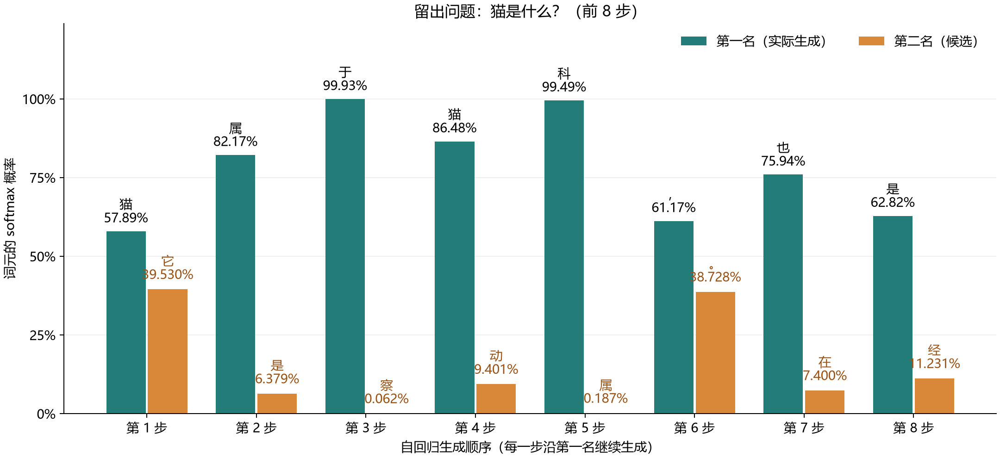

# Transformer Theory and Experiments
[中文](README.md) | English

This experiment trains a Transformer from scratch on synthetic passages about animals. The model learns to predict the next token in the text. The evaluation file holds the question “猫是什么？” (What is a cat?), which the model receives after training.

<br>

## 1. Directory Structure

```text
04.Transformer
├── main.py
├── requirements.txt
├── run/
│   ├── configs.json          # Model, training, and generation settings
│   ├── config.py             # Configuration loader
│   ├── model.py
│   ├── train.py
│   └── predict.py
├── tools/
│   ├── batch.py
│   ├── plot.py
│   ├── save.py
│   └── seed.py
├── data/
│   ├── train.txt
│   └── eval.txt
└── output/  # Experiment results
```

<br>

## 2. How the Transformer Works

### A. From Text to Input Vectors


#### A.1 Tokenization
Training and prediction share the tokenizer in `tools/batch.py`. The vocabulary contains the characters in the training text and the special tokens. At prediction time, the tokenizer maps a character outside the vocabulary to `<UNK>`.

#### A.2 Embedding Lookup
After prepending `<BOS>`, each token ID $t_i$ selects a row of the embedding matrix. Training updates this matrix. For “猫是什么？”, the IDs including the start token are `[1, 192, 146, 25, 15, 323]`.

$$
e_i=E[t_i].
$$

#### A.3 Positional Encoding
The model evaluates fixed sine and cosine functions at position $i$. Here $j$ indexes a pair of components and $d_{\mathrm{model}}$ is the model width.

$$
\omega_j=10000^{2j/d_{\mathrm{model}}},\qquad
P(i)_{2j}=\sin(i/\omega_j),\qquad
P(i)_{2j+1}=\cos(i/\omega_j).
$$

#### A.4 Vector Addition
The Transformer input at each position is the elementwise sum of the token embedding and the positional vector.

$$
x_i=e_i+P(i).
$$

### B. Transformer Block and Output Layer


#### B.1 Layer Normalization
For each position, layer normalization computes the mean and variance over that position's vector components, then applies a learned scale and shift.

$$
Z=\operatorname{LN}_1(X),\qquad
z=\gamma\odot\frac{x-\mu}{\sqrt{\sigma^2+\varepsilon}}+\beta.
$$

For “猫” at position 1, the input vector $x$ has 48 components. The saved model gives these values.

$$
\begin{aligned}
\mu &= \frac{1}{48}\sum_{j=0}^{47}x_j
    \approx \frac{26.326900}{48} \approx 0.548477,\\
\sigma^2 &= \frac{1}{48}\sum_{j=0}^{47}(x_j-\mu)^2
    \approx \frac{66.341021}{48} \approx 1.382105,\\
\sqrt{\sigma^2+\varepsilon} &\approx \sqrt{1.382105+10^{-5}} \approx 1.175634.
\end{aligned}
$$

The first component is $x_0\approx -1.075274$. Its scale and shift are $\gamma_0\approx 0.869197$ and $\beta_0\approx 0.067246$.

$$
z_0\approx 0.869197\times\frac{-1.075274-(0.548477)}{1.175634}+(0.067246)\approx -1.133264.
$$

All 48 components at this position share the same mean and variance. Each component has its own scale $\gamma_j$ and shift $\beta_j$. The first four entries of the resulting 48-dimensional vector $z$ are approximately

$$
(-1.133264,\;-0.536488,\;1.007130,\;1.255387).
$$

#### B.2 Query, Key, and Value Projections

$$
Q=ZW_Q+b_Q,\qquad K=ZW_K+b_K,\qquad V=ZW_V+b_V.
$$

The match between a query $Q$ and a key $K$ determines the attention weight. The value vector $V$ supplies the information that attention combines.





$Q$ and $K$ affect the output $O$ through the attention weights $A$. The value matrix $V$ affects it through the weighted sum $O=AV$. All three paths contribute to the same cross-entropy loss $\mathcal L$. One call to `loss.backward()` computes the gradients along all three paths, and one call to `optimizer.step()` updates all three sets of weights.

A single $\operatorname{Linear}(48,144)$ layer maps $z$ to 48 components each for $Q$, $K$, and $V$. For the first query component of “猫”, multiply the 48 inputs by their corresponding weights, sum the products, and add the bias.

$$
\begin{aligned}
q_0 &\approx \left(-1.133264\right)\left(-0.024291\right) + \left(-0.536488\right)\left(-0.009124\right)\\
    &\quad + \left(1.007130\right)\left(0.189340\right) + \left(1.255387\right)\left(-0.009579\right)\\
    &\quad + \underbrace{(0.080165)}_{\text{sum of the other 44 terms}} + \underbrace{(-0.155837)}_{\text{bias}}
    \approx 0.135416.
\end{aligned}
$$

Compute the first components of $K$ and $V$ the same way. The table splits the 48 products into two groups before adding the bias.

| Projection | First four weights | Sum of first four products | Sum of remaining 44 products | Bias | First output component |
| --- | --- | ---: | ---: | ---: | ---: |
| $K$ | $(-0.053561,\;-0.147080,\;0.112585,\;-0.026736)$ | 0.219428 | 1.042475 | -0.037177 | 1.224727 |
| $V$ | $(-0.202270,\;-0.006749,\;0.202244,\;-0.024431)$ | 0.405862 | -0.282761 | -0.073655 | 0.049445 |

The example uses saved weights after training. The display values are rounded, and the sums use full-precision products.

#### B.3 Dot Products and Scaling

$$
S=\frac{QK^\mathsf T}{\sqrt{d_k}}.
$$

Rows represent query positions and columns represent source positions. $d_k$ is the key width of each attention head.

#### B.4 Causal Mask

$$
\widetilde S=S+M,\qquad
M_{ij}=\begin{cases}0&j\leq i\\-\infty&j>i.\end{cases}
$$

For example, the mask prevents the character “么” in “猫是什么？” from attending to the question mark that follows it.

#### B.5 Row-Wise Softmax

$$
A=\operatorname{softmax}(\widetilde S).
$$

The weights in each row sum to 1. Masked positions receive weight 0.

#### B.6 Weighted Sum

$$
O=AV,\qquad o_i=\sum_j A_{ij}v_j.
$$

At each position, the model combines the value vectors using the weights from the corresponding row.

#### B.7–B.10 Output Projection, Residuals, and Feed-Forward Network

$$
\begin{aligned}
U&=OW_O+b_O,\qquad H=X+U,\\
R&=\operatorname{LN}_2(H),\\
F&=\operatorname{GELU}(RW_1+b_1)W_2+b_2,\qquad Y=H+F.
\end{aligned}
$$

#### B.11 Output Layer
A final layer normalization and a linear projection produce a score for each vocabulary item at each position.

$$
L=\operatorname{LN}_f(Y)W_{\mathrm{out}}+b_{\mathrm{out}}.
$$

### C. Training and Prediction


#### C.1 Training Text and Next-Token Targets
`run/train.py` reads the [training text](../data/train.txt) and builds the vocabulary from it. In each window, the target at a position is the following character. The corpus includes statements about cats and questions and explanations about other animals. The evaluation question “猫是什么？” and the reference answer “猫是一种动物” (A cat is an animal) are held out.

#### C.2 Loss
At each position, softmax converts scores to probabilities. Cross-entropy measures the loss for the next token in the original text. $\mathcal I$ contains the target positions after excluding padding.

$$
p_{i,k}=\operatorname{softmax}(L_{i,:})_k,\qquad
\mathcal L=-\frac{1}{|\mathcal I|}\sum_{i\in\mathcal I}\log p_{i,y_i}.
$$

#### C.3 Backpropagation and Parameter Updates
The model starts with random weights, and each batch samples several text windows. Backpropagation computes the gradients, and AdamW updates the weights at the configured learning rate.

#### C.4 Predicting the Held-Out Question
After training, `run/predict.py` reads the question “猫是什么？” from the [evaluation file](../data/eval.txt). The prompt consists of the start token and the question. Each line of the file contains one question. The model appends the highest-probability token at the last position and repeats until it predicts `<EOS>`.

<br>

## 3. Results

The model trains on a [synthetic corpus about animals](../data/train.txt).

Run from the repository root.

```bash
cd Deep-Learning/04.Transformer
python -m pip install -r requirements.txt
python main.py
```

By default, `main.py` trains on `data/train.txt`. Set `PREDICT_ONLY` to `True` to load the saved weights and read `data/eval.txt`. Set `QUESTION` to supply your own question. The configuration file contains model dimensions, training steps, the random seed, and prediction length. [run/configs.json](../run/configs.json)

The output includes the [experiment records](../output/results.json) and [model weights](../output/weights.pt). The two plots show the 1,200-step run.

| Training steps | Training loss | Predicted token probabilities |
| ---: | :---: | :---: |
| 1,200 |  |  |

The table records the results at three training budgets. All three runs use the same corpus, model configuration, and reference text for the final loss. The answers preserve the model's original Chinese output.

| Training steps | Final loss | Raw answer to “猫是什么？” | Answer quality |
| ---: | ---: | --- | --- |
| 1,200 | 0.270516 | 猫属于猫科，也是食时能快速奔跑。猫会用叫声和动作交流。仔细看时，常能发现它善于跳跃。 | Correctly places cats in the cat family. The phrase “也是食时” is ungrammatical. |
| 4,000 | 0.238490 | 它是食肉的哺乳动物。在观察中，可以看到猫善于跳跃。它脚上有肉垫，也嘴边长着胡须。 | Correctly describes cats as carnivorous mammals. The final sentence has awkward word order. |
| 10,000 | 0.192729 | 它是常见的食草哺乳动物。猫善于跳跃。它会用叫声和动作交流，也身上有毛。 | Incorrectly describes cats as herbivores. |

<br>

## 4. Reference

Vaswani, A. et al. (2017). [Attention Is All You Need](https://arxiv.org/abs/1706.03762). NeurIPS 2017.
