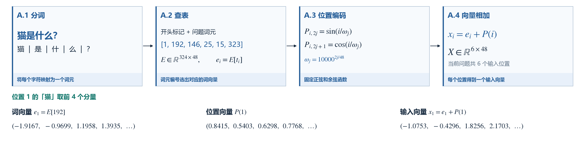
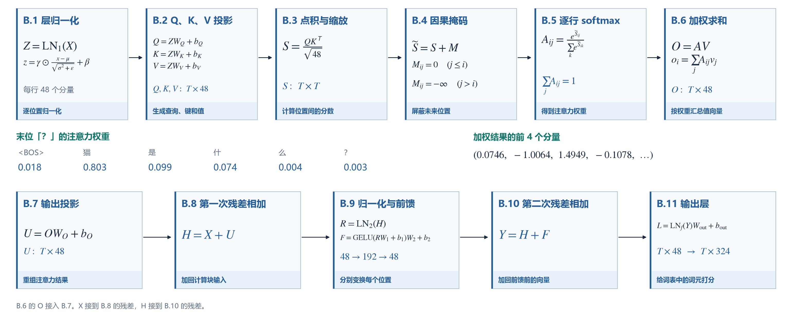
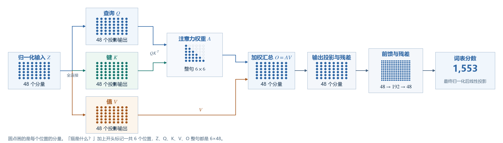
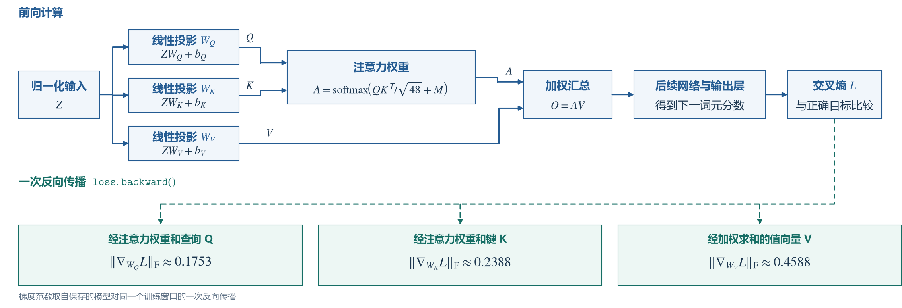
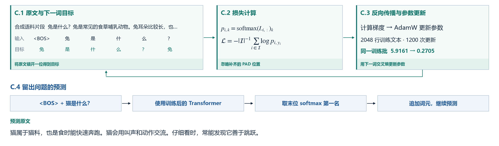
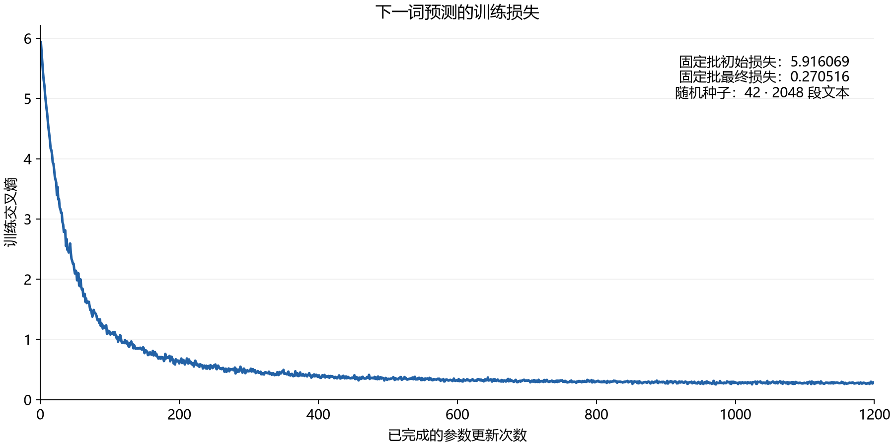
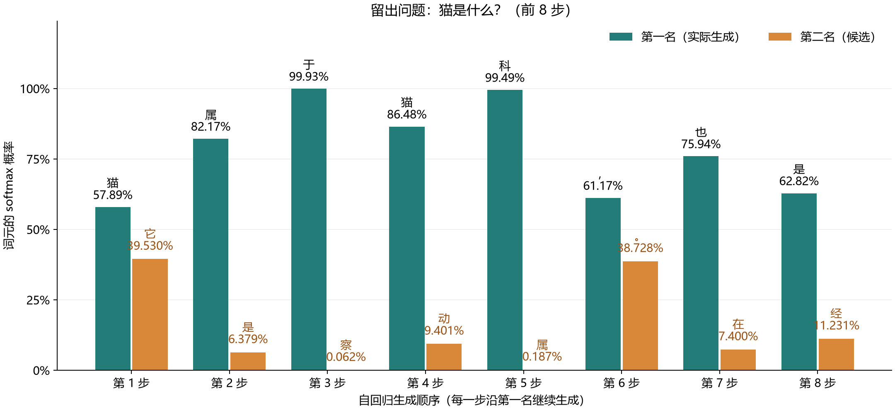

# Transformer：原理与实验
中文 | [English](README.en.md)

用合成动物科普段落从零训练一个 Transformer。训练目标是原文的下一个词元。「猫是什么？」存放在评估文件里，参数更新结束后再输入模型。

<br>

## 1. 目录

```text
04.Transformer
├── main.py
├── requirements.txt
├── run/
│   ├── configs.json          # 模型、训练和生成参数
│   ├── config.py             # 读取配置
│   ├── model.py
│   ├── train.py
│   └── predict.py
├── tools/
│   ├── batch.py
│   ├── plot.py
│   ├── save.py
│   └── seed.py
├── data/
│   ├── train.txt
│   └── eval.txt
└── output/  # 实验结果
```

<br>

## 2. Transformer 原理
### A 文字怎样变成模型输入

#### A.1 分词
训练和预测共用 `tools/batch.py` 的分词函数。新模型的词表由训练原文中的字符和控制词元组成。预测时遇到词表以外的字符，编码为 `<UNK>`。
#### A.2 查表
加上开头标记 `<BOS>` 后，每个词元编号 $t_i$ 对应词嵌入矩阵中的一行。训练会更新这个矩阵。「猫是什么？」加开头标记后的实际编号为 `[1, 192, 146, 25, 15, 323]`。

$$
e_i=E[t_i].
$$

#### A.3 位置编码
把位置下标 $i$ 代入固定的正余弦函数。$j$ 是分量对的下标，$d_{\mathrm{model}}$ 是模型宽度。

$$
\omega_j=10000^{2j/d_{\mathrm{model}}},\qquad
P(i)_{2j}=\sin(i/\omega_j),\qquad
P(i)_{2j+1}=\cos(i/\omega_j).
$$

#### A.4 向量相加
每个位置的词向量与位置向量逐元素相加，得到 Transformer 的输入。

$$
x_i=e_i+P(i).
$$

### B Transformer 计算块与输出层

#### B.1 层归一化
每个位置用自己的向量分量计算均值和方差，再做缩放和平移。

$$
Z=\operatorname{LN}_1(X),\qquad
z=\gamma\odot\frac{x-\mu}{\sqrt{\sigma^2+\varepsilon}}+\beta.
$$

以位置 1 的「猫」为例。它的输入向量 $x$ 有 48 个分量。用当前模型的权重，把这 48 项代入：

$$
\begin{aligned}
\mu &= \frac{1}{48}\sum_{j=0}^{47}x_j
    \approx \frac{26.326900}{48} \approx 0.548477,\\
\sigma^2 &= \frac{1}{48}\sum_{j=0}^{47}(x_j-\mu)^2
    \approx \frac{66.341021}{48} \approx 1.382105,\\
\sqrt{\sigma^2+\varepsilon} &\approx \sqrt{1.382105+10^{-5}} \approx 1.175634.
\end{aligned}
$$

第一个分量 $x_0\approx -1.075274$，它对应的缩放和平移参数分别是 $\gamma_0\approx 0.869197$、$\beta_0\approx 0.067246$：

$$
z_0\approx 0.869197\times\frac{-1.075274-(0.548477)}{1.175634}+(0.067246)\approx -1.133264.
$$

同一行的 48 个分量共用这个均值和方差，再分别乘各自的 $\gamma_j$、加各自的 $\beta_j$。得到的 $z$ 仍是 48 维，前四项约为

$$
(-1.133264,\;-0.536488,\;1.007130,\;1.255387).
$$

#### B.2 Q、K、V 投影

$$
Q=ZW_Q+b_Q,\qquad K=ZW_K+b_K,\qquad V=ZW_V+b_V.
$$

查询 $Q$ 与键 $K$ 的匹配程度决定权重。值向量 $V$ 提供要汇总的信息。





$Q$ 和 $K$ 通过注意力权重 $A$ 影响 $O$，$V$ 通过加权和 $O=AV$ 影响输出。三条路径最终都影响同一个交叉熵损失 $\mathcal L$。一次 `loss.backward()` 会沿这些路径分别求三组梯度，随后同一次 `optimizer.step()` 更新三组权重。

代码用一个 $\operatorname{Linear}(48,144)$，把同一个 $z$ 投影成 $Q$、$K$、$V$ 各 48 项。先算「猫」的 $Q$ 第一个分量。48 个输入分量各乘对应权重，求和后加偏置：

$$
\begin{aligned}
q_0 &\approx \left(-1.133264\right)\left(-0.024291\right) + \left(-0.536488\right)\left(-0.009124\right)\\
    &\quad + \left(1.007130\right)\left(0.189340\right) + \left(1.255387\right)\left(-0.009579\right)\\
    &\quad + \underbrace{(0.080165)}_{\text{其余 44 项之和}} + \underbrace{(-0.155837)}_{\text{偏置}}
    \approx 0.135416.
\end{aligned}
$$

$K$、$V$ 的第一个分量按同一方法计算。下表把 48 项乘积分为两部分，最后再加偏置。

| 投影 | 前 4 项的权重 | 前 4 项乘积之和 | 后 44 项乘积之和 | 偏置 | 第一个输出分量 |
|---|---|:--:|---:|---:|---:|
| $K$ | $(-0.053561,\;-0.147080,\;0.112585,\;-0.026736)$ | 0.219428 | 1.042475 | -0.037177 | 1.224727 |
| $V$ | $(-0.202270,\;-0.006749,\;0.202244,\;-0.024431)$ | 0.405862 | -0.282761 | -0.073655 | 0.049445 |

这里的数值来自训练后保存的权重。显示时四舍五入，乘积和用完整精度计算。
#### B.3 点积与缩放

$$
S=\frac{QK^\mathsf T}{\sqrt{d_k}}.
$$

一行对应一个查询位置，一列对应一个来源位置。$d_k$ 是每个注意力头的键向量宽度。
#### B.4 因果掩码

$$
\widetilde S=S+M,\qquad
M_{ij}=\begin{cases}0&j\leq i\\-\infty&j>i.\end{cases}
$$

例如，处理「猫是什么？」中的「么」时，后面的问号不能参与注意力计算。
#### B.5 逐行 softmax

$$
A=\operatorname{softmax}(\widetilde S).
$$

每行权重之和为 1，掩码遮住的位置权重为 0。
#### B.6 加权求和

$$
O=AV,\qquad o_i=\sum_j A_{ij}v_j.
$$

每个位置用这一行的权重对所有值向量加权求和。
#### B.7–B.10 输出投影、残差与前馈

$$
\begin{aligned}
U&=OW_O+b_O,\qquad H=X+U,\\
R&=\operatorname{LN}_2(H),\\
F&=\operatorname{GELU}(RW_1+b_1)W_2+b_2,\qquad Y=H+F.
\end{aligned}
$$

#### B.11 输出层
最后一层归一化与线性层为每个位置输出一组词表分数。

$$
L=\operatorname{LN}_f(Y)W_{\mathrm{out}}+b_{\mathrm{out}}.
$$

### C 训练与预测

#### C.1 原文与下一词目标
`run/train.py` 读取[训练文本](../data/train.txt)，从原文建立词表。每个窗口内，目标是输入位置的下一个字符。语料包括猫的陈述句，以及其他动物的提问与解释。评估题「猫是什么？」和标准答案「猫是一种动物」均留出。
#### C.2 损失计算
每个位置把词表分数转成概率，再计算原文下一词的交叉熵。$\mathcal I$ 是除填充位置外的目标下标集合。

$$
p_{i,k}=\operatorname{softmax}(L_{i,:})_k,\qquad
\mathcal L=-\frac{1}{|\mathcal I|}\sum_{i\in\mathcal I}\log p_{i,y_i}.
$$

#### C.3 反向传播与参数更新
从随机参数开始，每批抽取多个文本窗口。反向传播得到梯度，AdamW 按配置的学习率更新参数。
#### C.4 留出问题的预测
参数更新完成后，`run/predict.py` 从[评估集](../data/eval.txt)读取「猫是什么？」。模型输入是开头标记和问题原文。评估文件每行只有一个问题。每步取最后位置概率最高的词元，追加后继续预测，遇到 `<EOS>` 停止。

<br>

## 3. 实验结果
训练数据使用[合成动物科普语料](../data/train.txt)。

从仓库根目录运行以下命令。

```bash
cd Deep-Learning/04.Transformer
python -m pip install -r requirements.txt
python main.py
```

运行 `main.py` 默认从 `data/train.txt` 训练。把 `main.py` 顶部的 `PREDICT_ONLY` 改为 `True`，会加载权重并读取 `data/eval.txt`，也可在 `QUESTION` 中填入要预测的问题。模型尺寸、训练步数、种子和预测长度集中在同一份配置文件。[run/configs.json](../run/configs.json)

本次输出包含[实验记录](../output/results.json)和[模型权重](../output/weights.pt)。下方两张图对应 1,200 步的运行。

| 训练步数 | 训练损失 | 预测词元概率 |
|---:|:---:|:---:|
| 1,200 |  |  |

下表保留三个训练步数的结果记录。三次使用同一份语料和模型配置，最终损失在同一批训练文本上计算。

| 训练步数 | 最终损失 | 「猫是什么？」的原始回答 | 回答质量 |
|:--:|:--:|---|---|
| 1,200 | 0.270516 | 猫属于猫科，也是食时能快速奔跑。猫会用叫声和动作交流。仔细看时，常能发现它善于跳跃。 | 正确归为猫科，「也是食时」不通顺。 |
| 4,000 | 0.238490 | 它是食肉的哺乳动物。在观察中，可以看到猫善于跳跃。它脚上有肉垫，也嘴边长着胡须。 | 正确回答类别与食性，末句语序不顺。 |
| 10,000 | 0.192729 | 它是常见的食草哺乳动物。猫善于跳跃。它会用叫声和动作交流，也身上有毛。 | 把猫误判为食草动物。 |

<br>

## 4. 参考
Vaswani, A. et al. (2017). [Attention Is All You Need](https://arxiv.org/abs/1706.03762). NeurIPS 2017.
