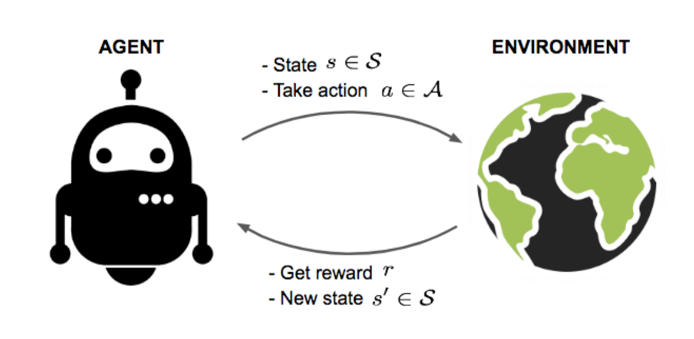
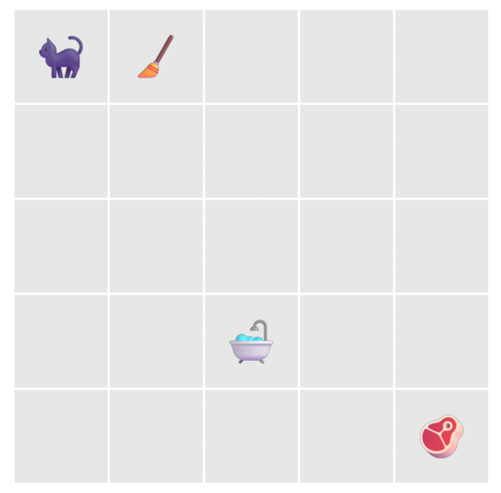
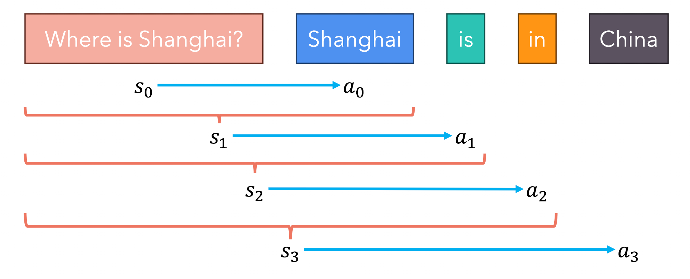
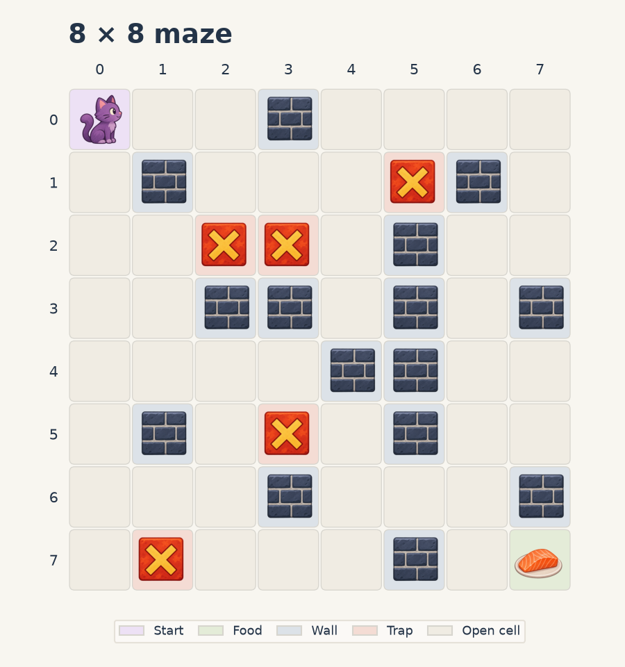
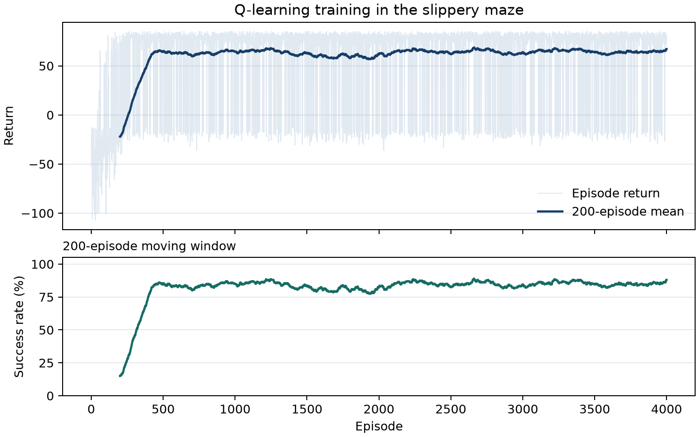
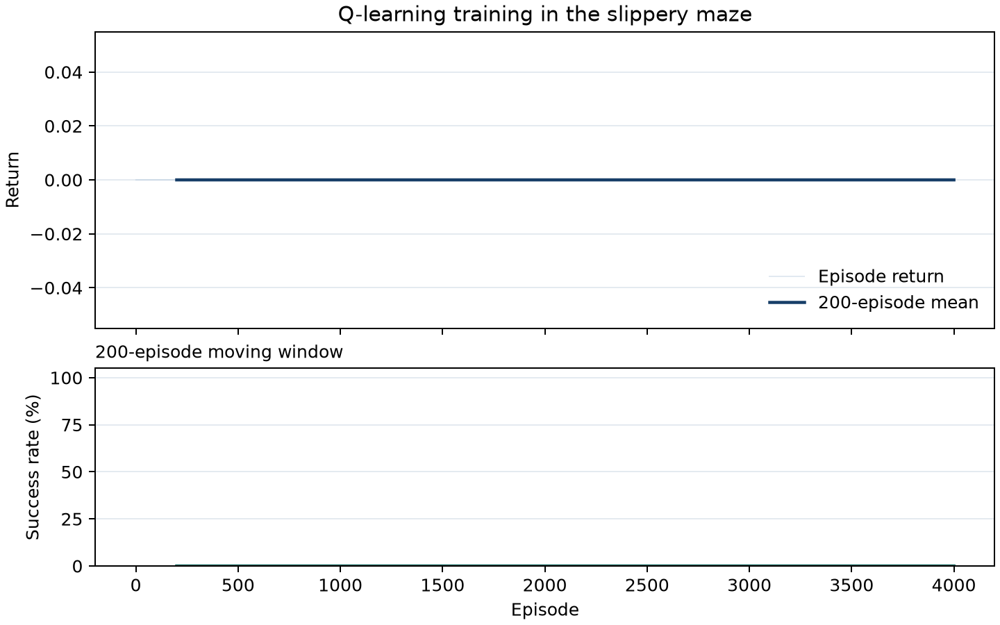
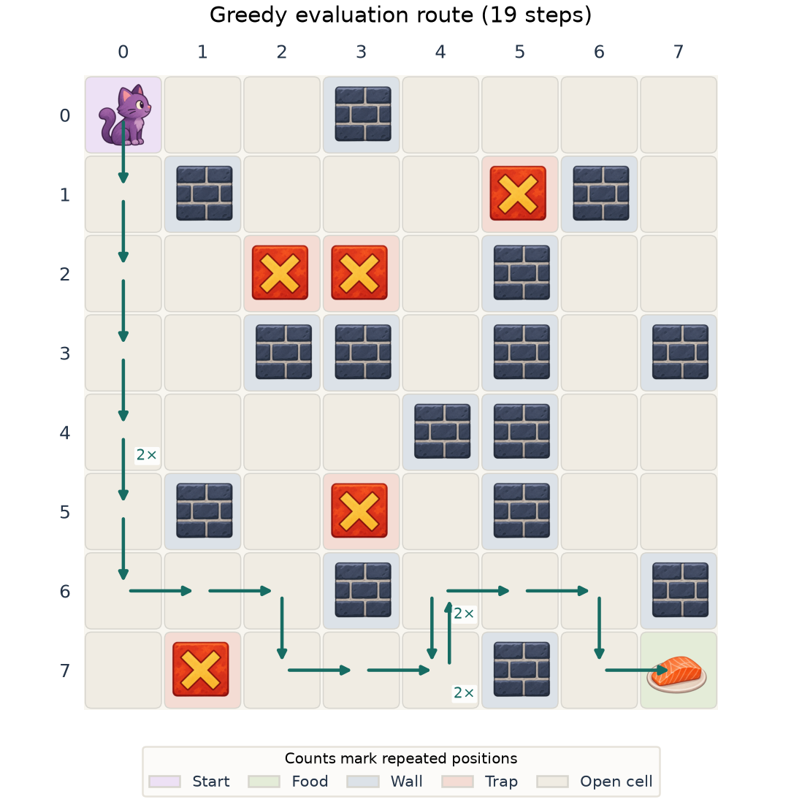
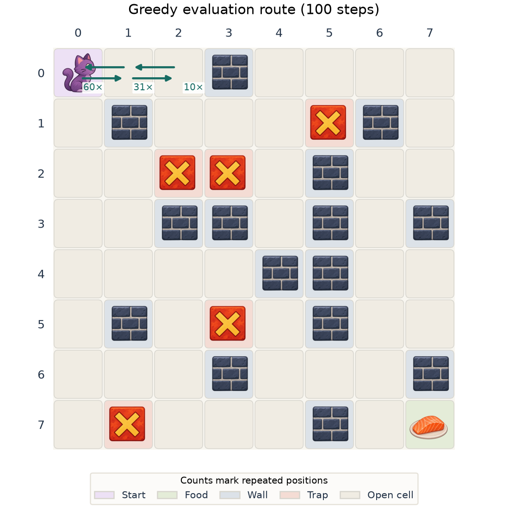

# 01.Q-learning
[中文](README.md) | English

Use tabular Q-learning to guide a cat through a slippery 8×8 maze. It starts in the upper-left corner, navigates walls and traps, and looks for food in the lower-right corner.

<br>

## Directory Structure

```text
01.Q-learning/
├── main.py                  # Experiment entry point
├── requirements.txt         # Python dependencies
├── environment/
│   ├── gridworld.py         # Maze layout, movement, slipping, and rewards
│   ├── background.py        # Draws the maze background
│   └── maze-icons.png       # Maze icon sheet
├── run/
│   ├── agent.py             # Q-table, action selection, and updates
│   ├── baseline.py          # Shortest-path planner without slipping
│   ├── configs.json         # Maze, training, evaluation, and ablation settings
│   ├── configs.py           # Configuration loader
│   └── experiment.py        # Training, evaluation, and metrics
├── tools/
│   └── plot.py              # Learning curve and route plot
└── output/                 # Experiment results
```

<br>

## Reinforcement Learning Basics

| Agent and environment | A cat looking for food | States and actions in text generation |
| :---: | :---: | :---: |
| [](figures/agent-environment.png) | [](figures/cat-gridworld.png) | [](figures/token-actions.png) |

### Agent and Environment
At step $t$, the agent observes state $s_t$ and uses its policy to choose action $a_t$. The environment responds with reward $r_{t+1}$ and next state $s_{t+1}$. The agent learns how to act by repeating this interaction. The discounted return $G_t$ sums rewards from this step until the end of the episode. Later rewards get less weight when the discount factor $\gamma$ is below 1. Here $T$ is the number of steps in the episode.

$$
G_t=\sum_{k=t}^{T-1}\gamma^{k-t}r_{k+1}
$$

### A Cat Looking for Food
This 5×5 example illustrates states, actions, and rewards. The cat's current cell is its state. The four actions are up, right, down, and left. Coordinates are zero-indexed `(row, column)` pairs.

| Cell | Coordinates | Reward on entry | Ends episode |
| --- | --- | ---: | --- |
| Start | `(0, 0)` | $-1$ | No |
| Broom | `(0, 1)` | $-10$ | Yes |
| Bathtub | `(3, 2)` | $-10$ | Yes |
| Food | `(4, 4)` | $+100$ | Yes |
| Ordinary cell | All other positions | $-1$ | No |

Resetting the episode places the cat at the start. Attempting to move outside the grid keeps the cat in its current cell and gives a reward of $-1$.

### States and Actions in Text Generation
In the illustration, $s_0$ is the question “Where is Shanghai?” and action $a_0$ generates “Shanghai”. The next state $s_1$ contains the question and “Shanghai”. Action $a_1$ then selects “is”, followed by steps that generate “in” and “China”. The state is the full prefix and the action selects the next token. The task determines the timing and amount of reward, such as a score assigned after completing the answer.

<br>

## Q-Learning

### Q-Table and Action Selection
$Q(s,a)$ estimates the expected discounted return from taking action $a$ in state $s$ and following the optimal policy thereafter. `q_table` stores these estimates by `(row, column, action)`. The 8×8 maze uses a table of shape $8\times8\times4$ with all entries initialized to zero.

Training and evaluation both use a purely greedy policy. At each step the agent chooses $a_t=\arg\max_a Q(s_t,a)$, the action with the highest Q-value in the current cell. Ties go to the first action in the order up, right, down, left. The Q-table determines the intended direction, and a slip can change where the cat actually moves.

### Update Rule and Code
After each step, the implementation receives `state`, `action`, `reward`, `next_state`, and `terminated`. The `action` is the agent's intended move. A slip can change the `next_state` and `reward` returned by the environment. Training uses the resulting transition to update the Q-value for the intended action. The code calls $y_t$ `target`.

$$
y_t =
\begin{cases}
r_{t+1}, & \text{transition into a terminal cell},\\
r_{t+1}+\gamma\max_{a'}Q(s_{t+1},a'), & \text{all other transitions}.
\end{cases}
$$

$$
Q(s_t,a_t)\leftarrow Q(s_t,a_t)+\alpha\bigl[y_t-Q(s_t,a_t)\bigr].
$$

$\alpha$ is the learning rate. When `terminated` is true, the target is the immediate reward. Otherwise, `target` includes the discounted maximum Q-value in the next state. Each training step updates the `q_table` entry for the current state and chosen action. Evaluation selects actions from the trained Q-table. [View the implementation](../run/agent.py)

<br>

## Experiment

### Slippery 8×8 Maze

| Maze layout |
| :---: |
| [](figures/maze-map.png) |

At each step the agent chooses up, right, down, or left. The environment moves in the intended direction with probability 80%. It slips to the perpendicular direction on the left with probability 10% and to the one on the right with probability 10%. For example, choosing right can move the cat up or down instead.

In the default experiment, moving into an open cell gives $-1$. A move into a wall or out of bounds keeps the cat in its current cell and also gives $-1$. Reaching food earns $+100$, and entering a trap earns $-10$. Both end the episode. Each episode lasts at most 100 steps. If step 100 ends in an ordinary cell, the episode times out with a total return of $-100$. The update for that step still uses the maximum next-state Q-value.

### Run
Run these commands from the repository root.

```bash
cd Reinforcement-learning/01.Q-learning
python -m pip install -r requirements.txt
python -c 'from pathlib import Path; from run.experiment import run_experiment; run_experiment(Path("output"))'
```

### Settings
Both runs read [run/configs.json](../run/configs.json). Edit `maze.layout` to change the layout. Keep the grid square with one `S` for the start and one `G` for food. Use `#` for a wall, `X` for a trap, and `.` for an open cell.

The `maze` section also sets rewards, slip probability, and the step limit. The `training` and `evaluation` sections control their respective runs, and `reporting` sets the rolling window.

[environment/gridworld.py](../environment/gridworld.py) defines the maze and movement rules. [environment/background.py](../environment/background.py) reads the layout directly from `gridworld` and draws the background. After changing the layout, run this command from the experiment directory to refresh the standalone maze image in the README. Rerun an experiment to update its evaluation route.

```bash
python -m environment.background
```

Training runs for 4,000 episodes, each starting at `(0, 0)`. The training environment uses seed 43 to generate slips. The learning rate is $\alpha=0.2$ and the discount factor is $\gamma=0.97$.

Each policy runs for 500 episodes on the same slippery maze. All policies share the same environment seed for episode $i$, using seeds from 10000 through 10499.

- **Random policy** samples uniformly among the four actions using action seed 44.
- **Shortest-path policy** uses breadth-first search to compute the distance from each traversable cell to the food without slipping. It chooses its direction from its current position at every step. The shortest route from the start without slipping takes 16 steps. Evaluation still uses a 20% slip probability. [Shortest-path implementation](../run/baseline.py)
- **Greedy Q-learning policy** freezes the Q-table after training and selects the action with the highest Q-value in the current cell.

Success means reaching the food. An episode lasting $T$ steps has the undiscounted return $R(T)$ below. The table averages returns across all 500 episodes. Mean steps to food averages the successful episodes.

$$
R(T)=
\begin{cases}
100-(T-1), & \text{food},\\
-10-(T-1), & \text{trap},\\
-T, & \text{timeout}.
\end{cases}
$$

### Results

| Policy | Reached food | Hit a trap | Timed out | Mean episode return | Mean steps to food |
| --- | ---: | ---: | ---: | ---: | ---: |
| Random policy | 1/500 (0.2%) | 486 | 13 | −41.072 | 30.00 |
| Shortest-path policy | 385/500 (77.0%) | 115 | 0 | 57.408 | 21.26 |
| Pure greedy Q-learning policy | 411/500 (82.2%) | 89 | 0 | 61.802 | 21.51 |

The agent first reached the food in training episode 44, taking 96 steps for a return of 5. Across 4,000 training episodes, 3,216 reached the food, 779 hit a trap, and 5 timed out. The success rate in the final 200 training episodes was 88.0%.

The [experiment records](../output/results.json) include training and evaluation data.

<br>

## Reward Ablation

Compare ordinary-step rewards of $-1$ and $0$. An attempted move into a wall or out of bounds receives the ordinary-step reward. Both conditions give $-10$ for a trap and $+100$ for reaching the food. Each condition trains separately from a zero-initialized Q-table, using the same 8×8 maze, slip probability, pure greedy policy, random seeds, and training and evaluation episode counts.

Run these commands from `Reinforcement-learning/01.Q-learning` to reproduce both conditions. The first uses `maze.step_reward` and writes to `output/`. `main.py` uses `reward_ablation.step_reward` and writes to `output/reward_ablation/`. Both read their settings from [run/configs.json](../run/configs.json).

```bash
python -c 'from pathlib import Path; from run.experiment import run_experiment; run_experiment(Path("output"))'
python main.py
```

| Ordinary-step reward | Reached food | Hit a trap | Timed out | Mean steps to food | Mean return under each reward rule | Mean return scored with a −1 step reward |
| ---: | ---: | ---: | ---: | ---: | ---: | ---: |
| −1 | 411/500 (82.2%) | 89 | 0 | 21.51 | 61.802 | 61.802 |
| 0 | 0/500 (0.0%) | 0 | 500 | — | 0.000 | −100.000 |

Success and timeout use the same criteria in both conditions. The last column scores the recorded evaluation episodes again, with $-1$ per ordinary step, $-10$ for a trap, and $+100$ for food.

With a zero ordinary-step reward, all 4,000 training episodes timed out. The Q-table starts at zero, so the tie-breaker selects up. On the top row, up hits the boundary or slips sideways, and the wall at `(0, 3)` keeps the cat in the first three cells. Every step earns zero, so the Q-values stay tied. With a reward of −1, the first ordinary step lowers the chosen Q-value from zero to −0.2, favoring another action when the agent returns to the same state.

| Plot | Ordinary-step reward −1 | Ordinary-step reward 0 |
| --- | :---: | :---: |
| Training curves | [](../output/training.png) | [](../output/reward_ablation/training.png) |
| Evaluation route | [](../output/route.png) | [](../output/reward_ablation/route.png) |

Both traces use evaluation seed 10000. The trace on the left reaches food in 19 steps for a return of 82. The trace on the right visits only `(0, 0)`, `(0, 1)`, and `(0, 2)`, then times out at step 100 with a return of zero under that condition's reward rule. Visit counts include steps that leave the cat in the same cell.

See the [ablation records](../output/reward_ablation/results.json).
