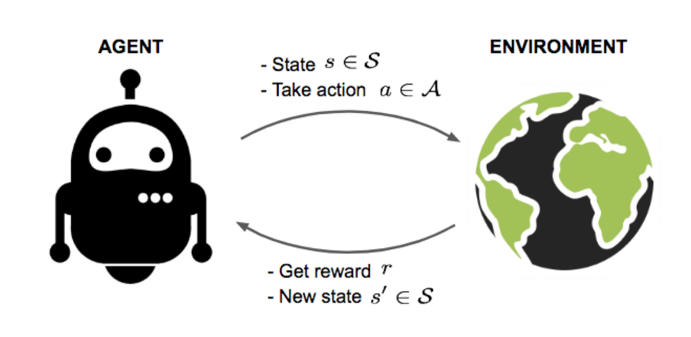
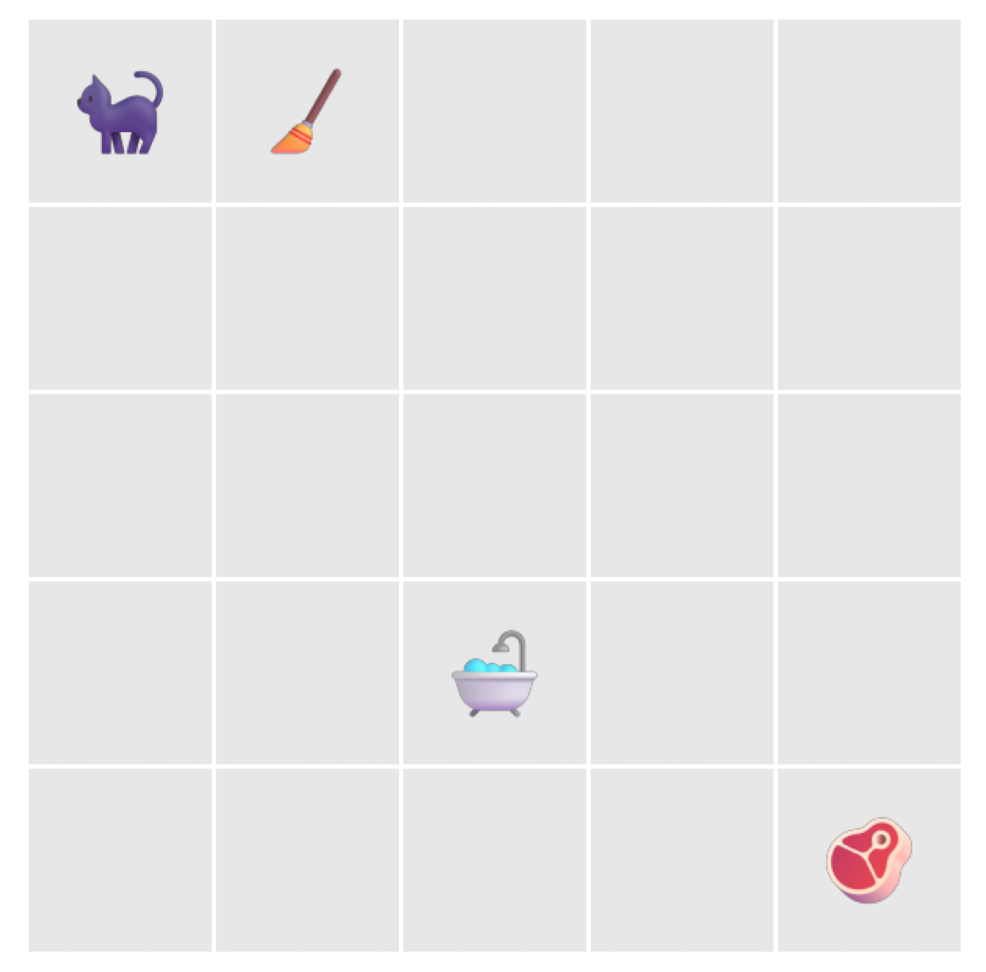
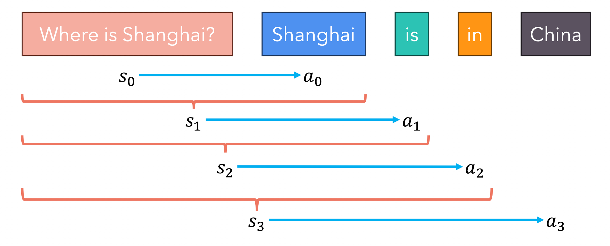
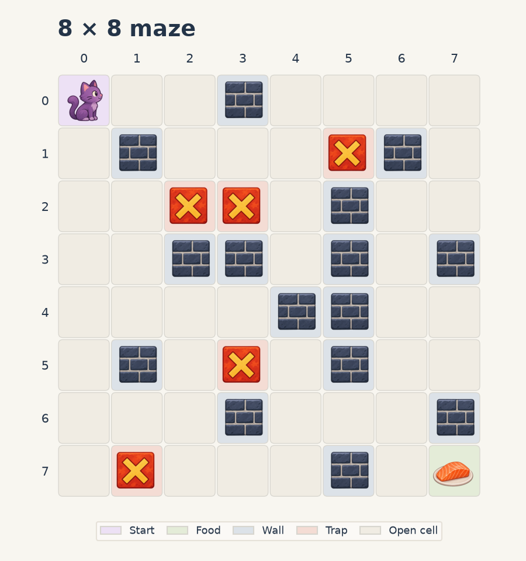
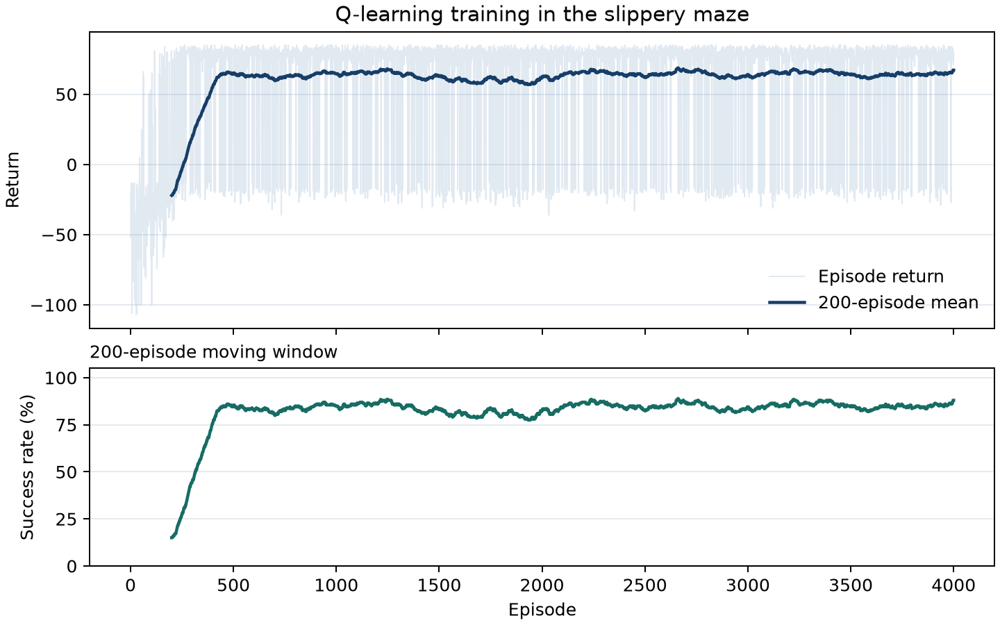
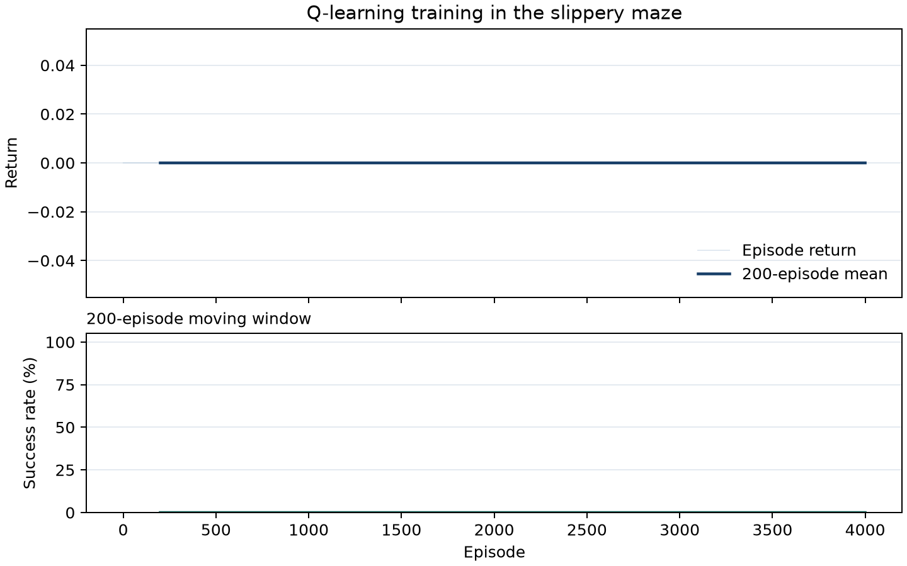
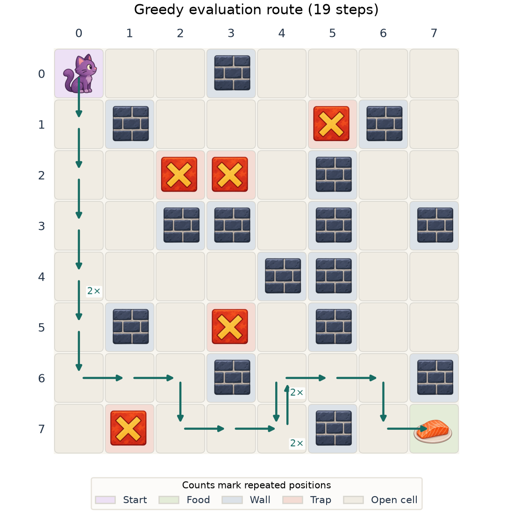
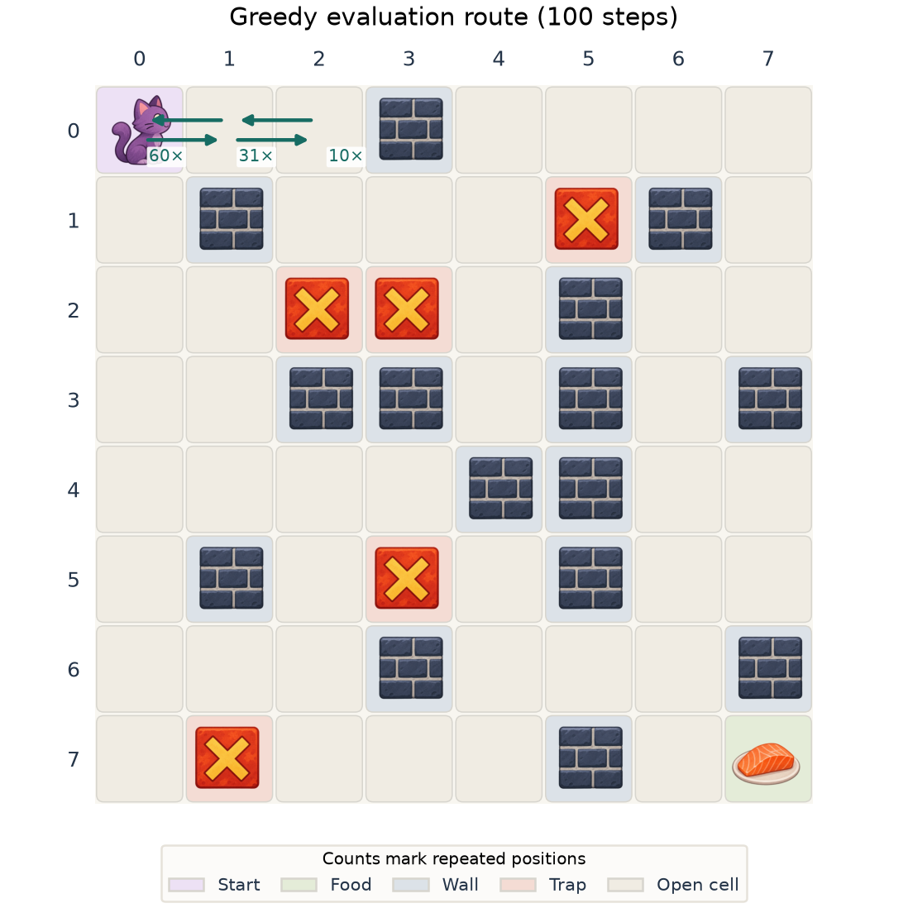

# 01.Q-learning
中文 | [English](README.en.md)

用表格型 Q-learning 训练一只猫穿过会打滑的 8×8 迷宫，绕开墙壁和陷阱，到右下角寻找食物。

<br>

## 目录

```text
01.Q-learning/
├── main.py                  # 实验入口
├── requirements.txt         # Python 依赖
├── environment/
│   ├── gridworld.py         # 地图、移动、打滑与奖励
│   ├── background.py        # 绘制迷宫底图
│   └── maze-icons.png       # 迷宫图标素材
├── run/
│   ├── agent.py             # Q 表、动作选择与更新
│   ├── baseline.py          # 无打滑最短路规划
│   ├── configs.json         # 迷宫、训练、评估与消融参数
│   ├── configs.py           # 读取实验配置
│   └── experiment.py        # 训练、评估与保存指标
├── tools/
│   └── plot.py              # 训练曲线与路线图
└── output/                 # 实验结果
```

<br>

## 强化学习基础

| 智能体与环境 | 猫找食物 | 文本生成中的状态和动作 |
| :---: | :---: | :---: |
| [](figures/agent-environment.png) | [](figures/cat-gridworld.png) | [](figures/token-actions.png) |

### 智能体与环境
第 $t$ 步，智能体观察状态 $s_t$，按策略选择动作 $a_t$。环境执行动作后返还奖励 $r_{t+1}$ 和新状态 $s_{t+1}$。智能体反复用这样的转移学习如何行动。折扣回报 $G_t$ 把这一步到回合结束的奖励加起来。折扣因子 $\gamma$ 小于 1 时，越晚收到的奖励权重越小。$T$ 是回合的总步数。

$$
G_t=\sum_{k=t}^{T-1}\gamma^{k-t}r_{k+1}
$$

### 猫找食物
先用这张 5×5 网格图理解状态、动作和奖励。猫当前所在的格子是状态，上、右、下、左是动作。坐标按 `(行, 列)` 记录，从 0 开始。

| 格子 | 坐标 | 进入后的奖励 | 回合结束 |
| --- | --- | ---: | --- |
| 猫的起点 | `(0, 0)` | $-1$ | 否 |
| 扫帚 | `(0, 1)` | $-10$ | 是 |
| 浴缸 | `(3, 2)` | $-10$ | 是 |
| 食物 | `(4, 4)` | $+100$ | 是 |
| 普通格子 | 其余位置 | $-1$ | 否 |

回合重置时，猫直接从起点出发。撞边界会留在原格，这一步仍记 $-1$。

### 文本生成中的状态和动作
图中 $s_0$ 是问题 “Where is Shanghai?”，动作 $a_0$ 生成 “Shanghai”。下一步的 $s_1$ 包含问题和刚生成的 “Shanghai”，动作 $a_1$ 选择 “is”。之后继续生成 “in” 和 “China”。这里的状态是完整前缀，动作是选下一个词元。奖励何时给、给多少取决于任务，例如可以在整段回答生成完后评分。

<br>

## Q-learning
### Q 表与动作选择
$Q(s,a)$ 估计从状态 $s$ 执行动作 $a$、随后采用最优策略时的期望折扣回报。`q_table` 按 `(行, 列, 动作)` 存储这些估计，8×8 迷宫的表尺寸为 $8\times8\times4$，初始值为 0。

训练和评估都采用纯贪心策略。智能体每步从当前格子的 Q 值中选出最大的动作，即 $a_t=\arg\max_a Q(s_t,a)$。Q 值并列时，按上、右、下、左的顺序取第一个。所选方向由 Q 表确定，实际移动仍可能因环境打滑而改变。
### 更新公式与代码
每走一步，代码用 `state`、`action`、`reward`、`next_state` 和 `terminated` 记下这次转移。`action` 是智能体原本选的方向。打滑可能改变环境返回的 `next_state` 和 `reward`，训练时用实际得到的转移更新原动作的 Q 值。目标值 $y_t$ 对应代码里的 `target`。

$$
y_t =
\begin{cases}
r_{t+1}, & \text{转移到终止格},\\
r_{t+1}+\gamma\max_{a'}Q(s_{t+1},a'), & \text{其余转移}.
\end{cases}
$$

$$
Q(s_t,a_t)\leftarrow Q(s_t,a_t)+\alpha\bigl[y_t-Q(s_t,a_t)\bigr].
$$

$\alpha$ 是学习率。`terminated` 为真时，目标只取即时奖励。其余情况下，`target` 加上折扣后的下一状态最大 Q 值。训练每步更新 `q_table` 中当前状态和所选动作对应的一个表项。评估使用训练完成的 Q 表选动作。[查看实现](../run/agent.py)

<br>

## 实验
### 8×8 打滑迷宫

| 迷宫地图 |
| :---: |
| [](figures/maze-map.png) |

智能体每步选择上、右、下、左中的一个方向。环境有 80% 的概率按所选方向移动，有 10% 的概率向它的左侧垂直方向打滑，有 10% 的概率向右侧垂直方向打滑。例如，选向右时可能实际向上或向下。

默认实验中，走进普通格奖励 $-1$。撞墙或越界会留在原格，这一步也记 $-1$。到达食物奖励 $+100$，踩到陷阱奖励 $-10$，两种情况都结束回合。每回合最多走 100 步。若第 100 步仍处于普通格，回合超时，累计回报为 $-100$，这一步的更新仍使用下一状态的最大 Q 值。
### 运行
从仓库根目录执行。

```bash
cd Reinforcement-learning/01.Q-learning
python -m pip install -r requirements.txt
python -c 'from pathlib import Path; from run.experiment import run_experiment; run_experiment(Path("output"))'
```

### 设置
默认实验和奖励消融均读取 [run/configs.json](../run/configs.json)。修改 `maze.layout` 即可调整迷宫布局。地图须为方形，并各有一个 `S`（起点）和 `G`（食物）。`#` 表示墙，`X` 表示陷阱，`.` 表示可通行的格子。

`maze` 也设置奖励、打滑概率和步数上限，`training` 和 `evaluation` 分别设置训练和评估，`reporting` 设置滑动统计窗口。

[environment/gridworld.py](../environment/gridworld.py) 管理迷宫和移动规则。[environment/background.py](../environment/background.py) 直接从 `gridworld` 读取地图并画底图。修改布局后，在实验目录运行以下命令刷新 README 的迷宫原图。重跑相应实验可以更新评估轨迹。

```bash
python -m environment.background
```

训练 4,000 回合，每次从 `(0, 0)` 出发。训练环境的随机种子为 43，用于生成打滑。学习率 $\alpha=0.2$，折扣因子 $\gamma=0.97$。

三种策略各在同一张打滑地图上评估 500 回合。每种策略的第 $i$ 回合都用相同的环境种子，种子范围为 10000 至 10499。

- **随机策略**均匀选择四个动作，动作种子为 44。
- **最短路策略**用广度优先搜索计算可通行格到食物的无打滑最短距离，每步按当前所在格重新选择方向。起点到食物的无打滑最短距离是 16 步。评估时仍有 20% 的打滑概率。[最短路实现](../run/baseline.py)
- **Q-learning 贪心策略**训练结束后固定 Q 表，在所在格选 Q 值最高的动作。

成功表示到达食物。一个走了 $T$ 步的回合按下式计算未折扣回报 $R(T)$。结果表对全部 500 个回合的回报取平均，平均成功步数只统计成功回合。

$$
R(T)=
\begin{cases}
100-(T-1), & \text{到达食物},\\
-10-(T-1), & \text{踩到陷阱},\\
-T, & \text{超时}.
\end{cases}
$$

### 结果

| 策略 | 到达食物 | 踩到陷阱 | 超时 | 平均回合回报 | 平均成功步数 |
| --- | :--: | :--: | :--: | :--: | :--: |
| 随机策略 | 1/500（0.2%） | 486 | 13 | −41.072 | 30.00 |
| 最短路策略 | 385/500（77.0%） | 115 | 0 | 57.408 | 21.26 |
| Q-learning 纯贪心策略 | 411/500（82.2%） | 89 | 0 | 61.802 | 21.51 |

智能体在第 44 个训练回合首次找到食物，用了 96 步，回报为 5。4,000 个训练回合中，3,216 个到达食物，779 个踩到陷阱，5 个超时。最后 200 个训练回合的成功率为 88.0%。

查看[实验记录](../output/results.json)，其中包含训练和评估数据。

<br>

## 奖励消融
比较普通步奖励 $-1$ 和 $0$。撞墙或越界原地停留时也按普通步计分，两组的陷阱奖励都是 $-10$，食物奖励都是 $+100$。两组从全零 Q 表分别训练，采用相同的 8×8 迷宫、打滑概率、纯贪心策略、随机种子、训练回合数和评估回合数。

在 `Reinforcement-learning/01.Q-learning` 下运行以下命令，复现两组结果。第一条命令使用 `maze.step_reward`，结果写入 `output/`。`main.py` 使用 `reward_ablation.step_reward`，结果写入 `output/reward_ablation/`。两组参数都在 [run/configs.json](../run/configs.json) 中。

```bash
python -c 'from pathlib import Path; from run.experiment import run_experiment; run_experiment(Path("output"))'
python main.py
```

| 普通步奖励 | 到达食物 | 踩到陷阱 | 超时 | 平均成功步数 | 按各自奖励的平均回报 | 统一按普通步 −1 计分的平均回报 |
| ---: | :--: | :--: | :--: | :--: | ---: | ---: |
| −1 | 411/500（82.2%） | 89 | 0 | 21.51 | 61.802 | 61.802 |
| 0 | 0/500（0.0%） | 0 | 500 | — | 0.000 | −100.000 |

成功率和超时次数采用同一判定标准。最后一列把两组已有的评估回合统一按普通步 $-1$、陷阱 $-10$、食物 $+100$ 重新计分。

普通步奖励为 0 时，4,000 个训练回合全部超时。Q 表从零开始，并列时选向上。在顶行，向上会撞边界或左右打滑，`(0, 3)` 的墙把猫留在前 3 格。每一步都得 0，Q 值因此始终并列。奖励为 −1 时，从全零 Q 表走出的首个普通步会把所选动作的 Q 值降到 −0.2，下一次遇到同一状态时便会优先考虑其他动作。

| 图 | 普通步奖励 −1 | 普通步奖励 0 |
| --- | :---: | :---: |
| 训练曲线 | [](../output/training.png) | [](../output/reward_ablation/training.png) |
| 评估轨迹 | [](../output/route.png) | [](../output/reward_ablation/route.png) |

两条轨迹都使用评估种子 10000。左图用 19 步到达食物，回报为 82。右图只经过 `(0, 0)`、`(0, 1)` 和 `(0, 2)`，100 步超时，按该组奖励计得 0 分。图中数字表示到访次数，原地停留也计入。

查看[消融实验记录](../output/reward_ablation/results.json)。


