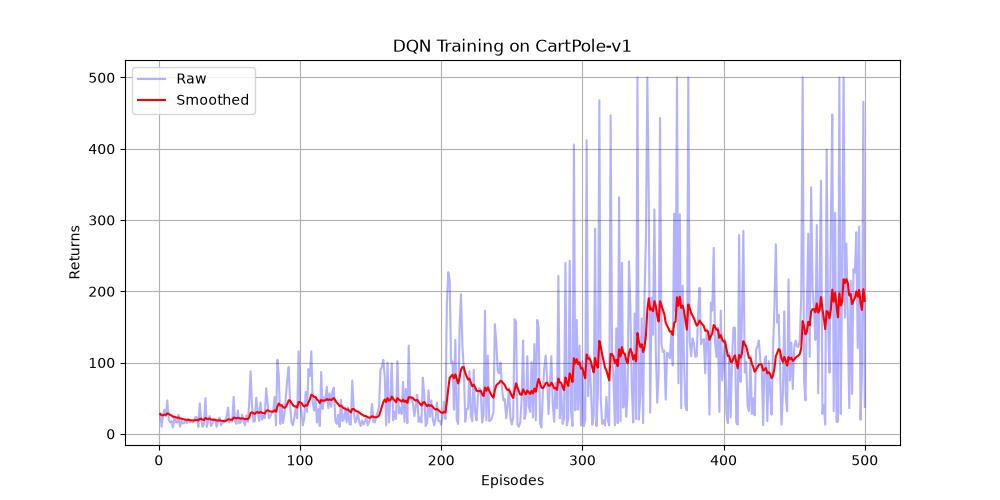
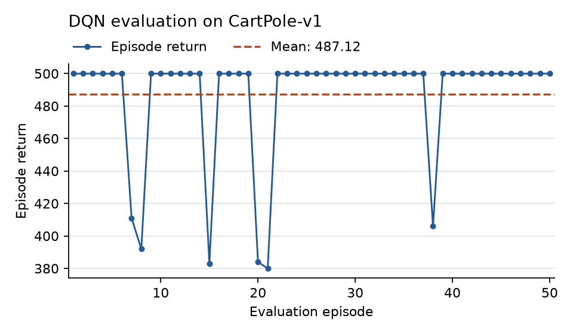

# Deep Q-Network
[中文](README.md) | English

<br>

## Directory Structure

```text
02.DQN
├── main.py                   # CartPole DQN entry point
├── output                    # Experiment results
├── requirements.txt
├── run
│   ├── agent.py              # Q-networks and DQN update
│   ├── configs.json          # CartPole settings
│   ├── configs.py            # Configuration loader
│   ├── replay.py             # Experience replay buffer
│   └── model.py              # Training, evaluation, and demo recording
└── tools
    ├── seed.py               # Random seeding
    └── plot.py               # Learning curves and GIFs
```

<br>

## Run the Experiment

From the repository root, run these commands.

```bash
cd Reinforcement-learning/02.DQN
python -m pip install -r requirements.txt
python main.py
```

DQN trains and evaluates on CartPole-v1. It saves the configuration, summary, and episode records in `output/results.json`, alongside the plots, demo GIF, and model weights. It uses a GPU when CUDA is available.

In [run/configs.json](../run/configs.json), set the number of training rounds with `train_episodes`, which defaults to 500 rounds. Each round is one complete episode, ending on `terminated` or `truncated`, with the environment's own time limit retained. The progress bar totals 500 episodes and advances once per completed episode. The training seed `seed` defaults to 42 and initializes the PyTorch, NumPy, and Python random number generators. Only the first training episode calls `reset(seed=42)`; later episodes continue the environment's random sequence. Evaluation resets each episode with `eval_seed + i`, using 50 distinct seeds, 20000–20049, by default. Fixed seeds make runs reproducible; they do not force identical episode returns.

Adam uses the fixed learning rate in `lr` throughout training, `3e-3` (0.003), without a learning rate schedule. `epsilon_decay` only decays the exploration rate after each episode; it does not change the learning rate.

<br>

## How DQN Works

DQN uses a neural network to estimate the value $Q_\omega(s,a)$ of taking action $a$ in state $s$. The TD target also depends on a network output. Computing predictions and targets with the same parameters on every update makes the targets move during training, which can cause oscillations.

- The **online network $Q_\omega$** (`q_net`) predicts the value of the current action. Gradient descent updates its parameters.
- The **target network $Q_{\omega^-}$** (`target_net`) estimates the value of the next state. It copies the online weights every $C$ gradient updates, where $C$ is `target_update`.

For replay sample $i$, $d_i$ is the `terminated` flag stored in replay. `done = terminated or truncated` controls when the episode ends. A transition that only reaches the time limit keeps the discounted value of the next state in its TD target. The TD target and mean squared error are

$$
y_i = r_i + \gamma (1-d_i) \max_{a'} Q_{\omega^-}(s_{i+1},a')
$$

$$
L(\omega) = \frac{1}{N} \sum_{i=1}^N \left[Q_\omega(s_i,a_i) - y_i\right]^2.
$$

Here $r_i$ is the immediate reward, $\gamma$ is the discount factor, and $N$ is the batch size. In `run/agent.py`, `q_values` holds the predictions and `q_targets` holds the TD targets.

<br>

## Algorithm

### Inputs
The state space $\mathcal S$, action space $\mathcal A$, discount factor $\gamma$, fixed learning rate $\alpha$, exploration rate $\epsilon$, target sync interval $C$, replay capacity $M$, batch size $N$, and the number of training episodes `train_episodes`.

### Steps

1. Initialize the online network, copy its weights to the target network, create replay buffer $R$, and set the initial exploration rate.
2. Reset the environment at the start of each episode. At each step, pick a random action with probability $\epsilon$ and otherwise take the action with the highest online Q-value. Act, accumulate the reward, and store $(s_t,a_t,r_t,s_{t+1},d_t)$.
3. Once the replay buffer exceeds `minimal_size`, sample $N$ transitions, compute the TD targets and loss, and update the online network. Sync the target network at the `target_update` interval. End the episode when `done` is true.
4. Decay exploration and advance the progress bar after each complete episode. $\epsilon \leftarrow \max(\epsilon_{\min}, \epsilon \lambda)$, where $\epsilon_{\min}$ and $\lambda$ are `epsilon_end` and `epsilon_decay`. Training ends after `train_episodes` complete episodes, with the learning rate fixed at `lr`.

<br>

## Key Components

- **Experience replay** uses a fixed-size buffer and replaces the oldest transitions when full. Random sampling reduces temporal correlation between samples.
- The **target network** holds its weights fixed between syncs, reducing how much the TD targets fluctuate as the online network updates.
- The **$\epsilon$-greedy policy** balances random exploration with taking the currently best estimated action. The exploration rate decreases during training.

<br>

## Full Training Results

CartPole-v1 completed 500 training episodes on 2026-11-20, with learning rate fixed at `3e-3` (0.003), training seed 42, and CUDA. The final online network then completed 50 greedy evaluation episodes with seeds 20000–20049. The values, plots, and GIFs below come from this actual run, with no early stopping or shortened environment time limits.

The `training` records include each episode's return, steps, exploration rate, learning rate, and end flags. The `evaluation` records include return, steps, seed, and end flags. Training and evaluation use raw environment rewards. The GIF uses a separate demo episode with seed 20050.

| Environment | Training episodes | Actual training steps | Mean training return, last 50 episodes |
| --- | ---: | ---: | ---: |
| CartPole-v1 | 500 | 42,423 | 188.36 |

Training uses an $\epsilon$-greedy policy: CartPole still selects a random action with probability about 0.082 in episode 500, while evaluation always selects the largest Q-value. The last 50 training returns and final greedy evaluation returns therefore measure different action policies; their difference alone does not establish policy degradation.

| Environment | Training curve | Demo |
| --- | --- | --- |
| CartPole-v1 | [](../output/training.png) | [GIF](../output/demo.gif) |

### Evaluation over 50 Episodes

Standard deviation is the population standard deviation (`ddof=0`). End counts separately count `terminated=True` and `truncated=True`.

| Environment | Episodes | Mean return | Std. dev. | Return range | Mean steps | terminated / truncated |
| --- | ---: | ---: | ---: | ---: | ---: | ---: |
| CartPole-v1 | 50 | 487.12 | 35.12 | 380 to 500 | 487.12 | 6 / 44 |

| CartPole-v1 |
| :---: |
| [](../output/evaluation.png) |

Each point is one episode's return; the dashed line marks the mean. Across 50 episodes, CartPole-v1 achieved a mean return of 487.12, with 6 environment terminations and 44 episodes reaching the 500-step time limit. This measures the final policy from this fixed configuration; high returns during training alone do not establish stable convergence.

### Files from This Run

The [experiment records](../output/results.json) contain `config`, `summary`, `training`, and `evaluation`. Re-evaluating the [final network weights](../output/weights.pt) with the same 50 seeds reproduced every stored return, episode length, and end flag.
