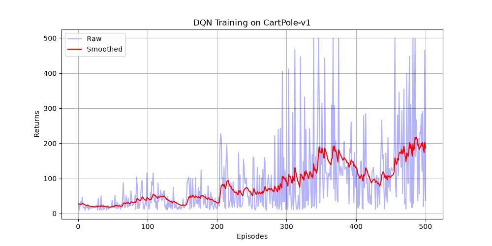
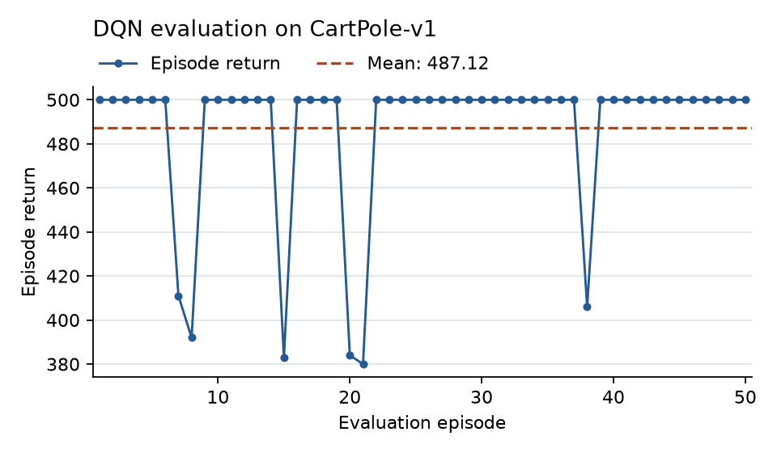

# Deep Q-Network
中文 | [English](README.en.md)

<br>

## 目录

```text
02.DQN
├── main.py                   # 运行 CartPole DQN
├── output                    # 实验结果
├── requirements.txt
├── run
│   ├── agent.py              # Q 网络与 DQN 更新
│   ├── configs.json          # CartPole 实验参数
│   ├── configs.py            # 读取实验配置
│   ├── replay.py             # 经验回放池
│   └── model.py              # 训练、评估和 GIF 录制
└── tools
    ├── seed.py               # 随机种子
    └── plot.py               # 学习曲线和 GIF
```

<br>

## 运行实验
从仓库根目录进入实验目录后运行。

```bash
cd Reinforcement-learning/02.DQN
python -m pip install -r requirements.txt
python main.py
```

在 CartPole-v1 上训练并评估。配置、汇总和逐回合记录保存在 `output/results.json`，图、演示 GIF 和模型权重也保存在 `output`。有 CUDA 时使用 GPU。

在 [run/configs.json](../run/configs.json) 中，用 `train_episodes` 设置训练轮次，默认训练 500 轮。一轮就是一个完整回合，直到环境返回 `terminated` 或 `truncated`，保留环境本身的回合时限。进度条总数为 500，每完成一轮更新一次。训练种子 `seed` 默认为 42，用于初始化 PyTorch、NumPy 和 Python 的随机数生成器。只有训练首回合调用 `reset(seed=42)`，之后的回合继续使用环境的随机数序列。评估按 `eval_seed + i` 重置每个回合，默认用 20000–20049 这 50 个不同种子。固定种子便于复现，不会强制各回合得到相同回报。

Adam 的学习率由 `lr` 设置，训练全程固定为 `3e-3`（0.003），不使用学习率衰减。`epsilon_decay` 只控制探索率的逐回合衰减，不改变学习率。

<br>

## DQN 原理
DQN 用神经网络估计状态 $s$ 下执行动作 $a$ 的价值 $Q_\omega(s,a)$。TD 目标也包含网络输出，如果用同一组参数实时计算预测值和目标值，目标会随训练变化，容易造成波动。

- **在线网络 $Q_\omega$**（`q_net`）计算当前动作的预测值，通过梯度下降更新。
- **目标网络 $Q_{\omega^-}$**（`target_net`）计算下一状态的价值，每隔 $C$ 次梯度更新从在线网络同步参数。$C$ 对应 `target_update`。

对回放池中的样本 $i$，令 $d_i$ 对应存入经验池的 `terminated`。`done = terminated or truncated` 控制何时结束回合。仅达到步数上限时，TD 目标保留折扣后的下一状态价值。TD 目标和均方误差分别为

$$
y_i = r_i + \gamma (1-d_i) \max_{a'} Q_{\omega^-}(s_{i+1},a')
$$

$$
L(\omega) = \frac{1}{N} \sum_{i=1}^N \left[Q_\omega(s_i,a_i) - y_i\right]^2.
$$

$r_i$ 是即时奖励，$\gamma$ 是折扣因子，$N$ 是采样批量大小。`run/agent.py` 中的 `q_values` 和 `q_targets` 分别是预测值和 TD 目标。

<br>

## 算法流程
### 输入参数
环境状态空间 $\mathcal S$、动作空间 $\mathcal A$、折扣因子 $\gamma$、固定学习率 $\alpha$、探索率 $\epsilon$、目标网络同步间隔 $C$、回放池容量 $M$、采样批量 $N$ 和训练轮次 `train_episodes`。
### 算法步骤

1. 初始化在线网络，将权重复制到目标网络，创建回放池 $R$ 并设置初始探索率。
2. 每个回合重置环境。在每一步，以概率 $\epsilon$ 随机选动作，其余情况选在线网络给出最大 Q 值的动作。执行动作，累计奖励并保存 $(s_t,a_t,r_t,s_{t+1},d_t)$。
3. 当回放池大小超过 `minimal_size` 时，随机采样 $N$ 条经验，计算 TD 目标和损失，再更新在线网络。按 `target_update` 的间隔同步目标网络。若 `done` 为真，则结束当前回合。
4. 每个完整回合结束后衰减探索率并更新进度条。$\epsilon \leftarrow \max(\epsilon_{\min}, \epsilon \lambda)$，其中 $\epsilon_{\min}$ 和 $\lambda$ 分别对应 `epsilon_end` 和 `epsilon_decay`。完成 `train_episodes` 轮后结束训练，学习率始终保持 `lr`。

<br>

## 关键设计

- **经验回放池**固定容量，存满后替换最旧的经验。随机采样减弱相邻经验的时序相关性。
- **目标网络**在两次同步之间保持参数固定，减小 TD 目标随在线网络更新而产生的波动。
- **$\epsilon$-贪婪策略**在随机探索和选择当前估计最优动作之间取舍，随训练逐步降低探索率。

<br>

## 本次完整训练结果

2026-11-20 按当前配置在 CartPole-v1 完成 500 个完整训练回合，学习率全程固定为 `3e-3`（0.003），训练种子为 42，使用 CUDA。随后用最终在线网络执行 50 回合贪婪评估，逐回合种子为 20000–20049。以下数值、曲线和 GIF 均来自这次实际运行，没有提前停止或缩短环境时限。

`training` 记录每回合的回报、步数、探索率、学习率和结束标记。`evaluation` 记录评估回合的回报、步数、种子和结束标记。训练和评估均使用环境原始奖励。GIF 使用种子 20050 的单独演示回合。

| 环境 | 训练回合 | 实际训练步数 | 最后 50 回合平均训练回报 |
| --- | ---: | ---: | ---: |
| CartPole-v1 | 500 | 42,423 | 188.36 |

训练采用 $\epsilon$-贪婪策略，CartPole 第 500 回合仍以约 0.082 的概率随机探索；评估始终选最大 Q 值动作。因此，最后 50 回合平均训练回报与最终贪婪评估回报采用不同的动作策略，不能直接据两者差值判断策略退化。

| 环境 | 训练曲线 | 演示 |
| --- | --- | --- |
| CartPole-v1 | [](../output/training.png) | [GIF](../output/demo.gif) |

### 50 回合评估

标准差为总体标准差（`ddof=0`）。结束计数分别统计 `terminated=True` 与 `truncated=True`。

| 环境 | 回合 | 平均回报 | 标准差 | 回报范围 | 平均步数 | terminated / truncated |
| --- | ---: | ---: | ---: | ---: | ---: | ---: |
| CartPole-v1 | 50 | 487.12 | 35.12 | 380 至 500 | 487.12 | 6 / 44 |

| CartPole-v1 |
| :---: |
| [](../output/evaluation.png) |

每个点代表一回合回报，虚线标出平均值。CartPole-v1 平均回报为 487.12，50 回合中 6 回合由环境终止、44 回合达到 500 步的时间上限。结果反映这次固定配置的最终策略，不能据训练中的高回报断言已经稳定收敛。

### 本次运行文件

[实验记录](../output/results.json) 中包含配置 `config`、汇总 `summary`、逐回合训练 `training` 和评估 `evaluation`。重新加载[最终网络权重](../output/weights.pt)并用同一组 50 个种子评估，逐回合回报、步数和结束标记均与存档一致。
