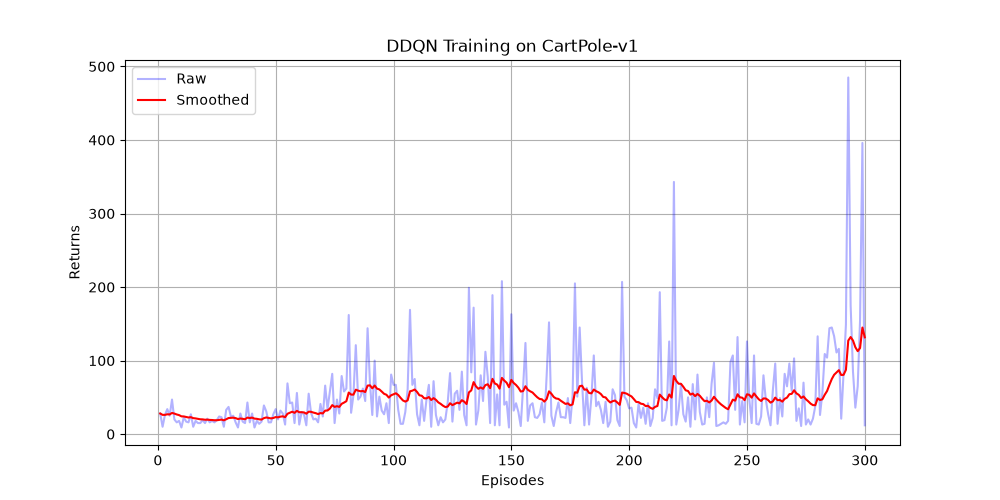
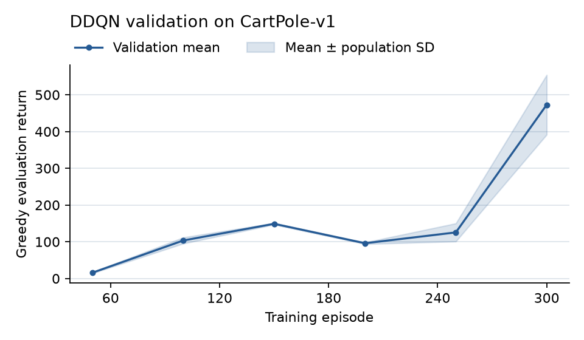
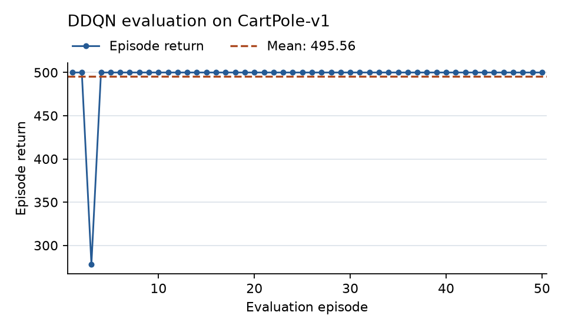
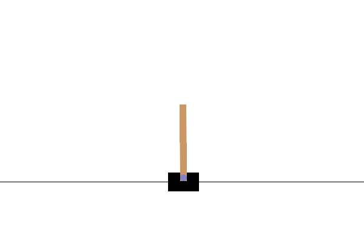

# Double DQN
[中文](README.md) | English

<br>

## Directory Structure

```text
03.DDQN
├── main.py                   # Training entry point
├── output                    # Experiment results
├── requirements.txt
├── run
│   ├── agent.py              # Q-networks and DDQN update
│   ├── replay.py             # Experience replay buffer
│   ├── model.py              # Training, validation, evaluation, and demo recording
│   └── configs
│       └── cartpole.json
└── tools
    ├── seed.py               # Random seeding
    └── plot.py               # Training, validation, evaluation plots, and GIFs
```

<br>

## Run the Experiment
From the repository root, run these commands.

```bash
cd Reinforcement-learning/03.DDQN
python -m pip install -r requirements.txt
python main.py
```

By default, DDQN completes 300 training episodes on CartPole-v1 and saves results in `output`. Every 50 episodes and at the end of training, it runs 10 greedy validation episodes in a separate environment with seeds 10000–10009. It retains the checkpoint with the highest validation mean without consuming the training random sequence. Training completes all configured episodes; validation selects the policy to save and display.

`results.json` contains the configuration, training, validation, and both evaluations. `weights.pt`, `evaluation.png`, and `demo.gif` show the selected policy. `final_weights.pt` holds the model at the end of training.

In `run/configs/cartpole.json`, set the number of training rounds with `train_episodes`. The default is 300 rounds. Each round is one complete episode, ending on `terminated` or `truncated`, with the environment's own time limit retained. The progress bar totals 300 episodes and advances once per completed episode. The training seed `seed` defaults to 42 and initializes the PyTorch, NumPy, and Python random number generators. Only the first training episode calls `reset(seed=42)`; later episodes continue the environment's random sequence. Both the selected and final checkpoints use `eval_seed + i` for test episodes, with 50 distinct seeds, 20000–20049, by default, separate from validation. Fixed seeds make runs reproducible; they do not force identical episode returns.

Adam uses the fixed learning rate in `lr` throughout training, without a learning rate schedule: `3e-3` (0.003). `epsilon_decay` only decays the exploration rate after each episode; it does not change the learning rate.

<br>

## How Double DQN Works
DQN computes its TD target using the largest Q-value from the target network. Selecting and evaluating an action with the same estimates favors estimates with positive errors, which can cause overestimation. Double DQN (DDQN) keeps experience replay and the target network, selects the action with the online network, and evaluates that action with the target network.

<br>

## DQN and DDQN
In the table, $d_i$ is the `terminated` flag stored in replay, $\theta$ and $\theta^-$ denote the online and target network parameters, and $\gamma$ is the discount factor.

| Aspect | DQN | DDQN |
| --- | --- | --- |
| Target computation | The target network selects and evaluates the action | The online network selects the action and the target network evaluates it |
| TD target | $r_i + \gamma (1-d_i)\max_{a'} Q_{\theta^-}(s_{i+1},a')$ | $r_i + \gamma (1-d_i)Q_{\theta^-}(s_{i+1},a_i^*)$ |
| Overestimation | The maximization can amplify estimation bias | Splitting the roles can reduce overestimation |
| Architecture | An online network and a target network with the same architecture | The same architecture |
| Computation | Computes next-state Q-values with the target network | Also computes next-state Q-values with the online network |

<br>

## Action Selection, Targets, and Loss
The online network (`q_net`) selects the action with the highest Q-value in the next state. `run/agent.py` stores the action in `max_next_action`.

$$
a_i^* = \arg\max_{a'} Q_\theta(s_{i+1},a')
$$

The target network (`target_net`) evaluates the selected action. $N$ is the batch size. `done = terminated or truncated` controls when the episode ends. The replay buffer records `terminated`. On termination, the TD target contains only the immediate reward $r_i$. A transition that only reaches the time limit keeps the discounted value of the next state.

$$
y_i^{\mathrm{DDQN}} = r_i + \gamma (1-d_i)Q_{\theta^-}(s_{i+1},a_i^*)
$$

$$
L(\theta) = \frac{1}{N}\sum_{i=1}^N \left[Q_\theta(s_i,a_i)-y_i^{\mathrm{DDQN}}\right]^2.
$$

`q_values` holds the predictions and `q_targets` holds the targets. The target network periodically copies the online weights, so their estimates can still be correlated.

<br>

## Algorithm

1. Initialize the online network, copy its parameters to the target network, create an experience replay buffer, and set the exploration rate $\epsilon$.
2. Reset the environment for each episode. Use the $\epsilon$-greedy policy to pick $a_t$, take the action, and store $(s_t,a_t,r_t,s_{t+1},d_t)$.
3. When the replay buffer exceeds `minimal_size`, sample a batch of transitions. Use the online network to choose the next actions and the target network to compute their TD targets. Update the online network with the mean squared error.
4. Sync the target network at the `target_update` interval. End the episode when `done` is true, then decay exploration using `epsilon_decay` and advance the progress bar. The learning rate stays fixed at `lr`.
5. Every 50 episodes and after the last episode, run independent greedy validation and retain the online network with the highest validation mean. Complete all `train_episodes`, then test both the selected and final checkpoints.

<br>

## When to Use It
DDQN can reduce overestimation while keeping the DQN network architecture. This example trains on the discrete actions of CartPole-v1. Its target calculation can be combined with prioritized experience replay (PER) and dueling networks, as in Rainbow.

<br>

## Fixed Learning Rate, 300-Episode Results
These results come from a fresh run of the current code completed on 2026-11-20: 300 complete CartPole-v1 training episodes, training seed 42, Adam learning rate fixed at `0.003`, and mean squared error loss. Configured hyperparameters match the DQN example except for the training budget: 300 episodes for DDQN and 500 for DQN. The run used PyTorch 2.11.0+cu128, Gymnasium 1.3.0, and CUDA, with one CPU computation thread. All 300 episode records in `training` show a learning rate of `0.003`.

| Complete training episodes | Actual environment steps | Last-50 mean training return | Selected checkpoint | Best validation mean |
| ---: | ---: | ---: | ---: | ---: |
| 300 | 15,268 | 80.24 | Episode 300 | 472.90 |

The red training line is an exponential moving average. The validation plot shows each of the 6 checkpoints' mean return on seeds 10000–10009, shaded by one population standard deviation above and below the mean. The `validation` records cover all 60 validation episodes.

| Returns over 300 training episodes | Independent validation |
| :---: | :---: |
| [](../output/training.png) | [](../output/validation.png) |

### 50-Episode Greedy Test
Both checkpoints use test seeds 20000–20049 with epsilon exploration disabled. Standard deviations are population standard deviations (`ddof=0`). Both evaluations record returns, episode lengths, end flags, and test seeds. Selection uses only the validation mean; test seeds do not participate in selection.

| Checkpoint | Mean return | Population std. dev. | Return range | Reached 500 steps | Online-network weights |
| --- | ---: | ---: | ---: | ---: | --- |
| Validation selection: episode 300 | 495.56 | 31.08 | 278 to 500 | 49/50 | [PyTorch](../output/weights.pt) |
| End of training: episode 300 | 495.56 | 31.08 | 278 to 500 | 49/50 | [PyTorch](../output/final_weights.pt) |

The plot and GIF show the selected episode-300 policy. Each point in the evaluation plot is one test episode, and the dashed line marks the mean. The demo uses another seed, 20050.

| Selected policy: 50 test episodes | Selected-policy demo (seed 20050) |
| :---: | :---: |
| [](../output/evaluation.png) | [](../output/demo.gif) |

### Checkpoints and Interpretation
Of the 6 checkpoints in this run, episode 300 has the highest validation mean, 472.90. The selected and final checkpoints are therefore the same model. Their test records are identical: 49 episodes reach the 500-step time limit, and 1 terminates at step 278. The program saves selected and final checkpoints separately so future runs can retain both when they differ.

Training uses epsilon-greedy actions, with epsilon approximately 0.223 in its last episode, so its mean includes exploratory actions. Testing disables exploration; training and test returns are measured under different policy conditions. This run uses one training seed, 42. The 50 test seeds measure this policy across different initial states; stable comparisons between algorithms require multiple training seeds and equal training budgets.

The [experiment records](../output/results.json) contain `config`, `summary`, and the per-episode `training`, `validation`, `evaluation`, and `final_evaluation` records.
