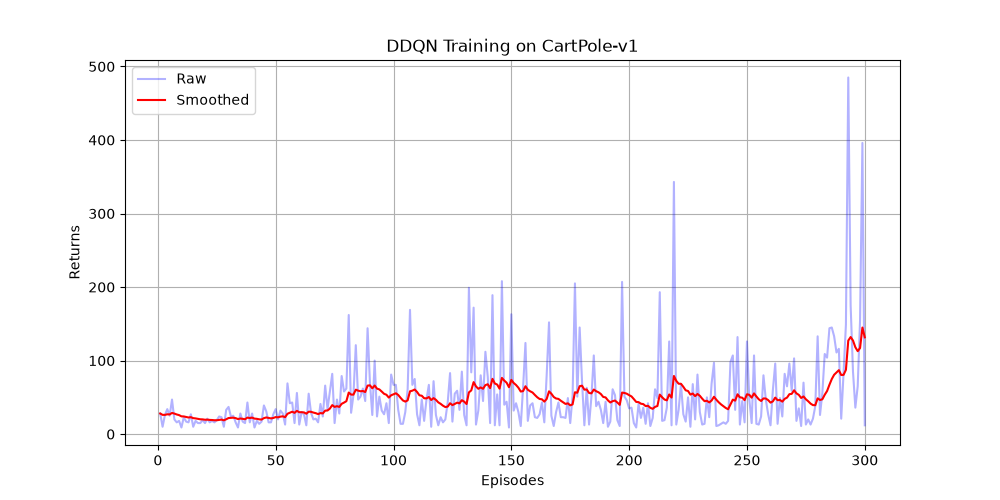
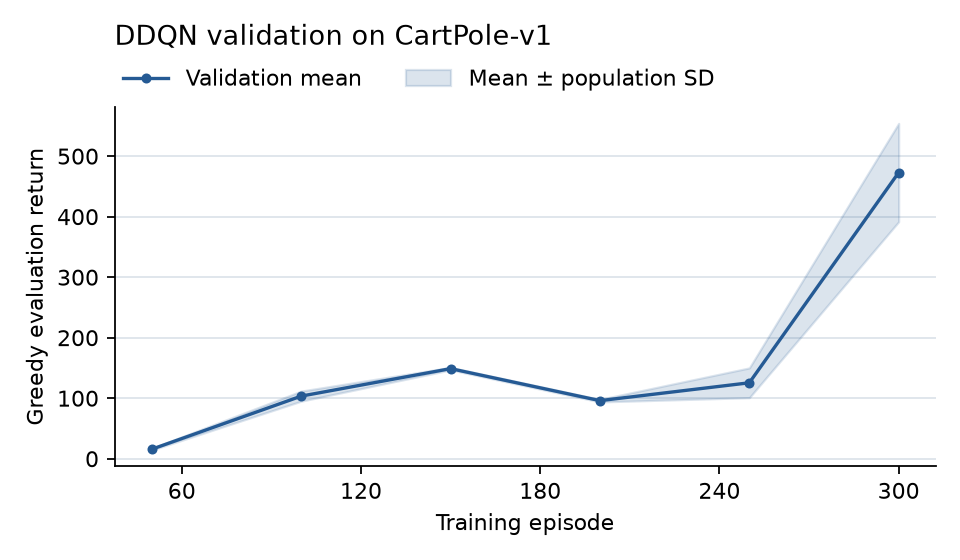
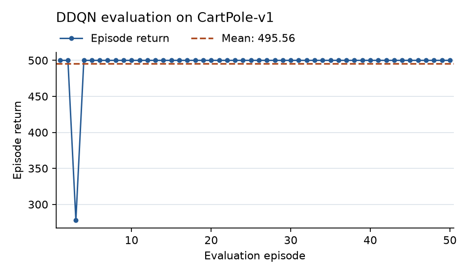
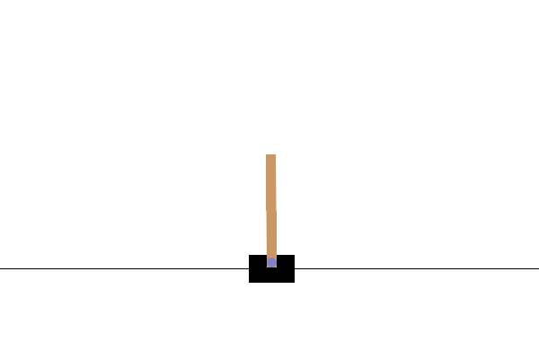

# Double DQN
中文 | [English](README.en.md)

<br>

## 目录

```text
03.DDQN
├── main.py                   # 运行 DDQN
├── output                    # 实验结果
├── requirements.txt
├── run
│   ├── agent.py              # Q 网络与 DDQN 更新
│   ├── configs.json          # CartPole 实验参数
│   ├── configs.py            # 读取实验配置
│   ├── replay.py             # 经验回放池
│   └── model.py              # 训练、验证、评估和 GIF 录制
└── tools
    ├── seed.py               # 随机种子
    └── plot.py               # 训练曲线、验证曲线、评估图和 GIF
```

<br>

## 运行
从仓库根目录运行。

```bash
cd Reinforcement-learning/03.DDQN
python -m pip install -r requirements.txt
python main.py
```

默认在 CartPole-v1 上完成 300 回合训练，结果保存到 `output`。程序每 50 回合及训练结束时，在独立环境中用种子 10000–10009 做 10 回合贪婪验证，保留验证平均回报最高的检查点；验证不消耗训练使用的随机数序列。训练完成配置的全部回合，验证负责选择保存和展示的策略。

`results.json` 汇总配置、训练、验证和两组评估结果。`weights.pt`、`evaluation.png` 和 `demo.gif` 对应验证选中的策略。`final_weights.pt` 保存训练结束时的模型。

在 [run/configs.json](../run/configs.json) 中，用 `train_episodes` 设置训练轮次，默认训练 300 轮。一轮就是一个完整回合，直到环境返回 `terminated` 或 `truncated`，保留环境本身的回合时限。进度条总数为 300，每完成一轮更新一次。训练种子 `seed` 默认为 42，用于初始化 PyTorch、NumPy 和 Python 的随机数生成器。只有训练首回合调用 `reset(seed=42)`，之后的回合继续使用环境的随机数序列。选中检查点与训练结束检查点都按 `eval_seed + i` 重置测试回合，默认用 20000–20049 这 50 个不同种子，与验证种子分开。固定种子便于复现，不会强制各回合得到相同回报。

Adam 的学习率由 `lr` 设置，训练全程固定，不使用学习率衰减：默认值为 `3e-3`（0.003）。`epsilon_decay` 只控制探索率的逐回合衰减，不改变学习率。

<br>

## 原理
DQN 的 TD 目标使用目标网络给出的最大 Q 值。同一组估计值同时用于动作选择和价值评估，取最大值时更容易选中带有正向误差的估计，引起过估计。Double DQN（DDQN）沿用经验回放和目标网络，把动作选择交给在线网络，把所选动作的评估交给目标网络。

<br>

## DQN 与 DDQN 对比
下表中，$d_i$ 对应经验池中的 `terminated`，$\theta$ 和 $\theta^-$ 分别是在线网络和目标网络的参数，$\gamma$ 是折扣因子。

| 对比维度 | DQN | DDQN |
| --- | --- | --- |
| 目标值计算 | 目标网络选动作并评估 | 在线网络选动作，目标网络评估 |
| TD 目标 | $r_i + \gamma (1-d_i)\max_{a'} Q_{\theta^-}(s_{i+1},a')$ | $r_i + \gamma (1-d_i)Q_{\theta^-}(s_{i+1},a_i^*)$ |
| 过估计 | 最大值运算会放大估计偏差 | 两个网络分工可缓解过估计 |
| 网络结构 | 在线网络和同结构的目标网络 | 沿用相同的网络结构 |
| 计算开销 | 计算目标网络的下一状态 Q 值 | 额外计算在线网络的下一状态 Q 值 |

<br>

## 动作选择、目标值与损失
在线网络（`q_net`）在下一状态选择 Q 值最大的动作。`run/agent.py` 将结果记为 `max_next_action`。

$$
a_i^* = \arg\max_{a'} Q_\theta(s_{i+1},a')
$$

目标网络（`target_net`）计算该动作的价值。$N$ 为采样批量大小。`done = terminated or truncated` 控制何时结束回合。经验池保存 `terminated`。环境真正终止时，TD 目标只含即时奖励 $r_i$。仅达到步数上限时，TD 目标仍包含折扣后的下一状态价值。

$$
y_i^{\mathrm{DDQN}} = r_i + \gamma (1-d_i)Q_{\theta^-}(s_{i+1},a_i^*)
$$

$$
L(\theta) = \frac{1}{N}\sum_{i=1}^N \left[Q_\theta(s_i,a_i)-y_i^{\mathrm{DDQN}}\right]^2.
$$

代码中的 `q_values` 和 `q_targets` 分别保存预测值和目标值。目标网络定期复制在线网络权重，两者的估计仍可能相关。

<br>

## 算法流程

1. 初始化在线网络并将参数复制给目标网络，创建经验回放池，设置探索率 $\epsilon$。
2. 每回合重置环境。每一步用 $\epsilon$-贪婪策略选择 $a_t$，执行动作并保存 $(s_t,a_t,r_t,s_{t+1},d_t)$。
3. 当回放池大小超过 `minimal_size` 时，随机采样一批转移。用在线网络选择下一动作，用目标网络评估并计算 TD 目标，最后以均方误差更新在线网络。
4. 按 `target_update` 的间隔同步目标网络。`done` 为真时结束当前回合，然后按 `epsilon_decay` 衰减探索率并更新进度条，学习率始终保持 `lr`。
5. 每 50 回合及最后一个回合做独立贪婪验证，保存验证均值最高的在线网络。完成 `train_episodes` 个完整回合后，分别测试选中的检查点和训练结束时的检查点。

<br>

## 优点与适用性
DDQN 可在沿用 DQN 网络结构的情况下缓解过估计。这个示例使用离散动作，在 CartPole-v1 上训练。其目标值计算可以和优先经验回放（PER）、Dueling 网络结构等改进一起使用，例如 Rainbow。

<br>

## 固定学习率 300 回合实测结果
以下结果来自 2026-11-20 按当前代码完成的重新训练：CartPole-v1 训练 300 个完整回合，训练种子为 42，Adam 学习率全程固定为 `0.003`，损失保持均方误差。除训练预算外，配置中的其他超参数与 DQN 示例一致：DDQN 训练 300 回合，DQN 训练 500 回合。运行使用 PyTorch 2.11.0+cu128、Gymnasium 1.3.0 和 CUDA，CPU 计算线程数为 1。`training` 中的 300 个回合记录的学习率均为 `0.003`。

| 完整训练回合 | 实际交互步数 | 最后 50 回合平均训练回报 | 选中检查点 | 最高验证均值 |
| ---: | ---: | ---: | ---: | ---: |
| 300 | 15,268 | 80.24 | 第 300 回合 | 472.90 |

训练图的红线为指数移动平均。验证图展示 6 个检查点各自在种子 10000–10009 上的平均回报，阴影为均值上下一个总体标准差。`validation` 保存全部 60 个验证回合。

| 300 回合训练曲线 | 独立验证曲线 |
| :---: | :---: |
| [](../output/training.png) | [](../output/validation.png) |

### 50 回合贪婪测试
两个检查点都使用种子 20000–20049 测试，关闭 epsilon 探索。标准差为总体标准差（`ddof=0`）。两组评估都记录回报、实际步数、结束标志和测试种子。选中检查点仅由验证均值决定，测试种子不参与选择。

| 检查点 | 平均回报 | 总体标准差 | 回报范围 | 达到 500 步 | 在线网络权重 |
| --- | ---: | ---: | ---: | ---: | --- |
| 验证集选择：第 300 回合 | 495.56 | 31.08 | 278 至 500 | 49/50 | [PyTorch](../output/weights.pt) |
| 训练结束：第 300 回合 | 495.56 | 31.08 | 278 至 500 | 49/50 | [PyTorch](../output/final_weights.pt) |

下图与 GIF 展示验证集选中的第 300 回合策略。评估图每个点代表一个测试回合，虚线标出均值；演示回合使用另一个种子 20050。

| 选中策略的 50 回合测试 | 选中策略演示（种子 20050） |
| :---: | :---: |
| [](../output/evaluation.png) | [](../output/demo.gif) |

### 检查点与结果解读
本次 6 个检查点中，第 300 回合的验证均值最高，为 472.90，因此选中检查点与训练结束检查点是同一个模型。两份测试记录一致：49 回合达到 500 步时限，1 回合在第 278 步终止。程序仍分别保存选中与最终检查点，便于后续运行中两者不同时核对结果。

训练采用 epsilon-贪婪策略，最后一回合使用的 epsilon 约为 0.223，训练均值包含探索动作。测试关闭探索；训练与测试的回报在不同策略条件下测得。本次只有一个训练种子 42；50 个测试种子衡量该策略在不同初始状态下的表现，算法之间的稳定比较仍需要多个训练种子和一致的训练预算。

[实验记录](../output/results.json) 包含配置 `config`、汇总 `summary`，以及逐回合记录 `training`、`validation`、`evaluation` 和 `final_evaluation`。
