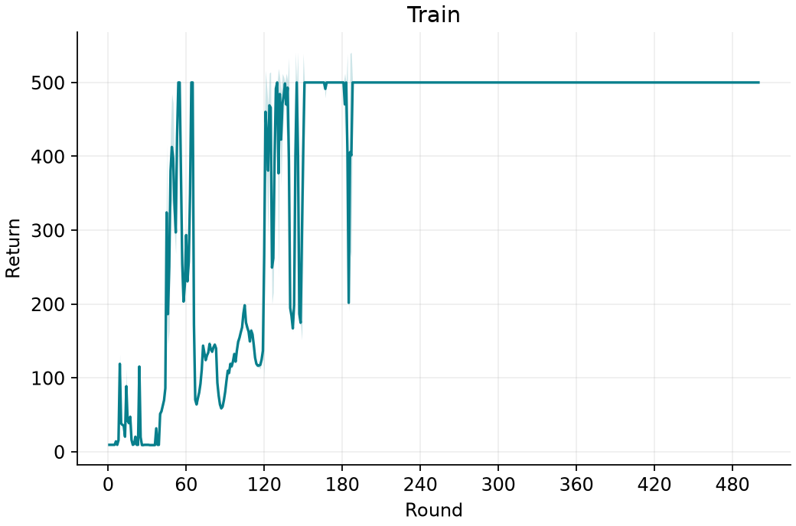
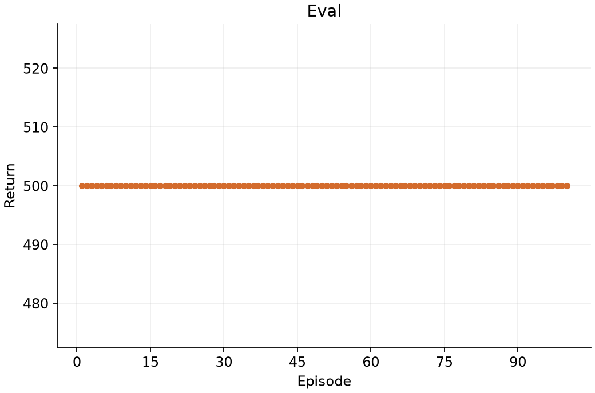
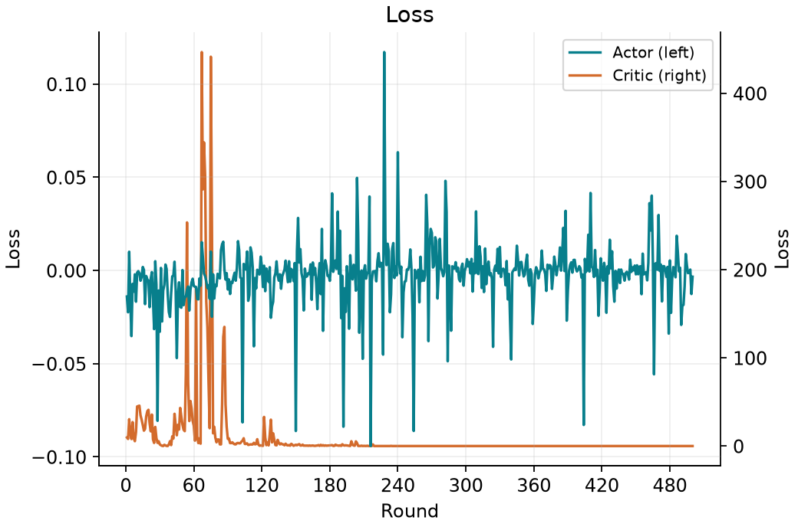
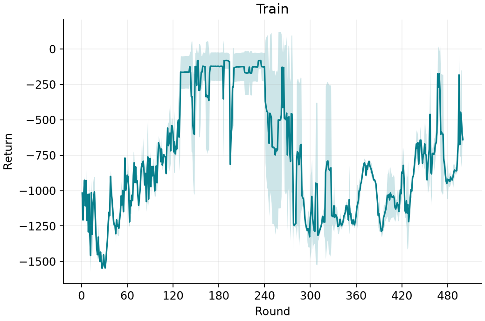
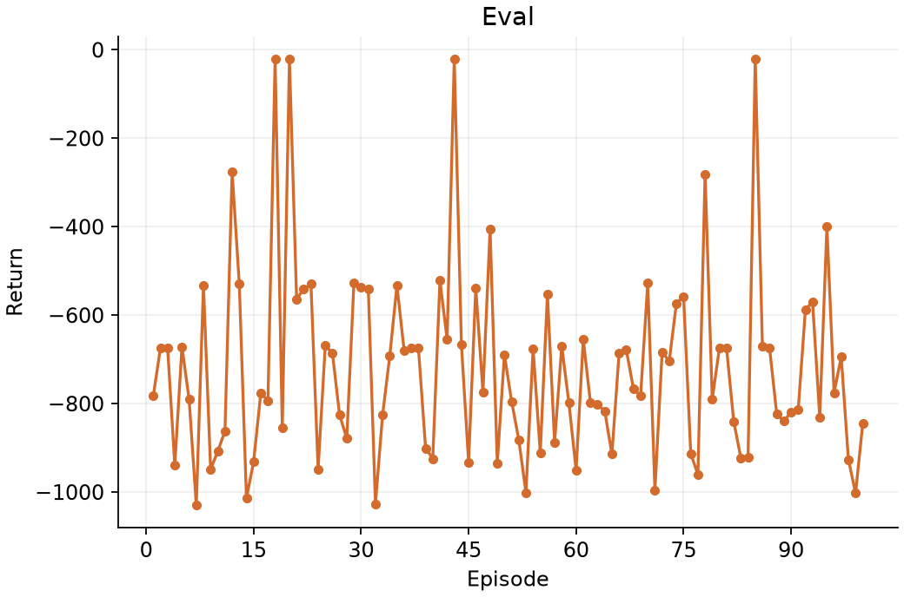
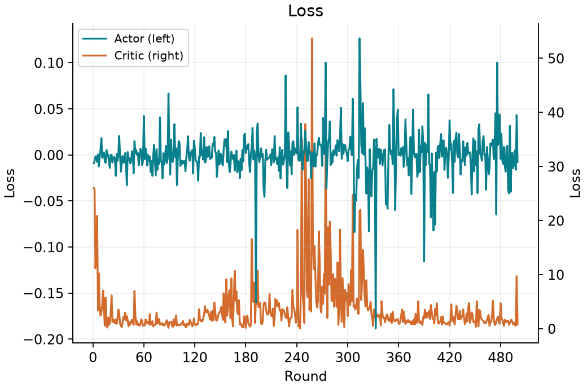

# PPO Theory and Experiments
[中文](README.md) | English

This PyTorch implementation combines PPO-Clip with generalized advantage estimation (GAE). It supports discrete actions and continuous actions with finite bounds. Training and batched inference use CUDA by default. Interactions with Gymnasium environments run on the CPU.

<br>

## 1. Directory Structure

```text
04.PPO/
├── main.py                      # Runs training, evaluation, and plotting
├── requirements.txt
├── run/
│   ├── agent.py                 # Actor, critic, distributions, configuration, rollouts, GAE, training, and evaluation
│   └── configs/
│       ├── cartpole.json
│       └── pendulum.json
├── tools/
│   ├── seed.py                  # Sets random seeds
│   ├── save.py                  # Saves parameters and logs
│   └── plot.py                  # Draws Train, Eval, and Loss plots
└── output/                     # Experiment results
```

<br>

## 2. How PPO Works
### Objective and Advantage
The policy $\pi_\theta(a\mid s)$ maximizes the expected discounted return. The advantage weights each action's contribution to the policy gradient.

$$
J(\theta)=\mathbb E_{\tau\sim\pi_\theta}\left[\sum_{t=0}^{T-1}\gamma^t r_t\right],
\qquad
\nabla_\theta J\propto\mathbb E\left[\nabla_\theta\log\pi_\theta(a_t\mid s_t)A^\pi(s_t,a_t)\right].
$$

The advantage $A^\pi(s,a)=Q^\pi(s,a)-V^\pi(s)$ measures how an action compares with the policy's average performance in that state. The actor learns action probabilities, and the critic estimates state values.
### GAE
GAE uses temporal-difference residuals to compute advantages recursively and form value targets.

$$
\delta_t=r_t+\gamma b_tV_\phi(s_{t+1})-V_\phi(s_t),
$$

$$
\hat A_t=\delta_t+\gamma\lambda c_t\hat A_{t+1},
\qquad
\hat R_t=\hat A_t+V_\phi(s_t).
$$

The two masks control bootstrapping and advantage propagation.

```text
b_t = 1 - terminated                 # Bootstrap from the next state
c_t = 1 - (terminated or truncated)  # Continue the advantage recursion
```

In `compute_gae` in [`run/agent.py`](../run/agent.py), $b_t$ is `bootstrap` and $c_t$ is `continue_trace`.

A true termination sets the bootstrap term to zero. A time-limit truncation uses the value of the final state before reset, while the advantage recursion stops at the episode boundary. The end of a rollout also uses the next state's value. The implementation computes $\hat R_t$ first and then normalizes the advantages across the batch, preserving the value targets.

`reward_scale` scales the training rewards that enter GAE. Logs and reward plots use the environment's raw returns.
### Probability Ratio
The probability ratio compares the old and current policies for the **same sampled action in the same state** when the old policy assigns it nonzero probability.

$$
\rho_t(\theta)
=\frac{\pi_\theta(a_t\mid s_t)}{\pi_{\mathrm{old}}(a_t\mid s_t)}
=\exp\left(\log\pi_\theta(a_t\mid s_t)-\log\pi_{\mathrm{old}}(a_t\mid s_t)\right).
$$

The old policy $\pi_{\mathrm{old}}$ collected the current round's trajectories. The current policy $\pi_\theta$ changes with each gradient update. Discrete actions use probabilities, and continuous actions use probability densities.

If the old policy assigns an action probability 0.2 and the current policy assigns it 0.3, then $\rho_t=1.5$, a 50% relative increase. A ratio $\rho_t>1$ means the action becomes more likely, $\rho_t<1$ means it becomes less likely, and $\rho_t=1$ means its probability stays the same. The estimated advantage $\hat A_t$ determines which direction the update favors.
#### Why Divide by the Old Policy Probability?
The update uses data collected by the old policy. For a fixed state $s$, treat the advantage estimate $\hat A(s,a)$ as a fixed function and assume the old policy covers every action the current policy can choose.

$$
\begin{aligned}
\mathbb E_{a\sim\pi_\theta(\cdot\mid s)}[\hat A(s,a)]
&=\sum_a\pi_\theta(a\mid s)\hat A(s,a)\\
&=\sum_a\pi_{\mathrm{old}}(a\mid s)
\frac{\pi_\theta(a\mid s)}{\pi_{\mathrm{old}}(a\mid s)}\hat A(s,a)\\
&=\mathbb E_{a\sim\pi_{\mathrm{old}}(\cdot\mid s)}
[\rho_\theta(s,a)\hat A(s,a)].
\end{aligned}
$$

This is importance weighting. The probability ratio adjusts the weight of each action sampled under the old policy. For continuous actions, the same identity uses integrals.

PPO uses the identity to define the unclipped surrogate objective.

$$
L^{\mathrm{PG}}(\theta)
=\mathbb E_{\substack{s\sim d_{\mathrm{old}}\\a\sim\pi_{\mathrm{old}}(\cdot\mid s)}}
\left[\rho_\theta(s,a)\hat A(s,a)\right],
$$

where $d_{\mathrm{old}}$ is the old policy's state visitation distribution. This implementation estimates the objective by averaging samples from the current rollout. The identity changes the action distribution at a fixed state. PPO retains the old policy's state distribution and advantage estimates, so the result is a surrogate for the new policy's long-term return. [PPO paper](https://arxiv.org/abs/1707.06347)
#### How the Ratio Affects the Policy Update
Maximizing $\rho_t\hat A_t$ favors increasing an action's probability when its advantage is positive and decreasing it when its advantage is negative. Holding the old probability and the advantage fixed gives the following gradient.

$$
\nabla_\theta\left[\rho_t(\theta)\hat A_t\right]
=\rho_t(\theta)\hat A_t\nabla_\theta\log\pi_\theta(a_t\mid s_t).
$$

The policies coincide at the start of the update, so $\rho_t=1$. The gradient can still be nonzero and takes the usual sample-based policy-gradient form. As the current policy changes, the ratio measures how the action probability has shifted since sampling. The clipping objective uses this ratio to control the incentive for larger changes.
#### Why Subtract Log Probabilities and Exponentiate?
The identity $\log p-\log q=\log(p/q)$ makes the two forms mathematically equivalent. The network computes the action's `log_prob` directly. Sampling stores `old_log_prob`, and the update recomputes `new_log_prob` for the same action.

```python
log_ratio = new_log_prob - old_log_prob
ratio = log_ratio.exp()
```

Computing the difference avoids reconstructing two potentially tiny probabilities before dividing. The continuous action distribution has independent dimensions, so the joint log probability is a sum across dimensions. The update holds `old_log_prob` and the advantage fixed, and the gradient flows through `new_log_prob` to the current policy.

This form improves numerical behavior. Very large log differences can still make the exponential overflow. The clipping objective and KL monitoring handle policy changes as described below.
### Clipped Objective and Total Loss
PPO applies clipping to the ratio-weighted advantage objective.

$$
L^{\mathrm{CLIP}}=\mathbb E_t\left[\min\left(\rho_t\hat A_t,
\operatorname{clip}(\rho_t,1-\epsilon,1+\epsilon)\hat A_t\right)\right].
$$

A positive advantage favors increasing the action probability, and a negative advantage favors decreasing it. Clipping limits the gain from changing it further. The code also monitors approximate KL divergence for early stopping because clipping leaves KL without a hard upper bound.

In `ppo_policy_loss`, `ratio` corresponds to $\rho_t$ and `clip_coef` corresponds to $\epsilon$.

The optimizer minimizes the following loss.

$$
L=-L^{\mathrm{CLIP}}+c_VL_V-c_H\mathcal H(\pi_\theta),
\qquad
L_V=\frac12\mathbb E_t\left[(V_\phi(s_t)-\hat R_t)^2\right].
$$

`value_coef` and `entropy_coef` correspond to $c_V$ and $c_H$. The critic uses squared error. The old log probabilities, advantages, and returns stay fixed throughout an update round.

```text
Collect rollout → compute GAE → normalize advantages → update over several mini-batch passes → sample again
```

PPO is usually classified as an online, on-policy algorithm because it reuses the newly collected data for a limited number of updates in each round.
### Action Distributions
The discrete actor outputs logits and uses `Categorical`. The continuous actor samples from a Gaussian and applies tanh to fit the action bounds.

$$
z\sim\mathcal N(\mu_\theta(s),\sigma_\theta^2),\quad a=b+c\tanh z,
\quad c=\frac{a_{\max}-a_{\min}}2,\quad b=\frac{a_{\max}+a_{\min}}2.
$$

The update accounts for the transformation in the log probability.

$$
\log\pi_\theta(a\mid s)=\sum_i\left[
\log\mathcal N(z_i;\mu_i,\sigma_i)-\log c_i-\log(1-\tanh^2z_i)\right].
$$

The rollout buffer stores the pre-tanh action $z$. The code computes the Jacobian correction with a numerically stable expression and estimates continuous policy entropy with differentiable sampling.

<br>

## 3. Experimental Results

### CartPole-v1 / seed42_run1

| Train | Eval | Loss |
|:---:|:---:|:---:|
|  |  |  |

[Experiment records](../output/CartPole-v1/seed42_run1/results.json)

### Pendulum-v1 / seed42_run1

| Train | Eval | Loss |
|:---:|:---:|:---:|
|  |  |  |

[Experiment records](../output/Pendulum-v1/seed42_run1/results.json)

Each `results.json` contains the configuration, summary, training records, monitoring episodes, optimizer updates, and final evaluation.

Both experiments ran for 500 rounds on CUDA with training seed `42` and a fixed learning rate of `0.003`. Each round collected one complete training episode and then performed one PPO update over multiple epochs.

After each update, the policy completed one monitoring episode on each of the fixed environment seeds `10000`, `10001`, and `10002`. Train shows the mean return across those three episodes with a band of ±1 standard deviation. After training, `final.pt` completed 100 deterministic evaluation episodes on seeds `30000` to `30099`. Eval shows the raw return for each episode.

### Results and Stability

The ± values below are population standard deviations across the 100 final evaluation episodes. All returns use the environment's original reward scale.

| Environment | Training rounds | Training interaction steps | Final 100-episode return | Minimum / median / maximum final return |
|---|---:|---:|---:|---:|
| CartPole-v1 | 500 | 181,865 | 500.0 ± 0.0 | 500.0 / 500.0 / 500.0 |
| Pendulum-v1 | 500 | 100,000 | −717.3 ± 216.1 | −1030.4 / −770.5 / −21.3 |

**CartPole reached the 500-step limit in all 100 final evaluation episodes.** All three monitoring seeds first scored 500 at round 54. They scored 500 every round from round 188 onward. By the end of round 188, the policy had collected 26,907 training steps.

**Pendulum's final evaluation return was −717.3 ± 216.1.** The three-seed monitoring mean peaked at −80.9 in round 190. Over the last 100 rounds, monitoring means ranged from −1218.8 to −174.5 and ended at −640.5. All final evaluation episodes lasted 200 steps, with returns from −1030.4 to −21.3 across starting states.

Pendulum uses `reward_scale=0.1` in its training targets. The logs, figures, and evaluation table report returns on the original environment reward scale.

### Losses and Updates

| Environment | PPO update rounds | Optimizer updates | Rounds with KL stopping | Mean approximate KL, last 100 rounds | Mean clip fraction, last 100 rounds |
|---|---:|---:|---:|---:|---:|
| CartPole-v1 | 500 | 13,407 | 349 | 0.00644 | 6.96% |
| Pendulum-v1 | 500 | 3,944 | 488 | 0.00722 | 7.63% |

- **Policy loss need not approach zero.** The implementation minimizes the negative clipped objective, so negative values follow its definition. Loss uses separate left and right axes for actor and critic losses; their magnitudes are not directly comparable.
- **KL stopping ends the remaining mini-batch updates within a round.** The current `target_kl=0.02` gives a stopping threshold of 0.03, checked before an update. All 500 training rounds completed. Mean KL is weighted by samples from completed optimizer updates; `max_approx_kl` also includes the batch that triggered stopping. A small mean can therefore coexist with stopping.
- **Clip fraction counts probability ratios outside the clipping interval.** It does not count actions at their bounds. Whether a sample's policy objective is flat also depends on the advantage sign and which bound was crossed.
- **Read explained variance alongside return.** Over Pendulum's last 50 rounds, mean EV was 0.770, the median was 0.798, and 25 rounds exceeded 0.8. $EV=1-\operatorname{Var}(\hat R-V)/\operatorname{Var}(\hat R)$. Extreme values can affect the mean; the logs did not record the denominator, so they cannot establish target variance as the cause of fluctuations.
- **Continuous-action entropy can be negative.** The estimate is differential entropy after the tanh action transformation and depends on action units. Pendulum's final Gaussian standard deviation was 0.422. Evaluation used the transformed mean action.

Advantage normalization changes the advantages used by the actor and leaves the critic's value targets on their original scale. Reward scaling changes the units of value loss, so its magnitude alone does not establish prediction quality. [CleanRL continuous-action PPO](https://docs.cleanrl.dev/rl-algorithms/ppo/#ppo_continuous_actionpy)

Pendulum collected 200 steps per round, used mini-batches of 64, and allowed up to 10 epochs. It completed 3,944 optimizer updates. Its 100,000 training steps, 300,000 monitoring steps, and 20,000 final evaluation steps totaled 420,000 interactions. Monitoring and final evaluation interactions did not contribute gradient updates.

### PPO Questions
Public candidate accounts informed the questions below. ByteDance accounts mention PPO loss, GAE, and returns. Tencent accounts cover project challenges and algorithm comparisons. Taotian accounts cover the optimization objective, Kuaishou accounts mention formulas and reward models, and Meituan accounts cover algorithm choice, learning rates, and batch size. These are individual reports. [ByteDance](https://www.nowcoder.com/feed/main/detail/3397b3e49b694830acdaa1a35db6694a), [Tencent](https://www.nowcoder.com/feed/main/detail/c8ddab6cf8ea467c9e4003c9256616cb?sourceSSR=users), [Taotian](https://www.nowcoder.com/feed/main/detail/aab1baa7bdde499d8b2f9f2d97efc7b5?sourceSSR=dynamic), [Kuaishou](https://www.nowcoder.com/feed/main/detail/9d24592752804d2790557f81230df62d), [Meituan](https://www.nowcoder.com/feed/main/detail/b87b9794a2114f7c818b40a3be51c4f0)

1. **Why is PPO usually called on-policy if it trains for 10 epochs on the same batch?**

    Each round begins with new trajectories collected by the current policy. PPO spends a limited number of updates on that batch and then samples again. Training for multiple epochs is a limited reuse of the current round's trajectories.

    During this update, the sampling policy stays fixed. The probability ratio $\rho_t=\pi_\theta(a_t\mid s_t)/\pi_{\mathrm{old}}(a_t\mid s_t)$ defines the surrogate objective, and clipping and KL monitoring help control changes to the policy. As updates proceed, the current policy drifts from the sampling policy, which limits how long the batch stays useful and rules out arbitrary stale replay data. **PPO stores the old log probabilities to compute the ratio. The on-policy classification comes from how it collects and refreshes data.** [PPO paper](https://arxiv.org/abs/1707.06347)

2. **Is the gradient always zero when the ratio leaves the clipping interval?**

    The outcome depends on the sign of advantage $A_t$ and the direction in which the ratio exceeded the bound. The per-sample clipped objective is $\min\!\left(\rho_t A_t,\operatorname{clip}(\rho_t,1-\epsilon,1+\epsilon)A_t\right)$. The following cases apply when the ratio lies strictly outside the interval.

    | Advantage and probability ratio | Is the sample's policy objective flat? |
    |---|---|
    | $A_t>0,\ \rho_t>1+\epsilon$ | Yes. Raising the action probability further gives no additional gain. |
    | $A_t>0,\ \rho_t<1-\epsilon$ | No. The gradient still favors raising the action probability. |
    | $A_t<0,\ \rho_t<1-\epsilon$ | Yes. Lowering the action probability further gives no additional gain. |
    | $A_t<0,\ \rho_t>1+\epsilon$ | No. The gradient still favors lowering the action probability. |

    For example, with $A_t=-1,\rho_t=1.3,\epsilon=0.2$, the two terms are $-1.3$ and $-1.2$. The minimum is $-1.3$, so the gradient is still present.

    **The zero-gradient case concerns the clipped policy term for that sample.** Other samples, the value loss, and the entropy term can still contribute gradients.

3. **What do PPO clipping, KL early stopping, and gradient clipping constrain?**

    | Method | Where it acts | Effect |
    |---|---|---|
    | PPO clipping | Policy surrogate objective | Removes the incentive to change a sample's probability further after it has moved too far in the favorable direction. |
    | KL early stopping | Update loop | Monitors estimated KL between policies and stops subsequent updates when it exceeds the threshold. |
    | Gradient clipping | After backpropagation | Caps the gradient norm to limit excessively large gradients. |

    Each mechanism covers a different part of the update. **The clipped objective leaves KL without a hard bound, and a small gradient norm can still accompany a large change in the action distribution.** KL early stopping depends on the estimate and check frequency. Completed updates normally remain in place. [Spinning Up PPO](https://spinningup.openai.com/en/latest/algorithms/ppo.html)

4. **Should the next state's value always be zero at the end of an episode?**

    Use the type of episode boundary to decide whether to bootstrap.

    - **True termination (`terminated=True`).** The task has ended. Omit the bootstrap term, so the TD target is $r_t$.
    - **External truncation (`truncated=True`) with a task that could otherwise continue.** Bootstrap from the last observation before truncation, so the TD target is $r_t+\gamma V(s_{t+1})$.

    In this project, Pendulum's 200-step limit is an external time truncation. The GAE recursion stops at reset. Bootstrapping uses **the final observation of the ending episode**, before the environment supplies a new initial observation.

    If the task itself defines a finite horizon, reaching that endpoint is a true termination. Decide whether to bootstrap based on the task definition. Omitting the bootstrap masks the next-state value term and leaves the network's prediction unchanged. [Gymnasium on time limits](https://gymnasium.farama.org/tutorials/gymnasium_basics/handling_time_limits/)

5. **What does the current rerun establish?**

    With training seed 42, 500 rounds, and a fixed learning rate of 0.003, the final models returned 500.0 ± 0.0 on CartPole and −717.3 ± 216.1 on Pendulum over 100 evaluation episodes. These are observations for the current configurations, environments, training budget, and evaluation initial states.

    The rerun did not vary reward scaling, gamma, or learning rate in controlled groups, so it cannot attribute a particular gain to one setting. Each environment has one independent training seed. The three monitoring seeds and 100 final evaluation seeds vary evaluation initial states. Comparing configurations and their stability requires repeating each configuration on the same set of independent training seeds with matched budgets, then comparing the resulting distributions.

6. **What does the shaded region for the three seeds in the training plot show?**

    After each update round, the **same policy** runs one complete episode on each of three fixed environment seeds. The line shows the mean of the three returns. The shade extends one standard deviation above and below that mean.

    The shade describes variation across those three initial conditions within one training run. Variation across training seeds and confidence intervals for the mean are separate quantities. A narrow band means the three returns were close.

7. **This project uses an actor and a critic. What else does PPO-based RLHF usually include?**

    Here, the actor outputs an action distribution and the critic estimates the state value. The environment supplies rewards. A typical PPO-based RLHF implementation has four logical roles.

    | Role | Purpose |
    |---|---|
    | Actor or policy model | Generates responses and is the main model being optimized. |
    | Critic or value model | Estimates expected returns for computing advantages. |
    | Reward model | Scores generated responses. |
    | Reference model | Supplies the comparison distribution for KL regularization and usually stays fixed. |

    **The old sampling policy supplies the denominator of the PPO ratio.** The RLHF reference model defines the distribution used to regularize policy drift. The two can start from the same parameters and serve different purposes. The four roles can share network components. [TRL PPO roles and metrics](https://huggingface.co/docs/trl/main/en/ppo_trainer)

The technical explanations draw on the PPO paper, Spinning Up, and the TRL metric definitions. [PPO paper](https://arxiv.org/abs/1707.06347), [Spinning Up](https://spinningup.openai.com/en/latest/algorithms/ppo.html), [TRL metric definitions](https://huggingface.co/docs/trl/main/en/ppo_trainer#explanation-of-the-logged-metrics)

The job listings emphasize different skills. Alibaba Agent highlights getting feedback from evaluation into the next iteration, Meituan LongCat highlights training stability and scale, and Unitree highlights simulation, control, and physical testing. This project demonstrates objective design, diagnosis, and experiment design. Doctoral roles may require more complex tasks and system evidence in the relevant area. [Alibaba Agent](https://campus-talent.alibaba.com/campus/position/199903260012), [Meituan LongCat](https://zhaopin.meituan.com/web/position/detail?highlightType=social&jobUnionId=4487581555), [Unitree](https://unitree.zhiye.com/campus/detail?jobAdId=84ea11e0-b4dd-43a0-89ec-1ca741f7c93a)

Each environment has one rerun with training seed 42. Reproducibility across training seeds requires independent runs. The GPU experiment covers a small MLP. Distributed training at large-model scale requires separate evidence.

<br>

## 4. References
[PPO paper](https://arxiv.org/abs/1707.06347) · [GAE paper](https://arxiv.org/abs/1506.02438) · [Gymnasium termination and truncation](https://gymnasium.farama.org/tutorials/gymnasium_basics/handling_time_limits/)
