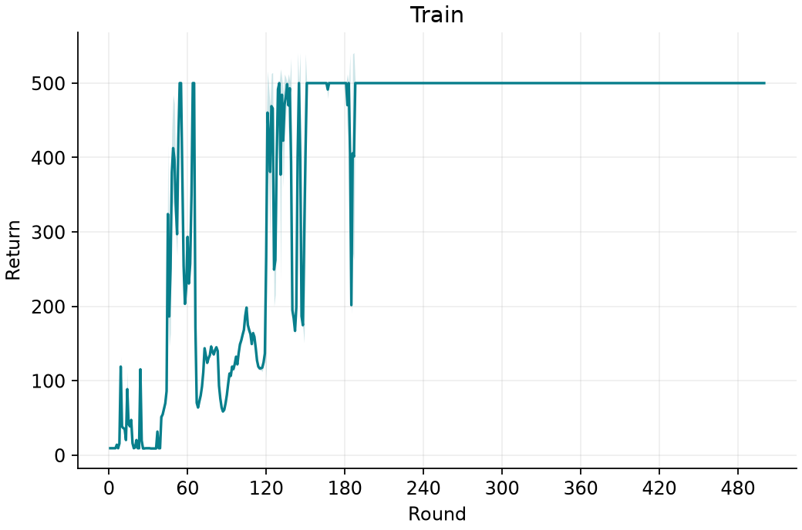
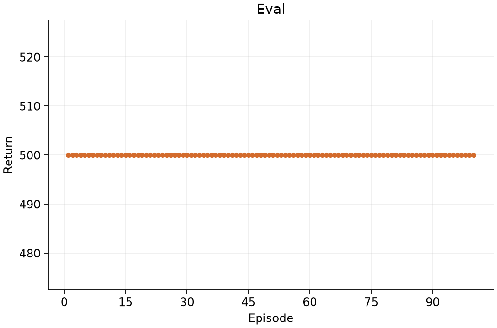
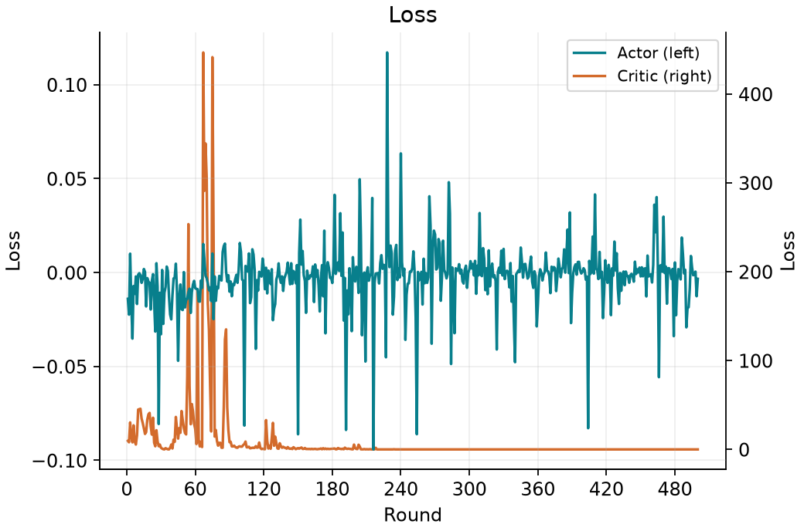
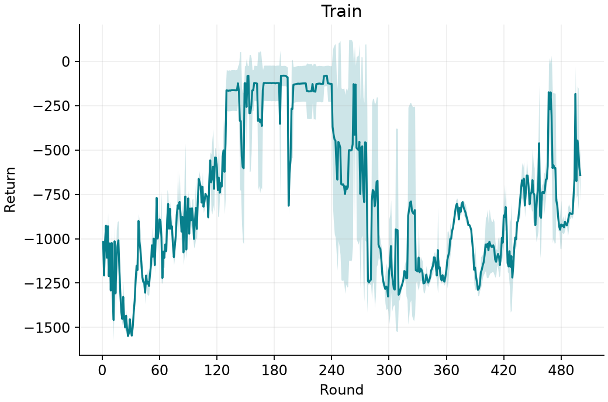
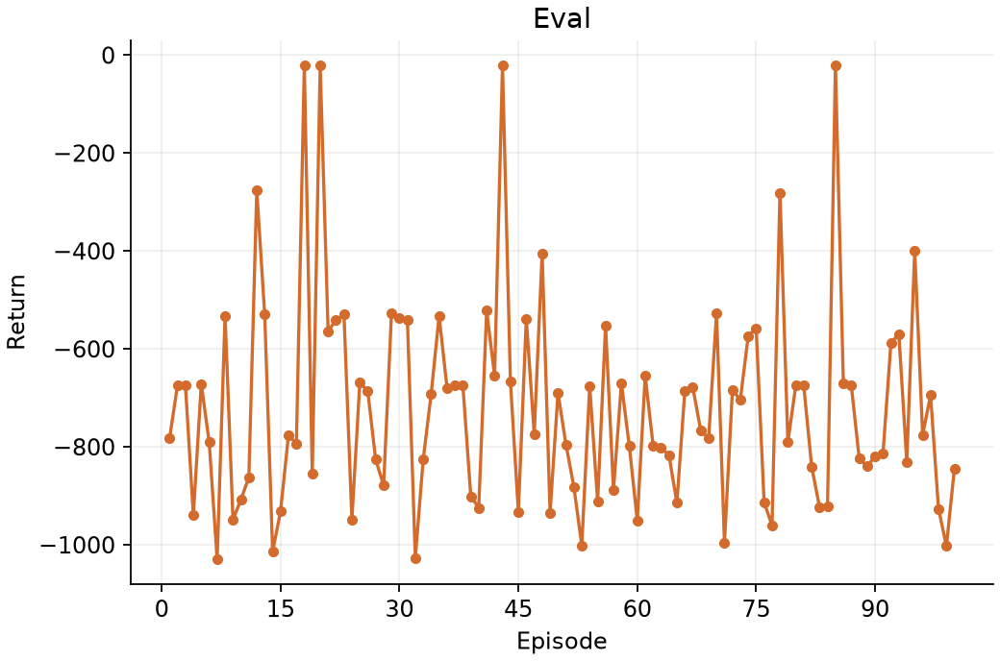
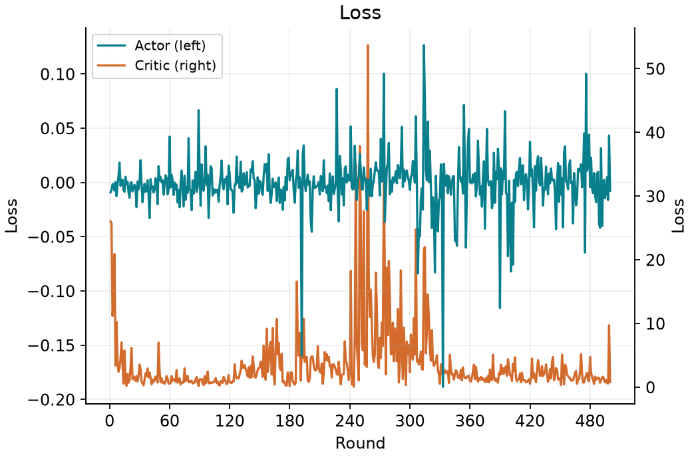

# PPO：原理与实验
中文 | [English](README.en.md)

PyTorch 实现 PPO-Clip + GAE，支持离散动作和有限边界的连续动作。默认使用 CUDA 训练与批量推理，Gymnasium 环境交互在 CPU 上运行。

<br>

## 1. 目录

```text
04.PPO/
├── main.py                      # 训练、评估、绘图入口
├── requirements.txt
├── run/
│   ├── agent.py                 # Actor/Critic、动作分布、配置、Rollout、GAE、训练与评估
│   └── configs.json              # 按环境 ID 保存训练配置
├── tools/
│   ├── seed.py                  # 随机种子
│   ├── save.py                  # 参数与日志保存
│   └── plot.py                  # Train、Eval、Loss
└── output/                     # 实验结果
```

### 运行
在 `main.py` 中用 `ENV_ID` 选择 `CartPole-v1` 或 `Pendulum-v1`。训练参数位于 `run/configs.json` 对应的环境条目。将 `MODE` 设为 `train`，并为新实验设置 `RUN_NUMBER`。默认设置将结果写入 `output/CartPole-v1/seed42_run2/`。

在 `04.PPO` 目录下运行：

```bash
python main.py
```

评估已有模型时，将 `MODE` 设为 `evaluate` 并设置 `RUN_DIR` 和 `CHECKPOINT`。重新生成已有实验的图表时，将 `MODE` 设为 `plot` 并设置 `RUN_DIR`。

<br>

## 2. PPO 原理
### 目标与优势
策略 $\pi_\theta(a\mid s)$ 的目标是最大化期望折扣回报：

$$
J(\theta)=\mathbb E_{\tau\sim\pi_\theta}\left[\sum_{t=0}^{T-1}\gamma^t r_t\right],
\qquad
\nabla_\theta J\propto\mathbb E\left[\nabla_\theta\log\pi_\theta(a_t\mid s_t)A^\pi(s_t,a_t)\right].
$$

优势 $A^\pi(s,a)=Q^\pi(s,a)-V^\pi(s)$ 衡量动作相对平均表现的好坏。Actor学习动作概率，Critic估计状态价值。
### GAE
用时序差分残差递推优势与价值目标：

$$
\delta_t=r_t+\gamma b_tV_\phi(s_{t+1})-V_\phi(s_t),
$$

$$
\hat A_t=\delta_t+\gamma\lambda c_t\hat A_{t+1},
\qquad
\hat R_t=\hat A_t+V_\phi(s_t).
$$

两个mask的职责不同：

```text
b_t = 1 - terminated                 # 是否bootstrap
c_t = 1 - (terminated or truncated)  # 是否继续优势递推
```

在 [`run/agent.py`](../run/agent.py) 的 `compute_gae` 中，$b_t$ 对应 `bootstrap`，$c_t$ 对应 `continue_trace`。

真实终止不bootstrap；时间截断使用reset前最后状态的value，但递推不能进入新回合。rollout边界也使用next value。先计算 $\hat R_t$，再标准化整批优势，保持价值目标不变。

`reward_scale` 只缩放进入GAE的训练奖励；日志与奖励图保留环境原始回报。
### 概率比率
概率比率比较新旧策略对**同一个状态、同一个已采样动作**的倾向。在旧策略概率非零处：

$$
\rho_t(\theta)
=\frac{\pi_\theta(a_t\mid s_t)}{\pi_{\mathrm{old}}(a_t\mid s_t)}
=\exp\left(\log\pi_\theta(a_t\mid s_t)-\log\pi_{\mathrm{old}}(a_t\mid s_t)\right).
$$

旧策略 $\pi_{\mathrm{old}}$ 是采集本轮轨迹时的策略，当前策略 $\pi_\theta$ 随梯度更新而变化。离散动作使用概率，连续动作使用概率密度。

例如，旧策略给某动作的概率为0.2，新策略给同一动作的概率为0.3，则 $\rho_t=1.5$，表示该动作的概率相对提高了50%。$\rho_t>1$ 表示更倾向于选择该动作，$\rho_t<1$ 表示更不倾向于选择，$\rho_t=1$ 表示两者给该动作的概率相同。动作是否值得提高概率，则由优势 $\hat A_t$ 判断。
#### 为什么需要除以旧策略概率
更新时使用的数据来自旧策略。对固定状态 $s$，将优势估计 $\hat A(s,a)$ 视为固定函数，并假设旧策略覆盖新策略可能选择的动作，则：

$$
\begin{aligned}
\mathbb E_{a\sim\pi_\theta(\cdot\mid s)}[\hat A(s,a)]
&=\sum_a\pi_\theta(a\mid s)\hat A(s,a)\\
&=\sum_a\pi_{\mathrm{old}}(a\mid s)
\frac{\pi_\theta(a\mid s)}{\pi_{\mathrm{old}}(a\mid s)}\hat A(s,a)\\
&=\mathbb E_{a\sim\pi_{\mathrm{old}}(\cdot\mid s)}
[\rho_\theta(s,a)\hat A(s,a)].
\end{aligned}
$$

这就是重要性加权：用旧策略采集的动作，通过概率比率调整它们在目标中的权重。连续动作时将求和换为积分。

PPO由此构造未裁剪的代理目标：

$$
L^{\mathrm{PG}}(\theta)
=\mathbb E_{\substack{s\sim d_{\mathrm{old}}\\a\sim\pi_{\mathrm{old}}(\cdot\mid s)}}
\left[\rho_\theta(s,a)\hat A(s,a)\right],
$$

其中 $d_{\mathrm{old}}$ 表示旧策略的状态访问分布，本实现用本轮rollout的样本均值估计代理目标。上述换分布等式针对固定状态下的动作分布；PPO仍沿用旧策略的状态分布和优势估计，因此该目标是代理目标，不能等同于新策略的完整长期回报。[PPO原论文](https://arxiv.org/abs/1707.06347)
#### 在策略更新中的作用
最大化 $\rho_t\hat A_t$ 时，正优势鼓励提高该动作的概率，负优势鼓励降低其概率。将旧概率和优势视为常量，有：

$$
\nabla_\theta\left[\rho_t(\theta)\hat A_t\right]
=\rho_t(\theta)\hat A_t\nabla_\theta\log\pi_\theta(a_t\mid s_t).
$$

更新起点处新旧策略相同，$\rho_t=1$，梯度仍可非零，此时就是普通策略梯度的样本形式。随着当前策略更新，比率反映该动作概率相对采样时的变化，并作为后续clipping的变量。比率本身不会限制策略变化。
#### 为什么用log相减再取exp
由 $\log p-\log q=\log(p/q)$ 可知，log差取exp与概率直接相除在数学上等价。网络通常直接计算动作的 `log_prob`，采样时保存 `old_log_prob`，更新时重新计算同一动作的 `new_log_prob`：

```python
log_ratio = new_log_prob - old_log_prob
ratio = log_ratio.exp()
```

这样避免先分别还原可能很小的概率，再做除法。本项目的连续动作分布按维独立，因此联合log probability可对各维求和，避免直接连乘各维密度。`old_log_prob` 与优势在本轮更新中保持固定，梯度通过 `new_log_prob` 回到当前策略。

这种写法改善数值计算，但不保证任意大的log差取exp后都不会溢出，也不把比率限制在裁剪区间内。裁剪与KL监测的作用见下节。
### 裁剪目标与总损失
PPO在概率比率加权的优势目标上加入clipping：

$$
L^{\mathrm{CLIP}}=\mathbb E_t\left[\min\left(\rho_t\hat A_t,
\operatorname{clip}(\rho_t,1-\epsilon,1+\epsilon)\hat A_t\right)\right].
$$

正优势提高动作概率，负优势降低概率；裁剪限制继续改变概率带来的目标收益。Clip不保证KL硬上界，代码另用approximate KL提前停止更新。

`ppo_policy_loss` 中的 `ratio` 对应 $\rho_t$，`clip_coef` 对应 $\epsilon$。

实际最小化：

$$
L=-L^{\mathrm{CLIP}}+c_VL_V-c_H\mathcal H(\pi_\theta),
\qquad
L_V=\frac12\mathbb E_t\left[(V_\phi(s_t)-\hat R_t)^2\right].
$$

`value_coef`、`entropy_coef` 对应 $c_V$、$c_H$；value使用MSE。同一轮更新中，旧log probability、优势和return保持固定。

```text
采集rollout → 计算GAE → 标准化优势 → 多轮mini-batch更新 → 重新采样
```

PPO通常归为在线、on-policy算法；每轮仅复用刚采集的数据。
### 动作分布
离散Actor输出logits，使用 `Categorical`。连续Actor使用高斯分布，经tanh映射到动作边界：

$$
z\sim\mathcal N(\mu_\theta(s),\sigma_\theta^2),\quad a=b+c\tanh z,
\quad c=\frac{a_{\max}-a_{\min}}2,\quad b=\frac{a_{\max}+a_{\min}}2.
$$

更新时的log probability包含变换修正：

$$
\log\pi_\theta(a\mid s)=\sum_i\left[
\log\mathcal N(z_i;\mu_i,\sigma_i)-\log c_i-\log(1-\tanh^2z_i)\right].
$$

缓存保存tanh前的 $z$；Jacobian使用稳定计算式，连续策略entropy用可微采样估计。

<br>

## 3. 实验结果

### CartPole-v1 / seed42_run1

| Train | Eval | Loss |
|:---:|:---:|:---:|
|  |  |  |

[实验记录](../output/CartPole-v1/seed42_run1/results.json)

### Pendulum-v1 / seed42_run1

| Train | Eval | Loss |
|:---:|:---:|:---:|
|  |  |  |

[实验记录](../output/Pendulum-v1/seed42_run1/results.json)

每组的 `results.json` 包含实际配置、汇总、逐轮训练、监测回合、优化更新和终评记录。

两组实验均使用训练种子 `42` 和固定学习率 `0.003`，在 CUDA 上完成 500 轮。每轮采集一个完整训练回合，再执行一次 PPO 多 epoch 更新。

每轮更新后，用环境种子 `10000`、`10001`、`10002` 各评估一回合。Train 图绘制这三个回报的均值，阴影覆盖均值上下各一个标准差。训练结束后，用 `final.pt` 在种子 `30000` 至 `30099` 上做 100 回合确定性评估，Eval 图展示这 100 个回合的原始回报。

### 结果与稳定性

表中±表示100个终评回合的总体标准差，回报均未缩放。

| 环境 | 训练轮数 | 训练交互步 | 最终100回合Return | 终评最小／中位／最大Return |
|---|---:|---:|---:|---:|
| CartPole-v1 | 500 | 181,865 | 500.0 ± 0.0 | 500.0／500.0／500.0 |
| Pendulum-v1 | 500 | 100,000 | −717.3 ± 216.1 | −1030.4／−770.5／−21.3 |

**CartPole 的 100 个终评回合都达到 500 步上限。** 三个监测种子首次同时达到 500 分是在第 54 轮。从第 188 轮起，三者每轮都达到 500 分。第 188 轮结束时累计了 26,907 个训练交互步。

**Pendulum 的终评回报为 −717.3 ± 216.1。** 第 190 轮的三种子监测均值最高，为 −80.9。最后 100 轮的监测均值在 −1218.8 至 −174.5 之间波动，第 500 轮为 −640.5。终评回合都运行 200 步，但回报从 −1030.4 到 −21.3，说明在不同起点上表现差异较大。

Pendulum 在训练目标中用 `reward_scale=0.1` 缩放奖励。日志、图和终评表中的回报均按原始环境奖励计算。

### 损失与更新

| 环境 | PPO更新轮数 | 优化器更新次数 | 触发KL停止的轮数 | 后100轮平均approximate KL | 后100轮平均clip fraction |
|---|---:|---:|---:|---:|---:|
| CartPole-v1 | 500 | 13,407 | 349 | 0.00644 | 6.96% |
| Pendulum-v1 | 500 | 3,944 | 488 | 0.00722 | 7.63% |

- **Policy loss不要求降至0。** 本项目最小化负的裁剪目标，负值符合定义；Loss图分别用左右纵轴展示Actor和Critic损失，两条曲线的量级不能直接比较。
- **KL停止只结束本轮剩余mini-batch更新。** 当前`target_kl=0.02`，代码在更新前用0.03作为停止阈值；500轮训练全部完成。日志中的平均KL按已执行更新的样本数加权，`max_approx_kl`另行包含触发停止的batch，因此平均值较小也可能触发停止。
- **clip fraction是概率比率越界比例。** 它不是动作达到边界的比例；该样本的策略目标是否平坦，还取决于优势符号和越界方向。
- **EV需要结合回报阅读。** Pendulum后50轮解释方差均值为0.770，中位数为0.798，其中25轮高于0.8。$EV=1-\operatorname{Var}(\hat R-V)/\operatorname{Var}(\hat R)$，均值会受极端值影响；日志未记录分母，不能据此确认波动来自目标方差。
- **连续动作熵可以为负。** 此处估计tanh变换后动作分布的微分熵，受动作单位影响。Pendulum最终高斯标准差为0.422；终评使用变换后的均值动作。

优势标准化只处理Actor使用的优势，不会自动归一化Critic的价值目标。奖励缩放会改变value loss的单位，不能仅凭损失数值大小判断价值预测质量。[CleanRL连续动作PPO](https://docs.cleanrl.dev/rl-algorithms/ppo/#ppo_continuous_actionpy)

Pendulum每轮采集200步、mini-batch为64、最多10个epoch；实际共完成3,944次优化器更新。训练交互为100,000步，固定三种子监测为300,000步，最终评估为20,000步，合计420,000步。监测和终评交互不参与梯度更新。

### PPO 关键问题
公开候选人自述中，[字节](https://www.nowcoder.com/feed/main/detail/3397b3e49b694830acdaa1a35db6694a)涉及PPO损失、GAE和returns，[腾讯](https://www.nowcoder.com/feed/main/detail/c8ddab6cf8ea467c9e4003c9256616cb?sourceSSR=users)涉及项目挑战与算法比较，[淘天](https://www.nowcoder.com/feed/main/detail/aab1baa7bdde499d8b2f9f2d97efc7b5?sourceSSR=dynamic)涉及优化目标，[快手](https://www.nowcoder.com/feed/main/detail/9d24592752804d2790557f81230df62d)涉及公式和奖励模型，[美团](https://www.nowcoder.com/feed/main/detail/b87b9794a2114f7c818b40a3be51c4f0)涉及选型、学习率和batch。这些样本用于选择复习方向，不代表公司的统一题库。

1. **同一批数据训练10个epoch，为什么PPO仍通常归为on-policy？**

    PPO每轮先用当前策略采集一批新轨迹，再对这批数据进行有限次数的更新，更新结束后重新采样。同一批数据训练多个epoch，是对本轮轨迹的有限复用。

    更新期间，采样策略保持固定，用概率比率 $\rho_t=\pi_\theta(a_t\mid s_t)/\pi_{\mathrm{old}}(a_t\mid s_t)$ 构造代理目标，并通过clipping、KL监测等方式控制策略偏移。随着更新进行，当前策略已经不同于采样策略，因此不能无限复用这批数据，也不能直接加入任意陈旧的replay数据。**固定旧log probability是计算比率的需要，本身不能作为判定on-policy的依据。** [PPO原论文](https://arxiv.org/abs/1707.06347)

2. **概率比率超出clip区间后，梯度一定为0吗？**

    不一定，取决于优势 $A_t$ 的符号和越界方向。对单个样本的裁剪目标 $\min\!\left(\rho_t A_t,\operatorname{clip}(\rho_t,1-\epsilon,1+\epsilon)A_t\right)$，严格越界时：

    | 优势与概率比率 | 该样本的策略目标是否进入常数区 |
    |---|---|
    | $A_t>0,\ \rho_t>1+\epsilon$ | 是，继续提高该动作概率不再增加目标值 |
    | $A_t>0,\ \rho_t<1-\epsilon$ | 否，仍有提高该动作概率的梯度 |
    | $A_t<0,\ \rho_t<1-\epsilon$ | 是，继续降低该动作概率不再增加目标值 |
    | $A_t<0,\ \rho_t>1+\epsilon$ | 否，仍有降低该动作概率的梯度 |

    例如 $A_t=-1,\rho_t=1.3,\epsilon=0.2$，两项分别为 $-1.3$ 和 $-1.2$，取最小值得到 $-1.3$，梯度仍然存在。

    **这里的零梯度只针对该样本的裁剪策略项。** 其他样本、价值损失和熵项仍可能产生梯度。

3. **PPO clipping、KL提前停止和梯度裁剪分别限制什么？**

    | 方法 | 作用位置 | 具体作用 |
    |---|---|---|
    | PPO clipping | 策略代理目标 | 对已朝有利方向变化过多的样本，移除继续改变概率带来的目标收益 |
    | KL提前停止 | 更新过程 | 监测新旧策略的KL估计值，超过阈值后停止后续更新 |
    | 梯度裁剪 | 反向传播之后 | 将梯度范数限制在设定范围内，缓解过大的梯度 |

    三者不能互相替代。**Clipping不保证新旧策略的KL一定小于某个阈值；梯度范数较小，也不代表策略分布变化一定较小。** KL提前停止依赖估计值和检查频率，通常也不会撤销已经完成的更新。[Spinning Up PPO说明](https://spinningup.openai.com/en/latest/algorithms/ppo.html)

4. **回合结束时，下一状态的价值是否都应该置为0？**

    应区分真正终止和外部截断：

    - **真正终止 `terminated=True`**：任务已经结束，不再bootstrap，TD目标为 $r_t$。
    - **外部截断 `truncated=True`，且任务本来仍可继续**：需要从截断前的最终观测bootstrap，TD目标为 $r_t+\gamma V(s_{t+1})$。

    本项目中，Pendulum的200步上限属于外部时间截断。环境reset后，GAE递推不能跨入新回合；bootstrap使用的也必须是**结束前的最终观测**，不能误用reset后的新初始观测。

    此外，任务本身定义的有限时域终点属于真正终止，不能仅凭“时间到了”判断是否bootstrap。“不bootstrap”是屏蔽下一状态价值项，并非强制网络输出0。[Gymnasium时间限制说明](https://gymnasium.farama.org/tutorials/gymnasium_basics/handling_time_limits/)

5. **当前重跑能支持什么结论？**

    在训练种子42、500轮和固定学习率0.003的条件下，CartPole与Pendulum最终模型的100回合Return分别为500.0 ± 0.0、−717.3 ± 216.1。这是当前配置在这些环境、训练预算与终评初始状态下的观测结果。

    当前重跑没有成组改变奖励缩放、gamma或学习率，因而不能据此判断某一个设置造成了多少收益。每个环境只有一个独立训练种子；三个监测种子和100个终评种子改变的是评估初始状态。要比较配置的效果及稳定性，需要在同一组独立训练种子与相同预算下重复各配置，再比较结果分布。

6. **训练图中三个种子的阴影，具体表示什么？**

    每一轮更新后，用**同一个策略**在三个固定环境种子下各运行一个完整回合。曲线表示这三个回报的均值，阴影表示均值上下一个标准差。

    它反映当前策略在这三个初始条件下的表现差异。由于训练只进行了一次，**该阴影不反映不同训练随机种子造成的差异，也不是均值的置信区间。** 即使阴影很窄，也只能说明这三个评估条件下的回报接近。

7. **本项目只有Actor和Critic，PPO式RLHF通常还包含哪些角色？**

    本项目由Actor输出动作分布，Critic估计状态价值，奖励直接由环境提供。典型PPO式RLHF通常包含四类逻辑角色：

    | 角色 | 作用 |
    |---|---|
    | Actor／策略模型 | 生成回答，是主要优化对象 |
    | Critic／价值模型 | 估计预期回报，辅助计算优势 |
    | Reward model／奖励模型 | 为生成结果提供评分 |
    | Reference model／参考模型 | 提供KL正则的参照，通常保持固定 |

    **采样旧策略和参考模型的角色不同。** PPO概率比率的分母来自本轮采样旧策略；RLHF的参考模型用于约束策略相对参考分布的偏移。二者可能在初始化时相同，但不能混用。这里说的是四类逻辑角色，不要求实现时一定部署成四套完全独立的网络。[TRL PPO角色与指标说明](https://huggingface.co/docs/trl/main/en/ppo_trainer)

技术解释以[PPO原论文](https://arxiv.org/abs/1707.06347)、[Spinning Up](https://spinningup.openai.com/en/latest/algorithms/ppo.html)和[TRL指标定义](https://huggingface.co/docs/trl/main/en/ppo_trainer#explanation-of-the-logged-metrics)校核。岗位要求侧，[阿里Agent](https://campus-talent.alibaba.com/campus/position/199903260012)强调评测闭环，[美团LongCat](https://zhaopin.meituan.com/web/position/detail?highlightType=social&jobUnionId=4487581555)强调RL训练稳定性与规模化，[宇树](https://unitree.zhiye.com/campus/detail?jobAdId=84ea11e0-b4dd-43a0-89ec-1ca741f7c93a)强调仿真、控制和真机验证。因此，这个项目适合讲清目标函数、故障定位和实验设计；面向博士岗位，还需补充目标方向的复杂任务与系统证据。

当前每个环境仅使用训练种子42完成一次重跑；跨训练种子的可重复性仍需独立训练检验。小型MLP在GPU上运行也不等于验证了大模型分布式训练能力。

<br>

## 4. 参考
[PPO论文](https://arxiv.org/abs/1707.06347) · [GAE论文](https://arxiv.org/abs/1506.02438) · [Gymnasium终止与截断](https://gymnasium.farama.org/tutorials/gymnasium_basics/handling_time_limits/)
