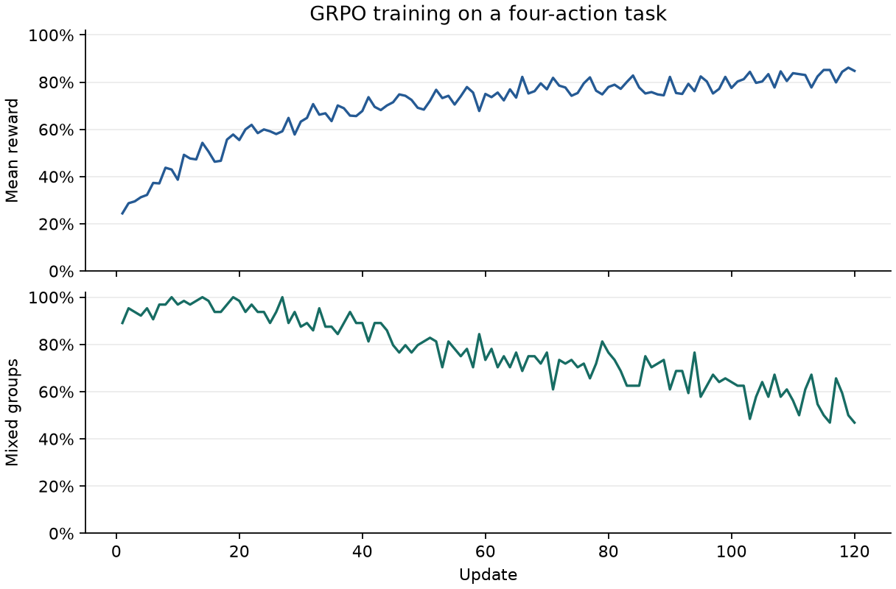

# GRPO
[中文](README.md) | English

<br>

## Directory

```text
05.GRPO
├── main.py                  # Sample, train, evaluate, and plot
├── requirements.txt         # Python dependencies
├── run
│   ├── agent.py             # GRPO policy update
│   └── configs
│       └── default.json     # Experiment settings
├── tools
│   └── plot.py              # Training plot
└── output                   # Experiment results
```

<br>

## Task
This experiment uses a one-step contextual bandit with four actions. Each input is a point $(x,y)$ drawn uniformly from $[-1,1]^2$. The two diagonals divide the plane into four regions numbered from $0$ to $3$. The policy uses a linear layer to score the actions. The correct action earns $1$ and all others earn $0$.

$$
a^\star=\mathbf{1}[x+y\ge 0]+2\mathbf{1}[x-y\ge 0].
$$

<br>

## GRPO update
For each input $s$, sample $G$ actions with replacement from the sampling policy $\pi_{\mathrm{old}}$. Compute each action's advantage from the reward mean $\bar r$ and population standard deviation $\sigma_r$ within the group for that input. Groups with identical rewards have zero advantage. The denominator floor $\delta=10^{-8}$ corresponds to `clamp_min(1e-8)`.

$$
A_i=\frac{r_i-\bar r}{\max(\sigma_r,\delta)}.
$$

Keep the sampled actions, advantages, and old log probabilities fixed across updates on the batch. The code computes `ratios` by exponentiating the difference of the new and old log probabilities. Minimize the following loss averaged over groups. The ratio $\rho_i$ measures how the probability of action $a_i$ changes from the sampling policy. The clip range is set by $\epsilon$ and the KL penalty coefficient by $\beta$.

$$
\begin{aligned}
\rho_i &= \frac{\pi_\theta(a_i\mid s)}{\pi_{\mathrm{old}}(a_i\mid s)},\\
L(s) &= -\frac{1}{G}\sum_{i=1}^G\min\left(\rho_i A_i,\operatorname{clip}(\rho_i,1-\epsilon,1+\epsilon)A_i\right)
        +\beta D_{\mathrm{KL}}\left(\pi_\theta(\cdot\mid s)\,\Vert\,\pi_{\mathrm{ref}}(\cdot\mid s)\right).
\end{aligned}
$$

The reference policy $\pi_{\mathrm{ref}}$ stays at the initial uniform distribution. The experiment computes KL directly by summing over the four actions. Group rewards supply the advantage estimates, and the linear policy is the only trainable component. The single action corresponds to an output of length 1 in the original formulation. [Implementation](../run/agent.py) · [DeepSeekMath paper](https://arxiv.org/abs/2402.03300)

<br>

## Run

```bash
cd Reinforcement-learning/05.GRPO
python -m pip install -r requirements.txt
python main.py
```

The default experiment runs 120 batches with 64 inputs per batch and 8 actions per input. It takes 4 optimizer steps on each batch. The learning rate is $0.03$, the clip range is $0.2$, the KL coefficient is $0.02$, and the training seed is 42. [Default configuration](../run/configs/default.json)

<br>

## Experiment results
Both evaluations use the same 4,096 independent test inputs generated with seed 2026. Greedy accuracy measures how often the highest-probability action is correct. The average probability of the correct action also gives the expected reward when sampling from the policy. All four actions start with the same probability, and greedy evaluation breaks ties by taking the first action.

| Policy | Greedy accuracy | Mean probability of the correct action |
| --- | ---: | ---: |
| At initialization | 25.05% (1,026 / 4,096) | 25.00% |
| After GRPO training | 97.29% (3,985 / 4,096) | 83.09% |

| Training |
| :---: |
|  |

The mean sampled reward rose from $0.2441$ in the first batch to $0.8477$ in the final batch. A mixed-reward group contains both correct and incorrect sampled actions for the same input. [Experiment records](../output/results.json)
