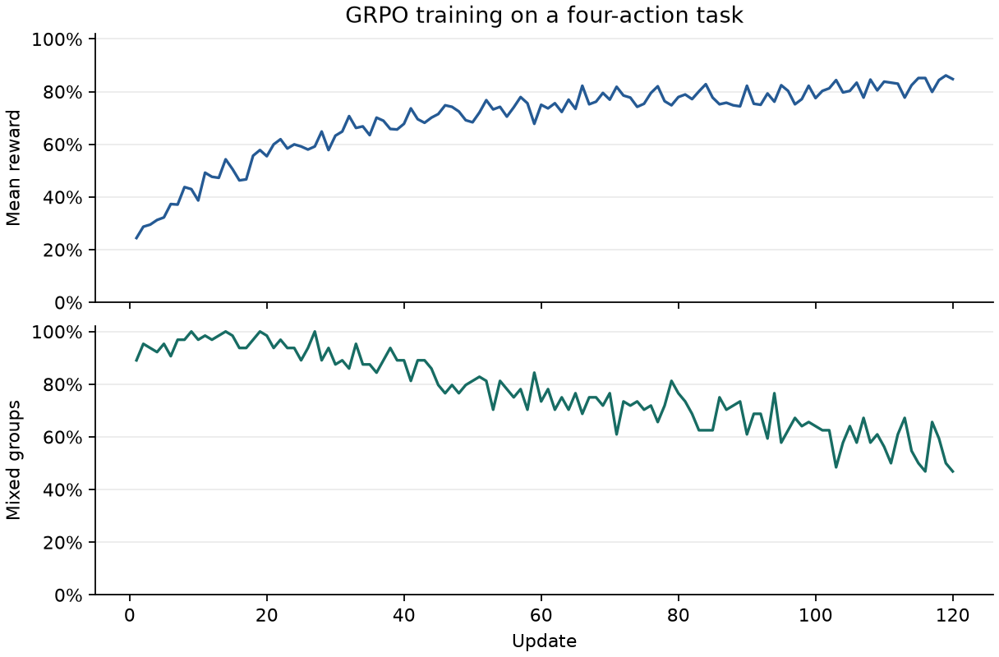

# GRPO
中文 | [English](README.en.md)

<br>

## 目录

```text
05.GRPO
├── main.py                  # 生成样本、训练、评估和绘图
├── requirements.txt         # Python 依赖
├── run
│   ├── agent.py             # GRPO 策略更新
│   └── configs.json         # 实验参数
├── tools
│   └── plot.py              # 绘制训练曲线
└── output                   # 实验结果
```

<br>

## 任务
实验使用四选一的单步上下文老虎机。每个输入是从 $[-1,1]^2$ 均匀采样的坐标 $(x,y)$。两条对角线将平面划成四个区域，对应动作 $0$ 到 $3$。策略用一个线性层输出四个动作的分数，选对得 $1$ 分，选错得 $0$ 分。

$$
a^\star=\mathbf{1}[x+y\ge 0]+2\mathbf{1}[x-y\ge 0].
$$

<br>

## GRPO 更新
对每个输入 $s$，从当前的采样策略 $\pi_{\mathrm{old}}$ 有放回地采样 $G$ 个动作。用同一输入下的平均奖励 $\bar r$ 和总体标准差 $\sigma_r$ 计算每个动作的组内优势。组内奖励都相同时，优势为零。分母下限 $\delta=10^{-8}$ 对应 `clamp_min(1e-8)`。

$$
A_i=\frac{r_i-\bar r}{\max(\sigma_r,\delta)}.
$$

采样后固定动作、优势和旧策略的对数概率。代码将新旧对数概率之差取指数，得到 `ratios`。用同一批数据做多次更新，按各组取平均并最小化下式。$\rho_i$ 衡量当前策略相对于采样策略对动作 $a_i$ 的概率变化，$\epsilon$ 是裁剪幅度，$\beta$ 是 KL 惩罚系数。

$$
\begin{aligned}
\rho_i &= \frac{\pi_\theta(a_i\mid s)}{\pi_{\mathrm{old}}(a_i\mid s)},\\
L(s) &= -\frac{1}{G}\sum_{i=1}^G\min\left(\rho_i A_i,\operatorname{clip}(\rho_i,1-\epsilon,1+\epsilon)A_i\right)
        +\beta D_{\mathrm{KL}}\left(\pi_\theta(\cdot\mid s)\,\Vert\,\pi_{\mathrm{ref}}(\cdot\mid s)\right).
\end{aligned}
$$

参考策略 $\pi_{\mathrm{ref}}$ 固定在初始的四动作均匀分布上。实验直接对四个动作求和计算 KL，组内奖励提供优势估计，策略训练只更新线性层。这里的一步动作对应原论文中输出长度为 1 的情形。[算法代码](../run/agent.py) · [DeepSeekMath 论文](https://arxiv.org/abs/2402.03300)

<br>

## 运行

```bash
cd Reinforcement-learning/05.GRPO
python -m pip install -r requirements.txt
python main.py
```

默认训练 120 批，每批 64 个输入，每个输入采样 8 个动作，固定该批数据做 4 次优化。学习率为 $0.03$，裁剪幅度为 $0.2$，KL 系数为 $0.02$，训练种子为 42。[默认配置](../run/configs.json)

<br>

## 实验结果
训练前后都用种子 2026 生成的同一批 4,096 个独立测试输入。贪婪准确率统计最大概率动作的正确率，正确动作平均概率也等于按策略采样时的期望奖励。初始四个动作概率相同，贪婪评估按索引选择第一个动作。

| 策略 | 贪婪准确率 | 正确动作平均概率 |
| --- | ---: | ---: |
| 初始化 | 25.05%（1,026 / 4,096） | 25.00% |
| GRPO 训练后 | 97.29%（3,985 / 4,096） | 83.09% |

| 训练过程 |
| :---: |
|  |

每批采样的平均奖励从首批的 $0.2441$ 升至末批的 $0.8477$。混合奖励组是同一个输入的采样动作中既有正确也有错误的组。[实验记录](../output/results.json)
