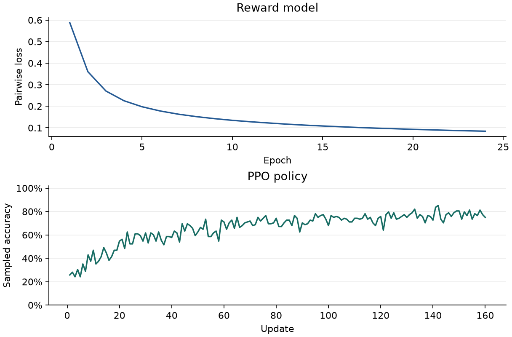

# RLHF
[中文](README.md) | English

<br>

## Directory

```text
06.RLHF
├── main.py                  # Generate preferences, train, and evaluate
├── requirements.txt         # Python dependencies
├── run
│   ├── agent.py             # Reward model and PPO policy update
│   └── configs
│       └── default.json     # Experiment settings
├── tools
│   └── plot.py              # Draw training curves
└── output                   # Experiment results
```

<br>

## Task
Reinforcement learning from human feedback fits a reward model to preference data and uses that reward to update the policy. This example uses the same four-action, single-step task as GRPO. Each input $(x,y)$ is sampled uniformly from $[-1,1]^2$. Two diagonals divide the plane into four regions. The task rule generates synthetic preferences. The chosen action $a^+$ is the correct action for the region, and the rejected action $a^-$ is drawn uniformly from the other three. The initial policy samples uniformly across the four actions. The experiment fits the reward model and then updates the policy. [InstructGPT paper](https://arxiv.org/abs/2203.02155)

<br>

## Algorithm
### Fit the reward model
The reward model outputs four scores $r_\phi(s,a)$ for an input $s$. The Bradley–Terry model expresses the probability that an action wins as the sigmoid of the score difference. The negative log-likelihood is computed as `softplus(-margin)`.

$$
L_{\mathrm{RM}}=-\mathbb{E}\log\sigma\bigl(r_\phi(s,a^+)-r_\phi(s,a^-)\bigr).
$$

### Update the policy with PPO
The frozen reward model centers the four scores for an input by subtracting their mean. The centered score of the sampled action gives the reward $r$. In this one-step task, the return is the immediate reward, and the advantage $A=r-V_\psi(s)$ uses the value estimate at sampling time as a baseline. Each batch is reused for four updates with fixed actions, old log probabilities, and advantages. In the PPO policy loss below, $\rho$ is the ratio of the current and sampling policies' probabilities for the action.

$$
\begin{aligned}
\rho &= \frac{\pi_\theta(a\mid s)}{\pi_{\mathrm{old}}(a\mid s)},\\
L_{\mathrm{clip}} &= -\mathbb{E}\min\!\left(\rho A,\operatorname{clip}(\rho,1-\epsilon,1+\epsilon)A\right).
\end{aligned}
$$

The total loss adds the value network's mean squared error and a KL penalty to the fixed uniform reference policy. The KL is computed exactly over the four actions. Correct actions are used to log accuracy and evaluate the policy. PPO receives its training rewards from the frozen reward model. [Implementation](../run/agent.py) · [PPO paper](https://arxiv.org/abs/1707.06347)

<br>

## Run

```bash
cd Reinforcement-learning/06.RLHF
python -m pip install -r requirements.txt
python main.py
```

The default training seed is 42. The reward model trains for 24 epochs on 4,096 fixed pairs. PPO then runs for 160 batches of 128 new inputs each. [Default configuration](../run/configs/default.json)

<br>

## Results
Evaluation uses 4,096 independent test inputs generated with seed 2026. The reward model reaches **99.46%** ranking accuracy on the corresponding preference pairs. Both policy evaluations use the same inputs. Greedy accuracy selects the highest-probability action and breaks initial ties by choosing the first action.

| Policy | Greedy accuracy | Mean probability of the correct action |
| --- | ---: | ---: |
| Initial | 25.05% | 25.00% |
| After PPO | 94.95% | 77.73% |

| Training curves |
| :---: |
|  |

The reward model's mean loss per epoch falls from 0.5877 to 0.0843. The lower panel shows PPO's sampled-action accuracy on each new batch. [Experiment records](../output/results.json)
