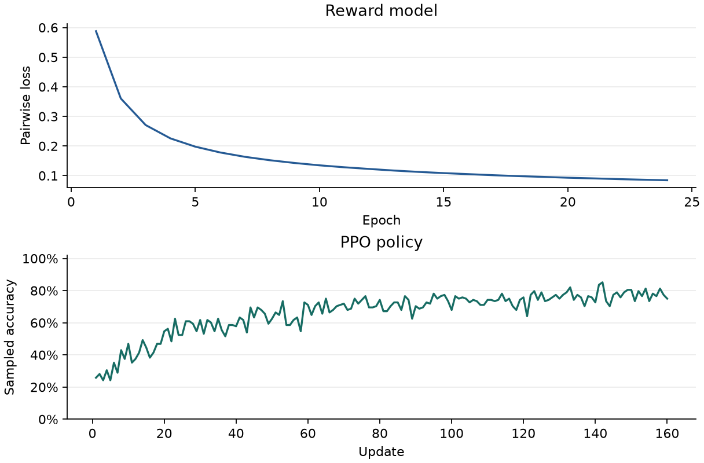

# RLHF
中文 | [English](README.en.md)

<br>

## 目录

```text
06.RLHF
├── main.py                  # 生成偏好数据、训练和评估
├── requirements.txt         # Python 依赖
├── run
│   ├── agent.py             # 奖励模型和 PPO 策略更新
│   └── configs.json         # 实验参数
├── tools
│   └── plot.py              # 绘制训练曲线
└── output                   # 实验结果
```

<br>

## 任务
RLHF（Reinforcement Learning from Human Feedback）先从偏好数据学习奖励，再用该奖励更新策略。本例沿用 GRPO 的四动作单步任务。输入 $(x,y)$ 从 $[-1,1]^2$ 均匀采样，两条对角线将平面划成四个区域。偏好对由规则合成，胜出动作 $a^+$ 是对应区域的正确动作，落选动作 $a^-$ 从其余三个动作中随机抽取。初始策略对四个动作均匀采样，随后依次训练奖励模型和策略。[InstructGPT 论文](https://arxiv.org/abs/2203.02155)

<br>

## 算法
### 训练奖励模型
奖励模型为每个输入 $s$ 输出四个动作的得分 $r_\phi(s,a)$。Bradley–Terry 模型把胜出概率写为两个得分之差的 sigmoid。最小化负对数似然，对应 `softplus(-margin)`。

$$
L_{\mathrm{RM}}=-\mathbb{E}\log\sigma\bigl(r_\phi(s,a^+)-r_\phi(s,a^-)\bigr).
$$

### 用 PPO 更新策略
冻结奖励模型，将每个输入的四个得分减去它们的均值，再给采样动作打分，得到奖励 $r$。单步回报等于即时奖励，因此优势 $A=r-V_\psi(s)$ 用采样时的价值估计作基线。每批数据复用 4 次，动作、旧对数概率和优势在批内固定。PPO 策略损失 $L_{\mathrm{clip}}$ 如下，$\rho$ 为当前策略与采样策略的动作概率比。

$$
\begin{aligned}
\rho &= \frac{\pi_\theta(a\mid s)}{\pi_{\mathrm{old}}(a\mid s)},\\
L_{\mathrm{clip}} &= -\mathbb{E}\min\!\left(\rho A,\operatorname{clip}(\rho,1-\epsilon,1+\epsilon)A\right).
\end{aligned}
$$

总损失还包含价值网络的均方误差和到固定均匀参考策略的 KL 惩罚。四个动作可以枚举，KL 直接求和计算。正确动作只用于记录指标和评估，PPO 的训练奖励来自冻结的奖励模型。[算法代码](../run/agent.py) · [PPO 论文](https://arxiv.org/abs/1707.06347)

<br>

## 运行

```bash
cd Reinforcement-learning/06.RLHF
python -m pip install -r requirements.txt
python main.py
```

默认使用训练种子 42。奖励模型对 4,096 个固定偏好对训练 24 轮，随后进行 160 批 PPO 更新，每批 128 个新输入。[默认配置](../run/configs.json)

<br>

## 实验结果
使用种子 2026 生成的 4,096 个独立测试输入评估。奖励模型在其中的偏好对上取得 **99.46%** 的排序准确率。策略训练前后使用相同的测试输入。贪婪准确率选择概率最高的动作，初始概率相同时按索引取第一个动作。

| 策略 | 贪婪准确率 | 正确动作平均概率 |
| --- | ---: | ---: |
| 初始化 | 25.05% | 25.00% |
| PPO 更新后 | 94.95% | 77.73% |

| 训练过程 |
| :---: |
|  |

奖励模型每轮的平均损失从 0.5877 降至 0.0843。下半图记录 PPO 在每批新输入上的采样准确率。[实验记录](../output/results.json)
