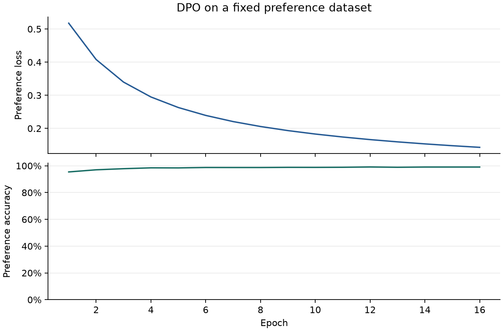

# DPO
[中文](README.md) | English

<br>

## Directory

```text
07.DPO
├── main.py                  # Main experiment
├── requirements.txt        # Dependencies
├── run
│   ├── agent.py             # DPO loss and optimizer
│   └── configs.json         # Experiment settings
├── tools
│   └── plot.py              # Training curves
└── output                  # Experiment results
```

<br>

## Task

Sample a coordinate $s=(x,y)$ uniformly from $[-1,1]^2$. The signs of $x+y$ and $x-y$ divide the plane into four regions, one for each action. The rule assigns the preferred action $a^+=\mathbf{1}[x+y\geq0]+2\mathbf{1}[x-y\geq0]$. The rejected action $a^-$ is sampled uniformly from the remaining three actions. Training uses fixed preference pairs generated by this rule and shuffles them between epochs.

<br>

## DPO update

A linear policy assigns probabilities to the four actions. Zero initialization gives each action probability $1/4$. A frozen copy of the initial policy supplies the reference $\pi_{\mathrm{ref}}$. The terms $\Delta_\theta$ and $\Delta_{\mathrm{ref}}$ are the differences in log probability between the preferred and rejected actions under the current and reference policies. The symbol $\sigma$ denotes the sigmoid and $\beta$ scales the relative margin. Training minimizes the following loss.

$$
\begin{aligned}
\Delta_\theta
&= \log\pi_\theta(a^+\mid s)-\log\pi_\theta(a^-\mid s), \\
\Delta_{\mathrm{ref}}
&= \log\pi_{\mathrm{ref}}(a^+\mid s)-\log\pi_{\mathrm{ref}}(a^-\mid s), \\
\mathcal L_{\mathrm{DPO}}
&= -\mathbb E_{(s,a^+,a^-)}
  \left[\log\sigma\!\left(\beta(\Delta_\theta-\Delta_{\mathrm{ref}})\right)\right].
\end{aligned}
$$

The `preference_loss` method gathers both action log probabilities and uses `logsigmoid` to compute the loss. This single-step example optimizes the policy directly from the fixed preference pairs. [Implementation](../run/agent.py) · [DPO paper](https://arxiv.org/abs/2305.18290)

<br>

## Run

From the repository root, run the following commands.

```bash
cd Reinforcement-learning/07.DPO
python -m pip install -r requirements.txt
python main.py
```

The CPU run uses 4,096 preference pairs, 16 training epochs and a batch size of 128. Adam uses a learning rate of $0.03$ and the loss uses $\beta=0.5$. The training and test seeds are 42 and 2026. [Default configuration](../run/configs.json)

<br>

## Results

Both evaluations use the same 4,096 independently generated test pairs. Greedy accuracy measures how often the highest-probability action is correct, with ties resolved by the lowest action index. Preference accuracy requires the preferred action to have strictly higher probability than the rejected action, so it starts at 0%.

| Metric | Before training | After training |
| --- | ---: | ---: |
| Greedy accuracy | 25.05% | 96.68% |
| Mean probability of the preferred action | 25.00% | 82.41% |
| Preference accuracy | 0.00% | 98.93% |

| Training loss and preference accuracy |
| :---: |
|  |

Each point evaluates the policy on the full training set at the end of that epoch. The loss fell from 0.5176 after the first epoch to 0.1429 after the sixteenth. [Experiment records](../output/results.json)
