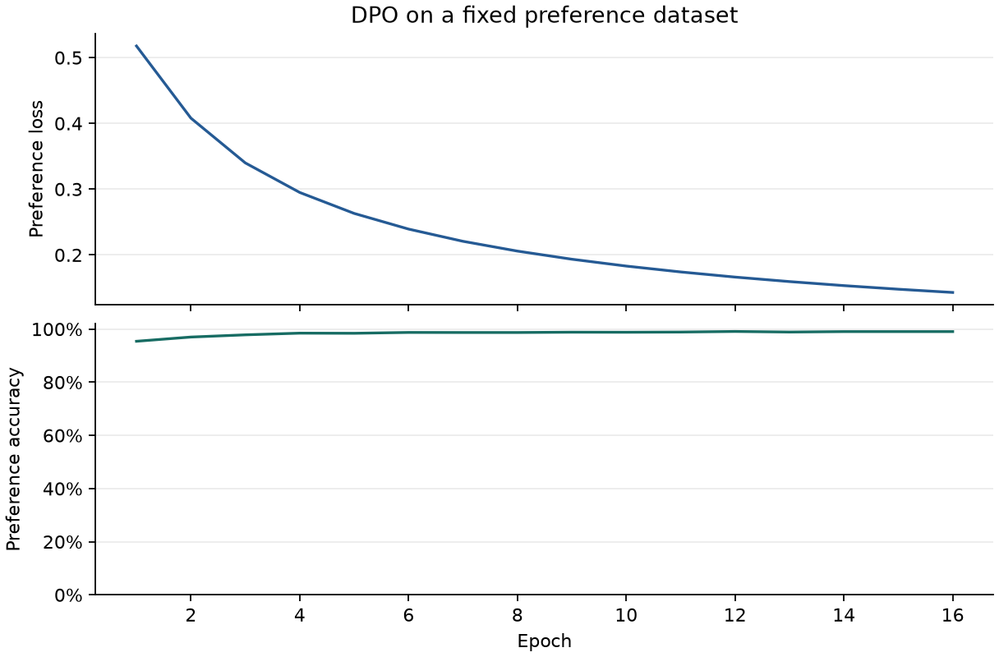

# DPO
中文 | [English](README.en.md)

<br>

## 目录

```text
07.DPO
├── main.py                  # 实验入口
├── requirements.txt        # Python 依赖
├── run
│   ├── agent.py             # DPO 损失和优化
│   └── configs
│       └── default.json     # 实验参数
├── tools
│   └── plot.py              # 训练曲线
└── output                  # 实验结果
```

<br>

## 任务
从 $[-1,1]^2$ 中均匀采样坐标 $s=(x,y)$。两条对角线把平面分为四个区域，对应动作 0 到 3。规则确定的正确动作是优选动作 $a^+=\mathbf{1}[x+y\geq0]+2\mathbf{1}[x-y\geq0]$，再从其余三个动作中均匀采样一个作为劣选动作 $a^-$。整份偏好数据在训练开始前生成，每轮只重排数据。偏好标签由规则生成。

<br>

## DPO 更新
线性策略输出四个动作的概率。初始参数全为零，四个动作的概率都是 $1/4$。训练时保留一份冻结的初始策略作为参考 $\pi_{\mathrm{ref}}$。$\Delta_\theta$ 和 $\Delta_{\mathrm{ref}}$ 分别表示当前策略和参考策略对优选、劣选动作的对数概率差，$\sigma$ 是 sigmoid 函数，$\beta$ 控制损失对概率差的敏感度。训练最小化以下损失。

$$
\begin{aligned}
\Delta_\theta
&= \log\pi_\theta(a^+\mid s)-\log\pi_\theta(a^-\mid s), \\
\Delta_{\mathrm{ref}}
&= \log\pi_{\mathrm{ref}}(a^+\mid s)-\log\pi_{\mathrm{ref}}(a^-\mid s), \\
\mathcal L_{\mathrm{DPO}}
&= -\mathbb E_{(s,a^+,a^-)}
  \left[\log\sigma\!\left(\beta(\Delta_\theta-\Delta_{\mathrm{ref}})\right)\right].
\end{aligned}
$$

代码的 `preference_loss` 先收集两个动作的对数概率，再用 `logsigmoid` 计算损失。这个单步示例直接从固定偏好对优化策略。[算法代码](../run/agent.py) · [DPO 论文](https://arxiv.org/abs/2305.18290)

<br>

## 运行
从仓库根目录执行。

```bash
cd Reinforcement-learning/07.DPO
python -m pip install -r requirements.txt
python main.py
```

默认在 CPU 上用 4,096 个偏好对训练 16 轮，批大小为 128，Adam 学习率为 $0.03$，$\beta=0.5$。训练与测试随机种子分别是 42 和 2026。[默认配置](../run/configs/default.json)

<br>

## 实验结果
训练前后用同一批独立生成的 4,096 个测试偏好对。贪婪准确率统计四个动作中概率最高的动作选对的比例，概率并列时取索引最小者。偏好准确率只统计优选动作概率严格高于劣选动作的样本，因此初始化时为 0%。

| 指标 | 训练前 | 训练后 |
| --- | ---: | ---: |
| 贪婪准确率 | 25.05% | 96.68% |
| 优选动作平均概率 | 25.00% | 82.41% |
| 偏好准确率 | 0.00% | 98.93% |

| 训练损失与偏好准确率 |
| :---: |
|  |

图中每个点都使用当前轮结束后的策略，在完整训练集上计算。第一轮到第十六轮的损失从 0.5176 降至 0.1429。[实验记录](../output/results.json)
