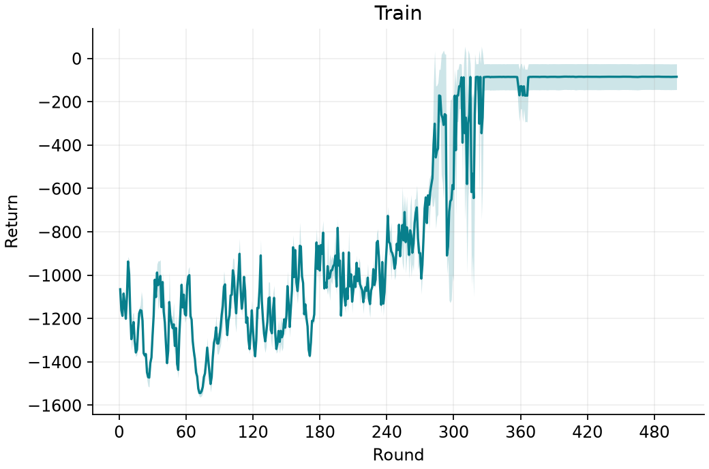
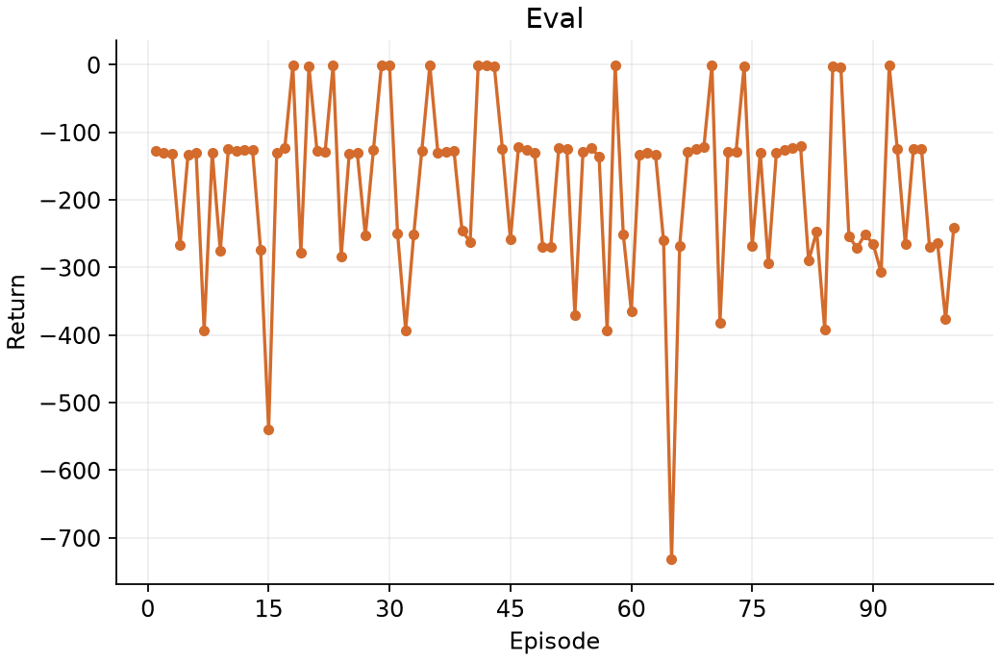
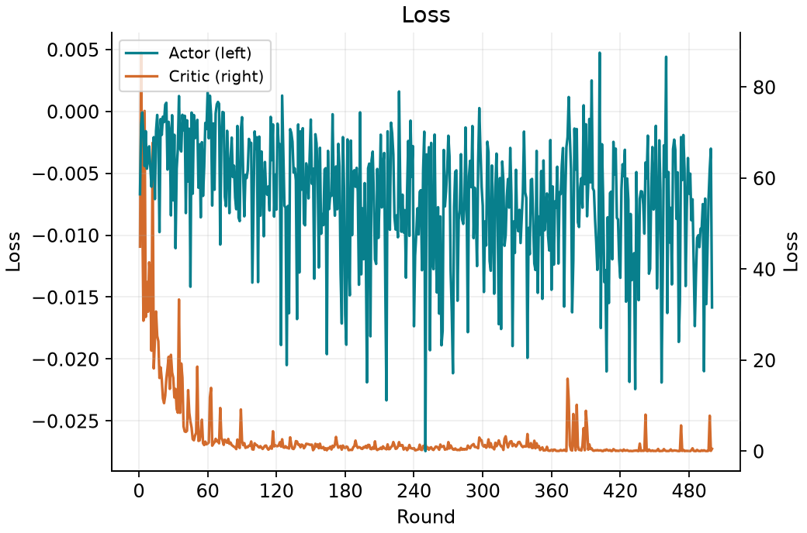

# PPO Markdown 书写规则

## 1. 文档结构

项目说明统一写在根目录 `README.md`，按以下顺序组织：

1. 目录。
2. PPO 数学原理。
3. 实验结果。
4. 参考。

本规则文件单独保存。环境目录、种子目录和 `output/` 中不再创建说明 Markdown。

## 2. 目录展示

- 总目录展示代码结构，`output/` 只展开到 `CartPole-v1/`、`Pendulum-v1/` 环境层。
- 核心实现放在 `run/network.py`、`run/model.py`；环境配置放在 `run/config/` 的 JSON 中。
- 总目录不列测试目录，不增加 `metadata.json`。
- 实验结果部分再展开一次运行，其他实验沿用相同结构：

```text
output/Pendulum-v1/
└── seed42/
    ├── config.json
    ├── summary.json
    ├── model/
    ├── logs/
    └── figures/
```

目录树到文件夹层停止，不继续列出 `model/`、`logs/`、`figures/` 内部文件。单次实验直接命名为 `seed42`；明确重复实验时，使用 `--run-number 1`、`--run-number 2` 对应 `seed42_run1`、`seed42_run2`，不按历史调试次数自动累加，不补零。

## 3. 数学原理

- 保留目标与优势、GAE、概率比率、PPO 裁剪目标、价值与熵的总损失、动作分布。
- 公式用 `$...$` 或独立的 `$$...$$`；变量定义与关键解释紧邻公式。
- GAE 分别说明 bootstrap mask 和递推 mask；连续动作保留 tanh 变换的概率修正。
- 只写理解算法所需的解释，避免重复、套话和泛泛建议。

## 4. 实验图片

每次实验输出三张独立 PNG，尺寸一致，在 Markdown 表格中一行并排展示：

| 图片文件 | 标题 | 横轴 | 纵轴 |
|---|---|---|---|
| `training_reward.png` | `Train` | `Round` | `Return` |
| `evaluation_reward.png` | `Eval` | `Episode` | `Return` |
| `loss.png` | `Loss` | `Round` | `Loss` |

- 训练共500轮。每轮采集1个完整训练回合，执行一次PPO多epoch更新；`Round`为训练轮次1至500。
- 每轮更新后，用固定种子 `10000、10001、10002` 各与环境交互1个完整回合，500轮始终使用这3个种子。
- `Train` 的曲线为这3个回合的平均Return，阴影为均值±1个标准差；不做时间平滑，也不用3次独立训练的结果代替。
- 训练结束后固定最终模型 `final.pt`，与环境交互100个完整回合，种子为 `30000` 至 `30099`；`Eval` 按 `Episode` 1至100画逐回合Return。
- 固定3个种子用于训练监测；最终100回合单独评估，不更新模型，也不替换成 `best.pt`。
- 图标题只写 `Train`、`Eval`、`Loss`；表格上方只写环境与种子目录名，不附加 CPU、CUDA 或其他设备标签。

```markdown
### Pendulum-v1 / seed42

| Train | Eval | Loss |
|:---:|:---:|:---:|
|  |  |  |
```

## 5. 内容取舍

README 不加入以下内容：

- 代码对应表、安装与运行命令、Python 接口说明。
- 文件含义表、默认超参数罗列。
- 泛泛的调参建议、重复结论和“策略表现以独立评估为准”等提醒。

实验部分保留目录示例、环境与种子标题、三图表格，并在图片后加入简洁的实验分析。分析用日志中的真实数据解释收敛、波动、损失、评估差异与对照实验；必要时使用小型指标表或消融表。区分已验证结论与待验证推断，不把评估种子的阴影当成独立训练重复实验的不确定性。面试分析紧扣本实验的公式、实现和证据，避免堆砌题目。参考部分直接链接原论文、官方资料或明确标注来源的面试讨论。

## 6. 问答书写

问答统一放在“PPO 关键问题”小节，以1–7编号逐条展开。问题加粗，回答独立成段，先直接回答，再说明机制、成立条件及必要的公式或例子。不用长篇两列问答表；裁剪分支、机制比较和模型角色可使用小表格。

回答须能独立阅读，删除“结合69轮提前停止解释实际更新”等写给讲解者的提示。实验数值仅在直接支持结论时使用，并说明统计对象与实验条件。

技术表述遵守以下边界：

1. on-policy 的解释包含本轮新轨迹、有限复用和更新后重新采样；不能仅凭旧 log probability 固定判定，也不能声称概率比率消除了全部分布偏移。
2. 裁剪的平坦分支由优势符号和概率比率方向共同决定；零梯度仅指该样本的裁剪策略项，不能扩大为总损失或整个网络的梯度为零。
3. 分开说明目标裁剪、KL提前停止与梯度范数裁剪的作用位置，不将它们表述为严格KL约束或互相替代的机制。
4. 分开说明真正终止与外部截断。bootstrap使用结束前的最终观测，GAE不能跨越reset；屏蔽下一状态价值项不等于强制网络输出0，任务本身的有限时域终点也不能一概视为外部截断。
5. 消融结论限定于实际环境、配置、预算和训练种子；新评估种子提供初始状态核验，不能代替跨训练种子的重复实验或证明普遍收益。
6. 三个环境评估种子的均值±标准差，不能写成三个独立训练模型的波动或置信区间；明确每轮各评估一个完整回合。
7. RLHF中的策略、价值、奖励、参考模型是逻辑角色；区分采样旧策略与参考策略，不要求四套完全独立的网络。

## 7. Markdown 与自动更新

- 标题、段落、列表、表格和代码块之间留空行。
- 路径、文件名和函数名使用行内代码；目录树使用 `text` 代码块。
- 图片使用相对根 README 的路径，表格使用合法的分隔行，不写本机绝对路径。
- 替换实验结果后，同步重算分析中的数值与结论；仅更新图片不代表分析已更新。
- `output/report.py` 只更新以下标记之间的实验图片区；实验分析放在标记之外，保留目录、数学原理、分析和参考：

```text
<!-- EXPERIMENT_RESULTS_START -->
<!-- EXPERIMENT_RESULTS_END -->
```

发布前检查图片存在、链接有效、表格三图同排、代码围栏与数学块成对闭合。
