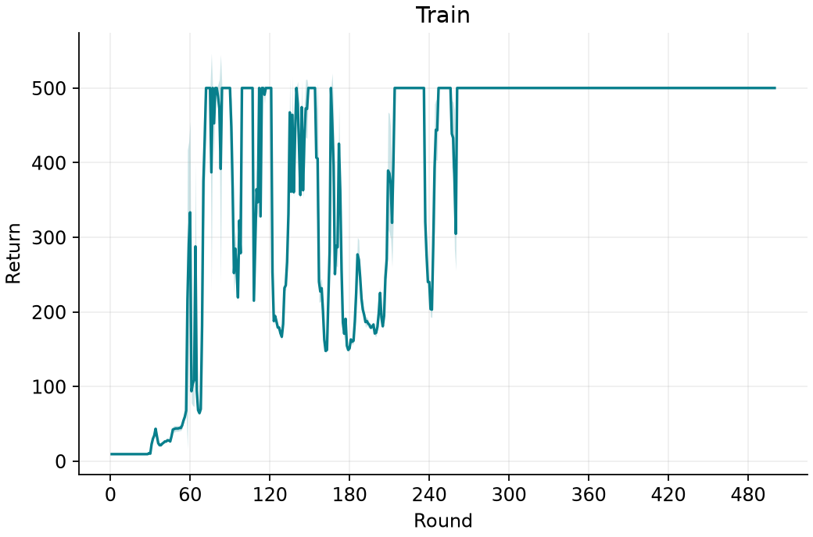
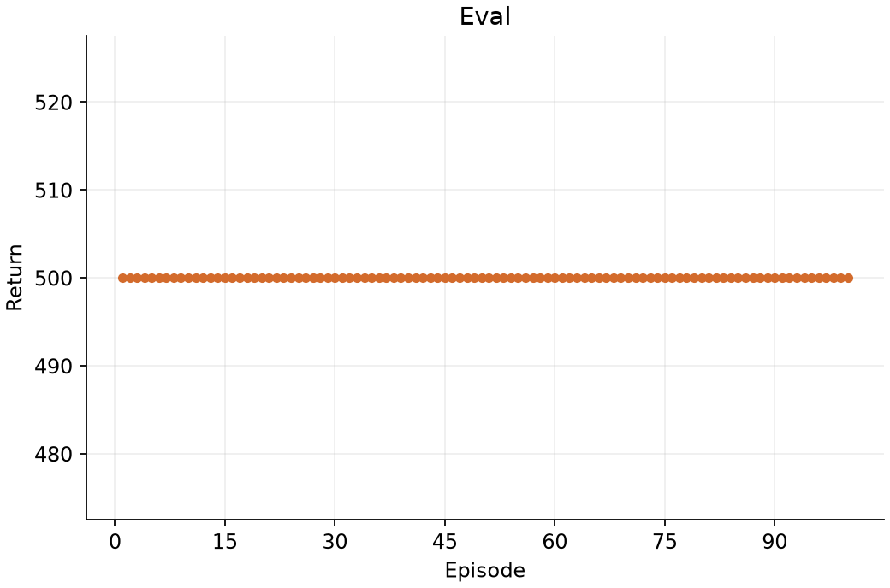
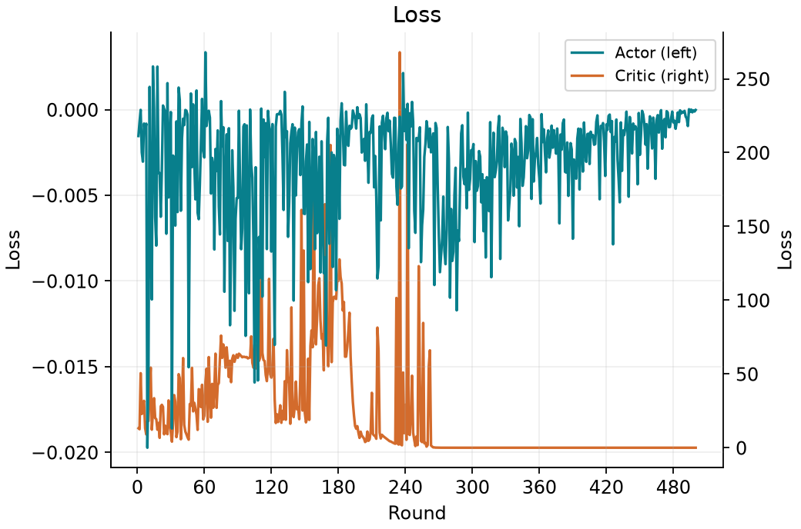
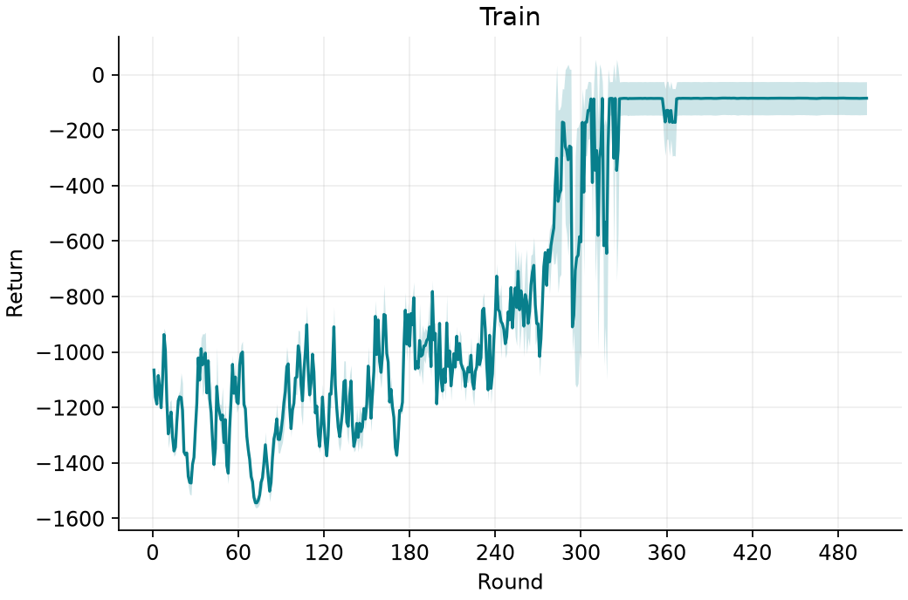
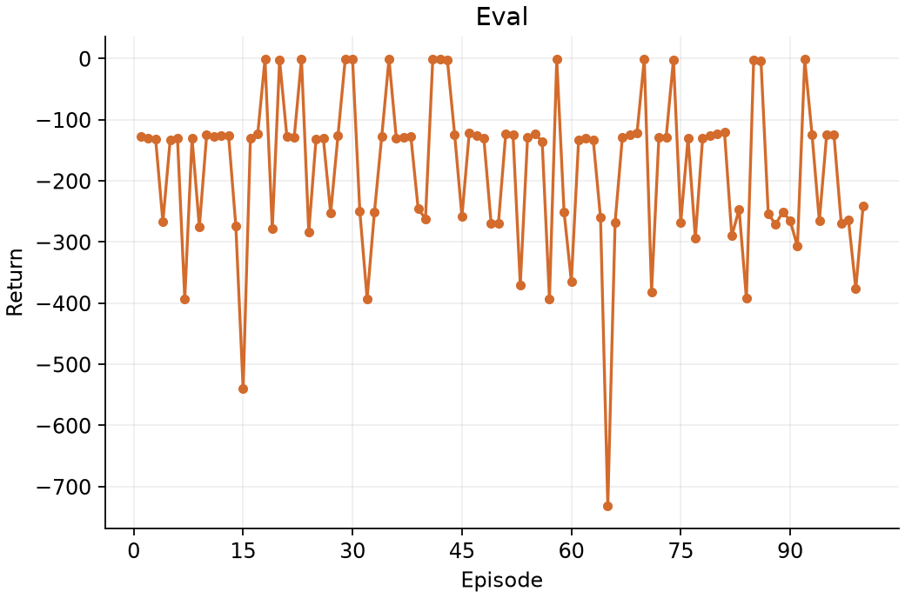
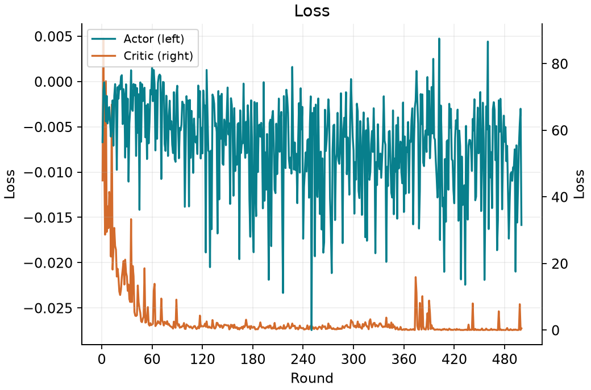

# PPO：原理与实验

PyTorch 实现 PPO-Clip + GAE，支持离散动作和有限边界的连续动作。默认使用 CUDA 训练与批量推理，Gymnasium 环境交互在 CPU 上运行。

## 1. 目录

```text
PPO/
├── README.md                    # 数学原理与实验结果
├── main.py                      # 训练、评估、绘图入口
├── requirements.txt
├── run/
│   ├── __init__.py
│   ├── network.py               # Actor、Critic、动作分布
│   ├── model.py                 # 配置校验、Rollout、GAE、训练与评估
│   └── config/
│       ├── cartpole.json
│       └── pendulum.json
├── tools/
│   ├── __init__.py
│   ├── seed.py                  # 随机种子
│   ├── save.py                  # 参数与日志保存
│   └── plot.py                  # Train、Eval、Loss
└── output/
    ├── __init__.py
    ├── report.py                # 汇总结果，更新本README
    ├── CartPole-v1/
    └── Pendulum-v1/
```

## 2. PPO原理

### 目标与优势

策略 $\pi_\theta(a\mid s)$ 的目标是最大化期望折扣回报：

$$
J(\theta)=\mathbb E_{\tau\sim\pi_\theta}\left[\sum_{t=0}^{T-1}\gamma^t r_t\right],
\qquad
\nabla_\theta J\propto\mathbb E\left[\nabla_\theta\log\pi_\theta(a_t\mid s_t)A^\pi(s_t,a_t)\right].
$$

优势 $A^\pi(s,a)=Q^\pi(s,a)-V^\pi(s)$ 衡量动作相对平均表现的好坏。Actor学习动作概率，Critic估计状态价值。

### GAE

用时序差分残差递推优势与价值目标：

$$
\delta_t=r_t+\gamma b_tV_\phi(s_{t+1})-V_\phi(s_t),
$$

$$
\hat A_t=\delta_t+\gamma\lambda c_t\hat A_{t+1},
\qquad
\hat R_t=\hat A_t+V_\phi(s_t).
$$

两个mask的职责不同：

```text
b_t = 1 - terminated                 # 是否bootstrap
c_t = 1 - (terminated or truncated)  # 是否继续优势递推
```

真实终止不bootstrap；时间截断使用reset前最后状态的value，但递推不能进入新回合。rollout边界也使用next value。先计算 $\hat R_t$，再标准化整批优势，保持价值目标不变。

`reward_scale` 只缩放进入GAE的训练奖励；日志与奖励图保留环境原始回报。

### 概率比率

概率比率比较新旧策略对**同一个状态、同一个已采样动作**的倾向。在旧策略概率非零处：

$$
\rho_t(\theta)
=\frac{\pi_\theta(a_t\mid s_t)}{\pi_{\mathrm{old}}(a_t\mid s_t)}
=\exp\left(\log\pi_\theta(a_t\mid s_t)-\log\pi_{\mathrm{old}}(a_t\mid s_t)\right).
$$

旧策略 $\pi_{\mathrm{old}}$ 是采集本轮轨迹时的策略，当前策略 $\pi_\theta$ 随梯度更新而变化。离散动作使用概率，连续动作使用概率密度。

例如，旧策略给某动作的概率为0.2，新策略给同一动作的概率为0.3，则 $\rho_t=1.5$，表示该动作的概率相对提高了50%。$\rho_t>1$ 表示更倾向于选择该动作，$\rho_t<1$ 表示更不倾向于选择，$\rho_t=1$ 表示两者给该动作的概率相同。动作是否值得提高概率，则由优势 $\hat A_t$ 判断。

#### 为什么需要除以旧策略概率

更新时使用的数据来自旧策略。对固定状态 $s$，将优势估计 $\hat A(s,a)$ 视为固定函数，并假设旧策略覆盖新策略可能选择的动作，则：

$$
\begin{aligned}
\mathbb E_{a\sim\pi_\theta(\cdot\mid s)}[\hat A(s,a)]
&=\sum_a\pi_\theta(a\mid s)\hat A(s,a)\\
&=\sum_a\pi_{\mathrm{old}}(a\mid s)
\frac{\pi_\theta(a\mid s)}{\pi_{\mathrm{old}}(a\mid s)}\hat A(s,a)\\
&=\mathbb E_{a\sim\pi_{\mathrm{old}}(\cdot\mid s)}
[\rho_\theta(s,a)\hat A(s,a)].
\end{aligned}
$$

这就是重要性加权：用旧策略采集的动作，通过概率比率调整它们在目标中的权重。连续动作时将求和换为积分。

PPO由此构造未裁剪的代理目标：

$$
L^{\mathrm{PG}}(\theta)
=\mathbb E_{\substack{s\sim d_{\mathrm{old}}\\a\sim\pi_{\mathrm{old}}(\cdot\mid s)}}
\left[\rho_\theta(s,a)\hat A(s,a)\right],
$$

其中 $d_{\mathrm{old}}$ 表示旧策略的状态访问分布，本实现用本轮rollout的样本均值估计代理目标。上述换分布等式针对固定状态下的动作分布；PPO仍沿用旧策略的状态分布和优势估计，因此该目标是代理目标，不能等同于新策略的完整长期回报。[PPO原论文](https://arxiv.org/abs/1707.06347)

#### 在策略更新中的作用

最大化 $\rho_t\hat A_t$ 时，正优势鼓励提高该动作的概率，负优势鼓励降低其概率。将旧概率和优势视为常量，有：

$$
\nabla_\theta\left[\rho_t(\theta)\hat A_t\right]
=\rho_t(\theta)\hat A_t\nabla_\theta\log\pi_\theta(a_t\mid s_t).
$$

更新起点处新旧策略相同，$\rho_t=1$，梯度仍可非零，此时就是普通策略梯度的样本形式。随着当前策略更新，比率反映该动作概率相对采样时的变化，并作为后续clipping的变量。比率本身不会限制策略变化。

#### 为什么用log相减再取exp

由 $\log p-\log q=\log(p/q)$ 可知，log差取exp与概率直接相除在数学上等价。网络通常直接计算动作的 `log_prob`，采样时保存 `old_log_prob`，更新时重新计算同一动作的 `new_log_prob`：

```python
log_ratio = new_log_prob - old_log_prob
ratio = log_ratio.exp()
```

这样避免先分别还原可能很小的概率，再做除法。本项目的连续动作分布按维独立，因此联合log probability可对各维求和，避免直接连乘各维密度。`old_log_prob` 与优势在本轮更新中保持固定，梯度通过 `new_log_prob` 回到当前策略。

这种写法改善数值计算，但不保证任意大的log差取exp后都不会溢出，也不把比率限制在裁剪区间内。裁剪与KL监测的作用见下节。

### 裁剪目标与总损失

PPO在概率比率加权的优势目标上加入clipping：

$$
L^{\mathrm{CLIP}}=\mathbb E_t\left[\min\left(\rho_t\hat A_t,
\operatorname{clip}(\rho_t,1-\epsilon,1+\epsilon)\hat A_t\right)\right].
$$

正优势提高动作概率，负优势降低概率；裁剪限制继续改变概率带来的目标收益。Clip不保证KL硬上界，代码另用approximate KL提前停止更新。

实际最小化：

$$
L=-L^{\mathrm{CLIP}}+c_VL_V-c_H\mathcal H(\pi_\theta),
\qquad
L_V=\frac12\mathbb E_t\left[(V_\phi(s_t)-\hat R_t)^2\right].
$$

`value_coef`、`entropy_coef` 对应 $c_V$、$c_H$；value使用MSE。同一轮更新中，旧log probability、优势和return保持固定。

```text
采集rollout → 计算GAE → 标准化优势 → 多轮mini-batch更新 → 重新采样
```

PPO通常归为在线、on-policy算法；每轮仅复用刚采集的数据。

### 动作分布

离散Actor输出logits，使用 `Categorical`。连续Actor使用高斯分布，经tanh映射到动作边界：

$$
z\sim\mathcal N(\mu_\theta(s),\sigma_\theta^2),\quad a=b+c\tanh z,
\quad c=\frac{a_{\max}-a_{\min}}2,\quad b=\frac{a_{\max}+a_{\min}}2.
$$

更新时的log probability包含变换修正：

$$
\log\pi_\theta(a\mid s)=\sum_i\left[
\log\mathcal N(z_i;\mu_i,\sigma_i)-\log c_i-\log(1-\tanh^2z_i)\right].
$$

缓存保存tanh前的 $z$；Jacobian使用稳定计算式，连续策略entropy用可微采样估计。

## 3. 实验结果

```text
output/Pendulum-v1/
└── seed42/
    ├── config.json
    ├── summary.json
    ├── model/
    ├── logs/
    └── figures/
```

<!-- EXPERIMENT_RESULTS_START -->

### CartPole-v1 / seed42

| Train | Eval | Loss |
|:---:|:---:|:---:|
|  |  |  |

### Pendulum-v1 / seed42

| Train | Eval | Loss |
|:---:|:---:|:---:|
|  |  |  |

<!-- EXPERIMENT_RESULTS_END -->

### 结果与稳定性

两个环境均训练500轮，训练种子为42。原终评使用种子30000–30099；模型冻结后，再用未参与本轮调参的50000–50099补充核验。表中为确定性策略的原始Return，±表示回合标准差。

| 环境 | 训练交互步 | 原100回合评估 | 新100回合核验 |
|---|---:|---:|---:|
| CartPole-v1 | 168,387 | 500.0 ± 0.0 | 500.0 ± 0.0 |
| Pendulum-v1 | 100,000 | −179.3 ± 126.0 | −161.7 ± 99.5 |

**CartPole已达到该环境的500步上限。** 第72轮首次在三个监测种子上达到500，之后仍有回落；第261轮、累计训练48,928步后，三个种子才持续维持500。首次满分与稳定满分应分开判断。

**Pendulum已学会摆起后维持直立，仍有初始状态带来的回报差异。** 原终评中位数为−130.3，最差回合为−731.9；固定三个监测种子最后一轮分别为−0.9、−124.5、−129.3，因此监测均值约−85不能代表完整初始状态分布。

新100回合中，按 $|\theta|<0.2$ 弧度且 $|\dot\theta|<1$ 弧度/秒的自定义判据，100个回合最后50步均保持直立，全程满足判据的步数占82.15%。前150步平均Return为−161.52，最后50步仅−0.21，代价主要集中在前段。相同种子下，零力矩为−1183.5，均匀随机动作为−1196.5。该判据用于本次控制分析，不是环境自带的成功标志。

同组新种子下，按已训练策略采样动作的评估为：CartPole 500.0 ± 0.0，Pendulum −162.2 ± 98.9。Pendulum在这一组上的采样与确定性动作表现接近；不能仅用训练回报与固定种子监测的差距判断探索噪声的影响。

### Pendulum消融

各组均为同一训练种子、500轮、100,000个训练交互步，使用最终模型评估。奖励缩放只影响训练目标，表内始终是环境原始回报。

| 配置 | 原100回合Return |
|---|---:|
| 原配置：奖励不缩放，线性衰减学习率 | −1162.4 ± 118.0 |
| 仅将训练奖励乘以0.1 | −468.5 ± 323.0 |
| 奖励乘以0.1，并将gamma改为0.9 | −531.5 ± 436.9 |
| 奖励乘以0.1，固定学习率3×10⁻⁴，gamma保持0.99 | −179.3 ± 126.0 |

旧Critic在4100个网格状态上几乎都预测−202.68，第二个Tanh层饱和率为100%。仅缩放奖励后，后50轮解释方差均值由接近0恢复至0.84；最终采用固定学习率后，Critic在不同状态上重新给出有区分的预测，第二个Tanh层饱和率约26.1%。对照支持：奖励尺度与本次训练预算下的学习率衰减共同影响了效果，不能由此推断所有PPO任务都应关闭衰减。

优势标准化只处理Actor使用的优势，不会自动归一化Critic的价值目标。奖励缩放前后的value loss单位也不同，不能直接用其下降倍数证明Critic质量。连续动作实现中的奖励处理可对照[CleanRL](https://docs.cleanrl.dev/rl-algorithms/ppo/#ppo_continuous_actionpy)。

### 损失与更新

- **Policy loss不要求降至0。** 本项目最小化负的裁剪目标，负值符合定义；价值损失、任务回报和策略变化需分别观察。
- **KL与clip fraction回答不同问题。** Pendulum后100轮平均approximate KL为0.00523，clip fraction为6.69%；全程69轮触发KL提前停止。均值只统计已执行更新的mini-batch，触发停止的batch由max KL记录，阈值为0.03，因此平均KL较小与提前停止并不矛盾。
- **clip fraction是概率比率越界比例。** 它既不是动作达到边界的比例，也不表示这些样本的策略梯度全部归零。
- **EV不能代替任务效果。** Pendulum后50轮EV均值为−1.62，中位数却为0.964，41轮高于0.8。$EV=1-\operatorname{Var}(\hat R-V)/\operatorname{Var}(\hat R)$；少数极负值会拉低均值。目标方差较小时可能放大该指标，但现有训练日志未记录分母，不能把这一解释写成已经验证的原因。
- **连续动作熵可以为负。** 此处估计的是tanh变换后动作分布的微分熵，受动作单位影响，不能与CartPole的离散熵直接比较。最终高斯标准差约0.57，仍保留随机性。

Pendulum的500轮对应18,985次优化器更新；每轮200步、mini-batch 64、最多10个epoch，KL提前停止会减少实际更新次数。原实验还进行了300,000步监测和20,000步终评，总交互420,000步，其中只有100,000步用于训练；补充核验和基线测试另计。

### PPO 关键问题

公开候选人自述中，[字节](https://www.nowcoder.com/feed/main/detail/3397b3e49b694830acdaa1a35db6694a)涉及PPO损失、GAE和returns，[腾讯](https://www.nowcoder.com/feed/main/detail/c8ddab6cf8ea467c9e4003c9256616cb?sourceSSR=users)涉及项目挑战与算法比较，[淘天](https://www.nowcoder.com/feed/main/detail/aab1baa7bdde499d8b2f9f2d97efc7b5?sourceSSR=dynamic)涉及优化目标，[快手](https://www.nowcoder.com/feed/main/detail/9d24592752804d2790557f81230df62d)涉及公式和奖励模型，[美团](https://www.nowcoder.com/feed/main/detail/b87b9794a2114f7c818b40a3be51c4f0)涉及选型、学习率和batch。这些样本用于选择复习方向，不代表公司的统一题库。

1. **同一批数据训练10个epoch，为什么PPO仍通常归为on-policy？**

    PPO每轮先用当前策略采集一批新轨迹，再对这批数据进行有限次数的更新，更新结束后重新采样。同一批数据训练多个epoch，是对本轮轨迹的有限复用。

    更新期间，采样策略保持固定，用概率比率 $\rho_t=\pi_\theta(a_t\mid s_t)/\pi_{\mathrm{old}}(a_t\mid s_t)$ 构造代理目标，并通过clipping、KL监测等方式控制策略偏移。随着更新进行，当前策略已经不同于采样策略，因此不能无限复用这批数据，也不能直接加入任意陈旧的replay数据。**固定旧log probability是计算比率的需要，本身不能作为判定on-policy的依据。** [PPO原论文](https://arxiv.org/abs/1707.06347)

2. **概率比率超出clip区间后，梯度一定为0吗？**

    不一定，取决于优势 $A_t$ 的符号和越界方向。对单个样本的裁剪目标 $\min\!\left(\rho_t A_t,\operatorname{clip}(\rho_t,1-\epsilon,1+\epsilon)A_t\right)$，严格越界时：

    | 优势与概率比率 | 该样本的策略目标是否进入常数区 |
    |---|---|
    | $A_t>0,\ \rho_t>1+\epsilon$ | 是，继续提高该动作概率不再增加目标值 |
    | $A_t>0,\ \rho_t<1-\epsilon$ | 否，仍有提高该动作概率的梯度 |
    | $A_t<0,\ \rho_t<1-\epsilon$ | 是，继续降低该动作概率不再增加目标值 |
    | $A_t<0,\ \rho_t>1+\epsilon$ | 否，仍有降低该动作概率的梯度 |

    例如 $A_t=-1,\rho_t=1.3,\epsilon=0.2$，两项分别为 $-1.3$ 和 $-1.2$，取最小值得到 $-1.3$，梯度仍然存在。

    **这里的零梯度只针对该样本的裁剪策略项。** 其他样本、价值损失和熵项仍可能产生梯度。

3. **PPO clipping、KL提前停止和梯度裁剪分别限制什么？**

    | 方法 | 作用位置 | 具体作用 |
    |---|---|---|
    | PPO clipping | 策略代理目标 | 对已朝有利方向变化过多的样本，移除继续改变概率带来的目标收益 |
    | KL提前停止 | 更新过程 | 监测新旧策略的KL估计值，超过阈值后停止后续更新 |
    | 梯度裁剪 | 反向传播之后 | 将梯度范数限制在设定范围内，缓解过大的梯度 |

    三者不能互相替代。**Clipping不保证新旧策略的KL一定小于某个阈值；梯度范数较小，也不代表策略分布变化一定较小。** KL提前停止依赖估计值和检查频率，通常也不会撤销已经完成的更新。[Spinning Up PPO说明](https://spinningup.openai.com/en/latest/algorithms/ppo.html)

4. **回合结束时，下一状态的价值是否都应该置为0？**

    应区分真正终止和外部截断：

    - **真正终止 `terminated=True`**：任务已经结束，不再bootstrap，TD目标为 $r_t$。
    - **外部截断 `truncated=True`，且任务本来仍可继续**：需要从截断前的最终观测bootstrap，TD目标为 $r_t+\gamma V(s_{t+1})$。

    本项目中，Pendulum的200步上限属于外部时间截断。环境reset后，GAE递推不能跨入新回合；bootstrap使用的也必须是**结束前的最终观测**，不能误用reset后的新初始观测。

    此外，任务本身定义的有限时域终点属于真正终止，不能仅凭“时间到了”判断是否bootstrap。“不bootstrap”是屏蔽下一状态价值项，并非强制网络输出0。[Gymnasium时间限制说明](https://gymnasium.farama.org/tutorials/gymnasium_basics/handling_time_limits/)

5. **当前消融实验能支持什么结论？**

    在本次训练种子42、500轮、100,000个训练交互步的条件下，单独加入奖励缩放后，Pendulum的终评均值由约 $-1162$ 改善到 $-468$；在奖励缩放基础上取消学习率衰减后，进一步改善到约 $-179$。这为两个设置在**本次实验条件下的作用**提供了证据。

    模型冻结后，使用另一组100个新种子评估，得到约 $-162$，说明改善也出现在这组新的初始状态中。**目前只有一次独立训练，尚不能据此判断该配置在不同训练随机种子下都能稳定获得收益。** 要检验这一点，需要让各配置使用相同的一组独立训练种子重复训练，再比较结果分布。

6. **训练图中三个种子的阴影，具体表示什么？**

    每一轮更新后，用**同一个策略**在三个固定环境种子下各运行一个完整回合。曲线表示这三个回报的均值，阴影表示均值上下一个标准差。

    它反映当前策略在这三个初始条件下的表现差异。由于训练只进行了一次，**该阴影不反映不同训练随机种子造成的差异，也不是均值的置信区间。** 即使阴影很窄，也只能说明这三个评估条件下的回报接近。

7. **本项目只有Actor和Critic，PPO式RLHF通常还包含哪些角色？**

    本项目由Actor输出动作分布，Critic估计状态价值，奖励直接由环境提供。典型PPO式RLHF通常包含四类逻辑角色：

    | 角色 | 作用 |
    |---|---|
    | Actor／策略模型 | 生成回答，是主要优化对象 |
    | Critic／价值模型 | 估计预期回报，辅助计算优势 |
    | Reward model／奖励模型 | 为生成结果提供评分 |
    | Reference model／参考模型 | 提供KL正则的参照，通常保持固定 |

    **采样旧策略和参考模型的角色不同。** PPO概率比率的分母来自本轮采样旧策略；RLHF的参考模型用于约束策略相对参考分布的偏移。二者可能在初始化时相同，但不能混用。这里说的是四类逻辑角色，不要求实现时一定部署成四套完全独立的网络。[TRL PPO角色与指标说明](https://huggingface.co/docs/trl/main/en/ppo_trainer)

技术解释以[PPO原论文](https://arxiv.org/abs/1707.06347)、[Spinning Up](https://spinningup.openai.com/en/latest/algorithms/ppo.html)和[TRL指标定义](https://huggingface.co/docs/trl/main/en/ppo_trainer#explanation-of-the-logged-metrics)校核。岗位要求侧，[阿里Agent](https://campus-talent.alibaba.com/campus/position/199903260012)强调评测闭环，[美团LongCat](https://zhaopin.meituan.com/web/position/detail?highlightType=social&jobUnionId=4487581555)强调RL训练稳定性与规模化，[宇树](https://unitree.zhiye.com/campus/detail?jobAdId=84ea11e0-b4dd-43a0-89ec-1ca741f7c93a)强调仿真、控制和真机验证。因此，这个项目适合讲清目标函数、故障定位和实验设计；面向博士岗位，还需补充目标方向的复杂任务与系统证据。

当前只有训练种子42。原终评种子曾参与多组配置对照，新种子核验补充了初始状态覆盖；跨训练种子的可重复性仍需独立训练检验。小型MLP在GPU上运行也不等于验证了大模型分布式训练能力。

## 4. 参考

[PPO论文](https://arxiv.org/abs/1707.06347) · [GAE论文](https://arxiv.org/abs/1506.02438) · [Gymnasium终止与截断](https://gymnasium.farama.org/tutorials/gymnasium_basics/handling_time_limits/)
